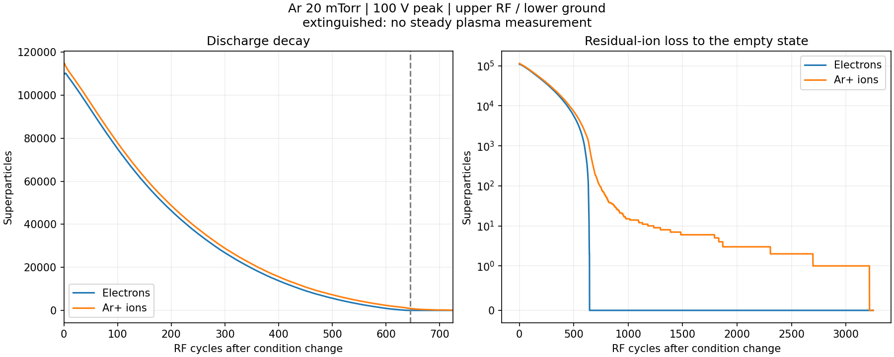

# 2026-11-19_Ar_20mTorr_100V_13.56MHz_25mm_topRF

상태: **extinguished — 정상 방전의 통계 수렴으로 판정하지 않았습니다.**

| 항목 | 결과 |
|---|---:|
| 전자 입자가 처음 0이 된 RF 주기 | 645 |
| 이온 입자가 처음 0이 된 RF 주기 | 3216 |
| 마지막 저장 RF 주기 | 3250 |
| 마지막 전자·이온 입자 수 | 0 · 0 |
| 정상 방전 측정 주기 | 0 |

20 mTorr, 100 V peak, 13.56 MHz, Ar 350 K, 간격 25 mm 조건입니다.
원래 수렴 입자 분포를 상하 반전해 시작했으나, 새 조건에서 입자 수가 감소했습니다.
최종 입자가 모두 없는 상태에서는 플라즈마 밀도와 입자 jE가 0입니다. 이는 빈 입자 상태에서 직접 따라오는 값이며 정상 방전의 측정 평균이 아닙니다.
전자·이온 에너지 분포는 정규화할 입자가 없어 정의할 수 없으므로, 정상상태 heating·EEPF·IFEDF 그림을 만들지 않았습니다.

이 결과는 현재 1D 모델, 원래 입자 가중치, 충돌 및 완전 흡수 표면 조건에 대한 결과입니다.
실제 실험의 방전 유지 한계로 바로 해석할 수는 없습니다. 다른 조건을 연구하려면 최종 빈 상태 대신 소멸 전 또는 초기 입자 체크포인트를 사용해야 합니다.

