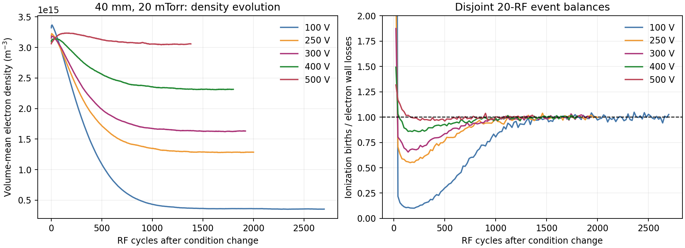

# Ar 20 mTorr, gap 40 mm: 전압 비교 결과

실행 시작일: 2026-11-20 (한국 시각). 결과 정리: 2026-11-20T20:11:53.164048+09:00.

상부 정현파 전압, 하부 접지. 전압은 **peak**이다. Ar 350 K, 13.56 MHz, 전극 간격 40 mm.

| V peak | 판정 | 마지막 RF주기 | 측정 평균 전자 밀도 m⁻³ | 생성/전자 벽 손실 | 기준 통과 측정 RF주기 |
|---:|---|---:|---:|---:|---:|
| 100 | 통계 기준 만족 | 2700 | 3.552e+14 | 0.995 | 700 |
| 250 | 통계 기준 만족 | 2001 | 1.284e+15 | 1.000 | 180 |
| 300 | 통계 기준 만족 | 1921 | 1.630e+15 | 1.006 | 140 |
| 400 | 통계 기준 만족 | 1801 | 2.314e+15 | 1.001 | 140 |
| 500 | 통계 기준 만족 | 1381 | 3.053e+15 | 1.005 | 120 |

밀도는 기준을 통과한 전체 측정 구간의 공간·시간 평균이다. 생성/손실은 통계 기준 만족 조건에서 최종 측정 구간 전체, 그 외 조건에서는 마지막 최대 50주기를 사용한다. 서로 다른 시점의 일시적인 비율만으로 전압 효과를 정량 비교하면 안 된다. 전자 소멸은 정상상태 수렴이 아니다. 측정/주기 상한으로 끝난 조건은 기준을 충족한 것으로 표기하지 않았다.

- [수치 요약 CSV](2026-11-20_Ar_20mTorr_100-250-300-400-500V_13.56MHz_40mm_topRF_summary.csv)
- [면적·지름·전력 수지 검토](2026-11-20_Ar_20mTorr_100-250-300-400-500V_13.56MHz_40mm_topRF_AREA_REVIEW.md)
- [실행 소스·조건·공통 초기 상태 ZIP](https://github.com/YGLSNU/eduPIC_PAL_RF-sheath/raw/refs/heads/results/2026-11-19-20mTorr-top-powered/results/2026-11-20_Ar_20mTorr_100-250-300-400-500V_13.56MHz_40mm_topRF/2026-11-20_Ar_20mTorr_100-250-300-400-500V_13.56MHz_40mm_topRF_source_and_initial_state.zip)

| 조건 | 다운로드 |
|---|---|
| 100 V | [요약·체크포인트·진단 자료](https://github.com/YGLSNU/eduPIC_PAL_RF-sheath/raw/refs/heads/results/2026-11-19-20mTorr-top-powered/results/2026-11-20_Ar_20mTorr_100-250-300-400-500V_13.56MHz_40mm_topRF/2026-11-20_Ar_20mTorr_100V_13.56MHz_40mm_topRF_core.zip) · [측정 전체 평균 그림](2026-11-20_Ar_20mTorr_100V_13.56MHz_40mm_topRF_phase_maps.png) |
| 100 V 측정 1/9 | [원시 측정 블록](https://github.com/YGLSNU/eduPIC_PAL_RF-sheath/raw/refs/heads/results/2026-11-19-20mTorr-top-powered/results/2026-11-20_Ar_20mTorr_100-250-300-400-500V_13.56MHz_40mm_topRF/2026-11-20_Ar_20mTorr_100V_13.56MHz_40mm_topRF_measurements_part01.zip) |
| 100 V 측정 2/9 | [원시 측정 블록](https://github.com/YGLSNU/eduPIC_PAL_RF-sheath/raw/refs/heads/results/2026-11-19-20mTorr-top-powered/results/2026-11-20_Ar_20mTorr_100-250-300-400-500V_13.56MHz_40mm_topRF/2026-11-20_Ar_20mTorr_100V_13.56MHz_40mm_topRF_measurements_part02.zip) |
| 100 V 측정 3/9 | [원시 측정 블록](https://github.com/YGLSNU/eduPIC_PAL_RF-sheath/raw/refs/heads/results/2026-11-19-20mTorr-top-powered/results/2026-11-20_Ar_20mTorr_100-250-300-400-500V_13.56MHz_40mm_topRF/2026-11-20_Ar_20mTorr_100V_13.56MHz_40mm_topRF_measurements_part03.zip) |
| 100 V 측정 4/9 | [원시 측정 블록](https://github.com/YGLSNU/eduPIC_PAL_RF-sheath/raw/refs/heads/results/2026-11-19-20mTorr-top-powered/results/2026-11-20_Ar_20mTorr_100-250-300-400-500V_13.56MHz_40mm_topRF/2026-11-20_Ar_20mTorr_100V_13.56MHz_40mm_topRF_measurements_part04.zip) |
| 100 V 측정 5/9 | [원시 측정 블록](https://github.com/YGLSNU/eduPIC_PAL_RF-sheath/raw/refs/heads/results/2026-11-19-20mTorr-top-powered/results/2026-11-20_Ar_20mTorr_100-250-300-400-500V_13.56MHz_40mm_topRF/2026-11-20_Ar_20mTorr_100V_13.56MHz_40mm_topRF_measurements_part05.zip) |
| 100 V 측정 6/9 | [원시 측정 블록](https://github.com/YGLSNU/eduPIC_PAL_RF-sheath/raw/refs/heads/results/2026-11-19-20mTorr-top-powered/results/2026-11-20_Ar_20mTorr_100-250-300-400-500V_13.56MHz_40mm_topRF/2026-11-20_Ar_20mTorr_100V_13.56MHz_40mm_topRF_measurements_part06.zip) |
| 100 V 측정 7/9 | [원시 측정 블록](https://github.com/YGLSNU/eduPIC_PAL_RF-sheath/raw/refs/heads/results/2026-11-19-20mTorr-top-powered/results/2026-11-20_Ar_20mTorr_100-250-300-400-500V_13.56MHz_40mm_topRF/2026-11-20_Ar_20mTorr_100V_13.56MHz_40mm_topRF_measurements_part07.zip) |
| 100 V 측정 8/9 | [원시 측정 블록](https://github.com/YGLSNU/eduPIC_PAL_RF-sheath/raw/refs/heads/results/2026-11-19-20mTorr-top-powered/results/2026-11-20_Ar_20mTorr_100-250-300-400-500V_13.56MHz_40mm_topRF/2026-11-20_Ar_20mTorr_100V_13.56MHz_40mm_topRF_measurements_part08.zip) |
| 100 V 측정 9/9 | [원시 측정 블록](https://github.com/YGLSNU/eduPIC_PAL_RF-sheath/raw/refs/heads/results/2026-11-19-20mTorr-top-powered/results/2026-11-20_Ar_20mTorr_100-250-300-400-500V_13.56MHz_40mm_topRF/2026-11-20_Ar_20mTorr_100V_13.56MHz_40mm_topRF_measurements_part09.zip) |
| 250 V | [요약·체크포인트·진단 자료](https://github.com/YGLSNU/eduPIC_PAL_RF-sheath/raw/refs/heads/results/2026-11-19-20mTorr-top-powered/results/2026-11-20_Ar_20mTorr_100-250-300-400-500V_13.56MHz_40mm_topRF/2026-11-20_Ar_20mTorr_250V_13.56MHz_40mm_topRF_core.zip) · [측정 전체 평균 그림](2026-11-20_Ar_20mTorr_250V_13.56MHz_40mm_topRF_phase_maps.png) |
| 250 V 측정 1/3 | [원시 측정 블록](https://github.com/YGLSNU/eduPIC_PAL_RF-sheath/raw/refs/heads/results/2026-11-19-20mTorr-top-powered/results/2026-11-20_Ar_20mTorr_100-250-300-400-500V_13.56MHz_40mm_topRF/2026-11-20_Ar_20mTorr_250V_13.56MHz_40mm_topRF_measurements_part01.zip) |
| 250 V 측정 2/3 | [원시 측정 블록](https://github.com/YGLSNU/eduPIC_PAL_RF-sheath/raw/refs/heads/results/2026-11-19-20mTorr-top-powered/results/2026-11-20_Ar_20mTorr_100-250-300-400-500V_13.56MHz_40mm_topRF/2026-11-20_Ar_20mTorr_250V_13.56MHz_40mm_topRF_measurements_part02.zip) |
| 250 V 측정 3/3 | [원시 측정 블록](https://github.com/YGLSNU/eduPIC_PAL_RF-sheath/raw/refs/heads/results/2026-11-19-20mTorr-top-powered/results/2026-11-20_Ar_20mTorr_100-250-300-400-500V_13.56MHz_40mm_topRF/2026-11-20_Ar_20mTorr_250V_13.56MHz_40mm_topRF_measurements_part03.zip) |
| 300 V | [요약·체크포인트·진단 자료](https://github.com/YGLSNU/eduPIC_PAL_RF-sheath/raw/refs/heads/results/2026-11-19-20mTorr-top-powered/results/2026-11-20_Ar_20mTorr_100-250-300-400-500V_13.56MHz_40mm_topRF/2026-11-20_Ar_20mTorr_300V_13.56MHz_40mm_topRF_core.zip) · [측정 전체 평균 그림](2026-11-20_Ar_20mTorr_300V_13.56MHz_40mm_topRF_phase_maps.png) |
| 300 V 측정 1/2 | [원시 측정 블록](https://github.com/YGLSNU/eduPIC_PAL_RF-sheath/raw/refs/heads/results/2026-11-19-20mTorr-top-powered/results/2026-11-20_Ar_20mTorr_100-250-300-400-500V_13.56MHz_40mm_topRF/2026-11-20_Ar_20mTorr_300V_13.56MHz_40mm_topRF_measurements_part01.zip) |
| 300 V 측정 2/2 | [원시 측정 블록](https://github.com/YGLSNU/eduPIC_PAL_RF-sheath/raw/refs/heads/results/2026-11-19-20mTorr-top-powered/results/2026-11-20_Ar_20mTorr_100-250-300-400-500V_13.56MHz_40mm_topRF/2026-11-20_Ar_20mTorr_300V_13.56MHz_40mm_topRF_measurements_part02.zip) |
| 400 V | [요약·체크포인트·진단 자료](https://github.com/YGLSNU/eduPIC_PAL_RF-sheath/raw/refs/heads/results/2026-11-19-20mTorr-top-powered/results/2026-11-20_Ar_20mTorr_100-250-300-400-500V_13.56MHz_40mm_topRF/2026-11-20_Ar_20mTorr_400V_13.56MHz_40mm_topRF_core.zip) · [측정 전체 평균 그림](2026-11-20_Ar_20mTorr_400V_13.56MHz_40mm_topRF_phase_maps.png) |
| 400 V 측정 1/2 | [원시 측정 블록](https://github.com/YGLSNU/eduPIC_PAL_RF-sheath/raw/refs/heads/results/2026-11-19-20mTorr-top-powered/results/2026-11-20_Ar_20mTorr_100-250-300-400-500V_13.56MHz_40mm_topRF/2026-11-20_Ar_20mTorr_400V_13.56MHz_40mm_topRF_measurements_part01.zip) |
| 400 V 측정 2/2 | [원시 측정 블록](https://github.com/YGLSNU/eduPIC_PAL_RF-sheath/raw/refs/heads/results/2026-11-19-20mTorr-top-powered/results/2026-11-20_Ar_20mTorr_100-250-300-400-500V_13.56MHz_40mm_topRF/2026-11-20_Ar_20mTorr_400V_13.56MHz_40mm_topRF_measurements_part02.zip) |
| 500 V | [요약·체크포인트·진단 자료](https://github.com/YGLSNU/eduPIC_PAL_RF-sheath/raw/refs/heads/results/2026-11-19-20mTorr-top-powered/results/2026-11-20_Ar_20mTorr_100-250-300-400-500V_13.56MHz_40mm_topRF/2026-11-20_Ar_20mTorr_500V_13.56MHz_40mm_topRF_core.zip) · [측정 전체 평균 그림](2026-11-20_Ar_20mTorr_500V_13.56MHz_40mm_topRF_phase_maps.png) |
| 500 V 측정 1/2 | [원시 측정 블록](https://github.com/YGLSNU/eduPIC_PAL_RF-sheath/raw/refs/heads/results/2026-11-19-20mTorr-top-powered/results/2026-11-20_Ar_20mTorr_100-250-300-400-500V_13.56MHz_40mm_topRF/2026-11-20_Ar_20mTorr_500V_13.56MHz_40mm_topRF_measurements_part01.zip) |
| 500 V 측정 2/2 | [원시 측정 블록](https://github.com/YGLSNU/eduPIC_PAL_RF-sheath/raw/refs/heads/results/2026-11-19-20mTorr-top-powered/results/2026-11-20_Ar_20mTorr_100-250-300-400-500V_13.56MHz_40mm_topRF/2026-11-20_Ar_20mTorr_500V_13.56MHz_40mm_topRF_measurements_part02.zip) |

기준을 통과한 조건의 core ZIP에는 **measurement_average/** 폴더가 있다. 해당 폴더는 수렴 판정에 사용한 전체 측정 구간의 밀도·RF 위상별 heating·전위·이온화율을 제공한다. last_diagnostic_block/은 마지막 한 블록만의 자료이다. heating은 전체 측정 구간의 위상 평균 j × 위상 평균 E로 계산했으며, stopping.py의 추정값과 일치하는지 확인했다.

## 해석과 수치 조건

현재 1D 평판 모델은 면적당 거동을 계산한다. 같은 flux와 입자 에너지에서 총 벽 손실 전력은 면적에 비례한다. 같은 전압과 동일한 단위면적 상태에서 공통 면적을 키우면 공급 전력·입자 수·체적도 함께 증가한다. 따라서 이상적인 동일 면적 평판에서는 공통 면적이 밀도 수지에서 상쇄된다. 총 W 고정, 전극 면적비, 유한 지름·측벽 효과를 비교하려면 실제 면적 및 외부 회로/적절한 기하 모델이 필요하다. 이 계산에 독립적인 전극 지름이나 A_eff는 없다.

요약 CSV의 전력은 **W/m²**이며 양 전극의 손실을 합해 한쪽 공통 면적으로 나눴다. field-work는 입자 속도 갱신에서의 전기장의 일이고, 발생기 표시 전력이나 과도상태의 단자 VI 전력과 동일시하지 않는다. 실제 전극 면적이 없어 실험의 총 W로 환산하지 않았다.

격자 640점, 전자 시간간격 RF/4000, 이온 subcycle 20. dx=62.598 µm로 기존 25 mm 계산의 공간 해상도를 유지했다. 초기 입자 위치를 1.6배 늘리고 계산 입자 가중치를 70,000→112,000으로 조정해 같은 x/L에서 물리 밀도와 속도 분포를 보존했다. 초기 상태 자체가 40 mm에서 정상상태인 것은 아니므로 과도상태는 측정에서 제외했다. 이번에는 가중치와 체적을 같은 비율로 늘려 계산 입자 수와 체적 평균 밀도의 비례계수 W/(A*L)가 두 gap에서 동일하다. 결과 CSV와 그림에는 물리 밀도를 표시했다.

전자 MCC는 체크포인트 이후 잔여 광학깊이 Exp(1) 샘플링을 사용한다. 매 시간간격의 충돌 확률 1−exp(−νΔt)와 1회 충돌 제한은 유지하며 난수 궤적은 달라진다. 기존 방법과 4개 난수 seed×5주기 비교 및 기존 방법 비활성화 분기의 바이트 일치 검증 기록을 소스 ZIP에 포함했다. 이온 MCC와 표면 흡수·충돌 단면적·물리 모델은 동일하다. 초기 참조 방법과 이후 방법의 소스 해시 및 전환 체크포인트는 config와 각 block record에 기록했다.

수렴 기준: 최근 600 RF주기의 입자 수를 200주기씩 나눈 평균 차이 <1%, 선형 drift <2%. 이후 최소 100주기 측정, 20주기 블록에서 평균량·밀도 3%, 40×40 heating map 5% 기준을 연속 2회 만족하면 종료한다. 통계적 중단 기준이며 전체 물리/수치 오차 보증은 아니다. 모든 측정 블록의 기본 안정성 및 입자 생성·손실 수지를 확인한다. 기존 phase heating 출력은 평균 전류×평균 전기장 정의를 유지했다.

빈 체크포인트는 현재 전자원 없는 모델에서 방전을 재생하지 못한다. 소멸한 조건은 last_nonempty_checkpoint.bin 또는 공통 초기 상태로 재시작해야 한다. 체크포인트에는 난수 상태가 없으며 재시작 seed는 블록 기록에 남긴다. 초기 및 과도상태의 모든 원시 체크포인트는 클라우드 실행 디렉터리에 보존했다.
