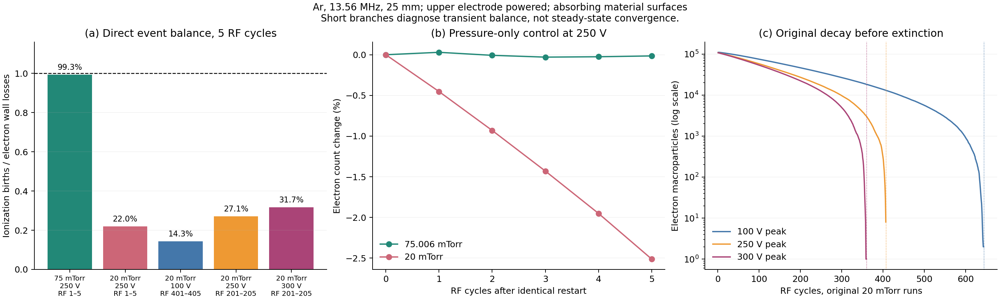

# 2026-11-20 — Ar 20 mTorr 방전 소멸 원인 진단

**현재 확인된 직접 원인은 이온화에 의한 전자 생성이 전극으로의 전자 손실을 보충하지 못한 것입니다.** 프로그램 예외 종료나 압력 단위 변환 오류가 원인이라는 증거는 발견되지 않았습니다. 다만 이것이 실제 실험에서도 반드시 소멸한다는 뜻은 아닙니다. 현재 eduPIC의 표면·충돌·전압 모델과 수치 해상도의 적용 범위를 구분해야 합니다.

진단일: 2026-11-20, 한국 시각. 본 계산은 Ar, 350 K, 13.56 MHz, 간격 25 mm, 상부 전압 인가·하부 접지, 정현파 **peak 전압** 기준입니다. 연구 장비의 추가 조건은 이번 진단에 제공되지 않았습니다.

- [진단 데이터·소스·재시작 상태 ZIP 다운로드](https://github.com/YGLSNU/eduPIC_PAL_RF-sheath/raw/refs/heads/results/2026-11-19-20mTorr-top-powered/results/2026-11-20_Ar_20mTorr_extinction_diagnosis/2026-11-20_Ar_20mTorr_extinction_diagnosis_all.zip)
- [입자 수지 CSV](2026-11-20_Ar_20mTorr_extinction_diagnosis_balance_summary.csv)
- [그림 PDF](2026-11-20_Ar_20mTorr_extinction_diagnosis.pdf)
- [이전 20 mTorr 전체 실행 보고서](../2026-11-19_Ar_20mTorr_100-250-300V_13.56MHz_25mm_topRF/README.md)



## 1. 이번에 직접 확인한 사실

기존 실행의 전자 수가 처음 0이 된 시점은 100 V에서 645 RF주기, 250 V에서 408주기, 300 V에서 361주기입니다. 이후 남은 이온이 빠져나가는 계산까지 진행되어 최종 체크포인트는 각각 3250·3100·3800주기가 되었습니다. 이 시점들은 정상상태 수렴 시점이 아닙니다.

소멸 전 체크포인트에서 별도의 5주기 진단 계산을 했습니다. 이온화 사건, 양 전극의 전자·이온 손실, 입자에 대한 전기장의 일, 벽으로 유출되는 운동에너지를 직접 누적했습니다. 아래 수는 **각 5 RF주기 합계이며 계산 입자 기준**입니다. 한 계산 입자의 가중치는 실제 입자 70,000개이고, 생성/손실 비율에는 이 가중치가 상쇄됩니다.

| 조건 | 진단 RF주기 | 이온화로 생성된 전자·이온 쌍 B | 전자 벽 손실 L | B/L | 전자 수 변화 |
|---|---:|---:|---:|---:|---:|
| 75.006 mTorr, 250 V: 기존 압력 대조군 | 1–5 | 2,404 | 2,420 | **99.3%** | −16개, −0.015% |
| 20 mTorr, 250 V: 위와 동일한 초기 상태 | 1–5 | 768 | 3,489 | **22.0%** | −2,721개, −2.512% |
| 20 mTorr, 100 V: 소멸 전 상태 | 401–405 | 88 | 616 | **14.3%** | −528개, −3.830% |
| 20 mTorr, 250 V: 소멸 전 상태 | 201–205 | 420 | 1,550 | **27.1%** | −1,130개, −4.161% |
| 20 mTorr, 300 V: 소멸 전 상태 | 201–205 | 530 | 1,670 | **31.7%** | −1,140개, −5.113% |

모든 진단 RF주기에서 `N_e(end) − N_e(start) = B − L_e`와 이온의 동일한 수지식이 **정확히 일치**했습니다. 즉, 추적되지 않은 입자 삭제가 아니라 코드의 이온화·벽 흡수 사건으로 입자 수 감소가 모두 설명됩니다.

앞의 두 행은 같은 초기 위치·속도, 같은 전압·전극 방향에서 **압력만 변경**한 비교입니다. 상부 전압 조건을 유지한 채 기존 압력으로 복귀하면 생성과 손실이 거의 균형을 이루었습니다. 압력 감소가 이번 결과를 바꾼 중요한 요인이라는 직접적인 근거입니다. 5주기는 국소적인 수지 진단이며, 새로운 정상상태 수렴이나 유지 가능한 최저 압력을 확정하는 실험은 아닙니다.

나머지 세 행은 각 실행의 서로 다른 상태를 이어받았습니다. 따라서 B/L이나 전자 감소율을 전압만의 효과로 해석하면 안 됩니다. 기존 체크포인트에 난수 상태가 없으므로, 이 진단 분기는 과거 실행의 동일한 난수 궤적을 재생한 것은 아닙니다.

## 2. 왜 20 mTorr에서 생성이 부족해지는가

기존 기본 압력은 **10 Pa = 75.006 mTorr**였습니다. 이번 **20 mTorr = 2.66645 Pa**이며, 코드의 변환은 맞습니다. 350 K에서 중성기체 밀도는 `5.5180 × 10^20 m^-3`, 기존의 26.66%입니다. 동일한 전자 에너지에서 `ν_ion = n_g σ_ion(E) v(E)`이므로 이온화 충돌 빈도는 약 3.75분의 1이 됩니다. 실제 전자 에너지 분포와 전기장도 변하므로 최종 이온화율 전체가 반드시 같은 비율로 바뀌지는 않습니다.

코드에 사용된 단면적으로 계산하면, 20 mTorr에서 20 eV 전자의 **이온화만의 평균자유행로**는 약 29.3 cm이고 50 eV에서는 약 7.04 cm입니다. 전극 간격 2.5 cm보다 깁니다. 이는 고정 에너지에서의 설명용 값이며, 총 충돌 평균자유행로나 실제 EEDF를 적분한 이온화율이 아닙니다. 쉬스에서 반사되어 여러 번 왕복하는 전자는 여전히 이온화할 수 있습니다.

압력 대조군의 첫 5주기에서는 전기장이 전자에 전달한 평균 전력밀도가 약 **1,591 → 426 W/m³**로 감소했습니다. 같은 구간의 전자 운동에너지도 20 mTorr에서 감소했습니다. 이 값은 입자 속도 갱신에서 계산한 전기장의 일이고, **발생기 전력이나 VI 단자 전력은 아닙니다**. 과도상태에서는 저장된 에너지 변화도 존재합니다.

현재 모델의 생성·손실 경로는 다음과 같습니다.

- **생성:** 바닥상태 Ar의 직접 전자충돌 이온화. 문턱 에너지 15.8 eV.
- **손실:** 실제 전극 표면에 도달한 모든 전자·이온을 흡수.
- **미포함:** 표면에서의 전자 반사, 이온 충돌에 의한 2차전자 방출, Ar 준안정종의 축적·수송·단계적 이온화.
- **포함되어 있는 것:** 전기장으로 인한 쉬스 내 전자의 정전기적 반사. 표면 반사가 없다는 말은 쉬스 반사도 없다는 뜻이 아닙니다.

따라서 이번 결과는 이 모델과 초기조건에서 손실을 보충할 이온화가 충분하지 않았음을 보여줍니다. 실험과의 차이를 특정 누락 과정 하나의 탓으로 확정한 것은 아닙니다. 전압을 300 V로 올려도 전자 이온화율이 충분해진다는 보장은 없습니다. 전압·전력은 쉬스와 이온 가속에도 작용하며, 현재 세 실행에서는 300 V 역시 B/L < 1입니다. 300 V의 더 이른 소멸이 보편적인 전압 의존성이라고 결론 내릴 수는 없습니다.

## 3. 코드 오류와 수치 오차에 대한 확인 범위

| 항목 | 확인 결과 | 해석의 한계 |
|---|---|---|
| mTorr → Pa → 중성밀도 | 20 mTorr → 2.666447 Pa, 올바름 | 압력 변경 자체는 큰 물리 조건 변화 |
| 상부 RF·하부 접지 | 진공 전위·전기장, 입자 손실/전극 표기 검사 통과. 기존 압력 대조군도 거의 균형 | 일반적인 모든 경계조건·회로 모델 검증은 아님 |
| 초기 전자 부족 | 시작 전자 108,314개, 이온 113,766개의 고밀도 재시작 상태 사용 | 갑작스러운 압력 변경의 과도응답·이력효과는 남음 |
| 입자 수지 | 25개 진단 RF주기 모두 전자·이온 수지 오차 0 | 물리 모델의 완전성을 의미하지 않음 |
| 진단 코드의 영향 | 같은 난수로 300→301주기 실행 시 진단 전후 체크포인트 바이트가 완전히 일치 | 해당 대조 실행에서 확인 |
| 기본 수치 조건 | 새 5개 진단에서 native 안정성 검사 통과, 출력 배열 유한값 | 격자·시간간격의 독립적인 수렴성 검증과 다름 |
| 계산 입자 가중치 | 이전 300 V, 250주기 상태를 10배 입자로 복제·가중치 1/10 적용해도 전자 소멸. 345주기 대 원래 361주기 | 한 조건의 후반 구간 검사. 모든 입자 잡음·수치 오차를 배제하지 못함 |

특히 이온화는 고에너지 전자 꼬리에 민감합니다. 중심부의 작은 CFL 초과 비율만으로 전체 공간의 고에너지 궤적 정확도를 보장할 수 없습니다. 연구용 결론 전에는 시간간격·격자를 줄인 비교가 필요합니다. 기존 3%·5% 중단 기준은 측정 통계의 안정성 기준이며, 물리 모델의 오차가 3%·5%라는 뜻이 아닙니다.

## 4. 수정 우선순위와 코드 위치

아래 링크는 이번 본 계산에 사용한 고정 커밋을 가리킵니다. 이번에는 진단용 복사본만 추가해 실행했으며, 운영 중인 본 계산 소스의 물리 모델에는 변경을 적용하지 않았습니다.

| 우선순위 | 수정할 부분 | 구체적인 수정과 목적 |
|---|---|---|
| 1 | [주기 계산·충돌·벽 처리: C/eduPIC.cc](https://github.com/YGLSNU/eduPIC_PAL_RF-sheath/blob/fab887e2697bbe4b04ab6b8ccedc4ad5701f5d42/C/eduPIC.cc#L511) | 정상상태 측정 전에도 매 RF주기 이온화/여기 사건, 양 전극 손실, 전자·이온 에너지 수지를 저장. 이번 `diagnostic.cc`에 직접 사건 수와 일·운동에너지 누적을 구현해 검증함. |
| 1 | [종료 조건: run_scan.py](https://github.com/YGLSNU/eduPIC_PAL_RF-sheath/blob/fab887e2697bbe4b04ab6b8ccedc4ad5701f5d42/scripts/voltage_scan/run_scan.py#L90) | 현재 `electrons == 0 and ions == 0`까지 기다림. 외부 전자원/SEE가 없는 현재 모델에서는 `electrons == 0`을 비가역 소멸로 기록하고 종료. 주기 내부 종료를 도입하면 실제 완료 주기·시각도 함께 저장하도록 제어기 수정. 소멸 전 비어 있지 않은 체크포인트를 별도 보존. SEE나 다른 전자원을 추가하면 이 판정은 다시 정의해야 함. |
| 1 | [EEPF/IFED 저장·정보 출력](https://github.com/YGLSNU/eduPIC_PAL_RF-sheath/blob/fab887e2697bbe4b04ab6b8ccedc4ad5701f5d42/C/eduPIC.cc#L815) | 입자/샘플 수 0일 때 나눗셈을 막고 `no samples`와 소멸 상태를 명시. 이는 NaN 출력 방지용이며 이번 동역학적 소멸의 원인은 아님. |
| 1 | [phase별 전력 계산: norm_all_xt](https://github.com/YGLSNU/eduPIC_PAL_RF-sheath/blob/fab887e2697bbe4b04ab6b8ccedc4ad5701f5d42/C/eduPIC.cc#L875) | 현재 phase bin의 평균 전류와 평균 전기장을 곱함. 순간 `jE` 또는 동일한 입자 field-work를 시간·위치별로 누적하여 `평균(jE)`를 얻도록 개선. 이 차이는 heating 결과 해석에 영향을 주지만 입자 운동에 다시 입력되지 않으므로 소멸 원인은 아님. |
| 2 | 실행 조건·수치 검증 | 상부 전압 조건에서 기존 압력 재현 후, 75→50→35→20 mTorr처럼 단계적으로 낮추며 수지/정상상태를 검사. 시간간격·격자·입자수 민감도도 별도 비교. 압력 램프는 급격한 변경 효과와 이력효과를 조사하는 방법이며 20 mTorr 유지의 보장은 아님. |
| 3 | [입자 경계 처리](https://github.com/YGLSNU/eduPIC_PAL_RF-sheath/blob/fab887e2697bbe4b04ab6b8ccedc4ad5701f5d42/C/eduPIC.cc#L636) | 실험 전극에 근거한 전자 표면 반사 `R(E,θ)`와 이온 유도 2차전자 수율 `γ(E_i,θ)` 추가 검토. 방출 방향은 하부에서 +x, 상부에서 −x. 방출 에너지·각도, 전극 전류와 에너지 수지를 함께 처리. 값을 임의로 맞춰 방전 유지를 강제하면 안 됨. |
| 4 | [여기·이온화 모델](https://github.com/YGLSNU/eduPIC_PAL_RF-sheath/blob/fab887e2697bbe4b04ab6b8ccedc4ad5701f5d42/C/eduPIC.cc#L311) | Ar 준안정종이 중요하면 생성 분기·수송·벽 소멸·단계적 이온화를 일관되게 추가. 기존 여기 충돌은 전자 에너지만 잃게 하고 여기종을 보존하지 않음. 바닥상태 Ar의 15.8 eV 문턱을 임의로 낮추는 방식은 부적절. |
| 실험 매칭과 병행 | 전압 경계·외부 회로 | 전극에서의 실측 `V(t)`·DC 성분·고조파, 실제 간격·주파수·가스·표면·기하 조건을 반영. 전류는 우선 계산 검증값으로 사용. 자기일관적 회로 없이 V와 I를 독립적으로 동시에 강제하지 않음. |

실험 전압이 RMS인지 peak-to-peak인지 먼저 맞춰야 합니다. 현재는 peak이므로 250 V는 이상적 정현파에서 500 Vpp, 약 176.8 Vrms입니다. 실제 고조파 파형은 단순한 √2 변환을 적용할 수 없으므로 측정 파형 자체를 사용해야 합니다. 발생기 표시 W와 전극/플라즈마 흡수 W도 구분해야 합니다.

전극 면적 차이·측벽·회로가 중요한 실험이면 평판 1D 동일 면적 모델의 한계를 검토해야 합니다. `ELECTRODE_AREA` 하나를 바꾸는 것만으로 양 전극의 면적 비대칭이나 self-bias가 구현되지는 않습니다. 추가 측벽은 입자 손실을 늘릴 수도 있으므로 다차원화가 자동으로 소멸을 해결하는 것은 아닙니다.

빈 체크포인트를 같은 모델로 계속 실행해도 방전은 되살아나지 않습니다. 보관된 소멸 전 상태 또는 초기 고밀도 상태를 사용해야 합니다. 그 상태에서도 생성/손실 불균형이 지속되면 더 오래 계산하는 것만으로는 정상상태를 얻을 수 없습니다.

## 5. 데이터·재현 방법

압축 파일에는 진단 소스, 고정 난수 대조 소스, 실행/분석 스크립트, 체크포인트, 5개 대조 실행의 원시 출력, 입자 수지 CSV, 검증 기록과 GPL-3.0 라이선스가 포함됩니다. 본 계산의 기존 결과는 보존되어 있습니다.

- `particle_balance.csv`: 매 RF주기 시작/종료 입자 수, 이온화/여기 사건, 상·하부 손실, field-work, 벽 유출 운동에너지, 남은 입자 운동에너지.
- `e_field_work_J`, `i_field_work_J`: 속도 kick의 정확한 운동에너지 차이를 합한 값. 발전기 전력이나 단자 VI 전력이 아님.
- `e_collisional_energy_loss_inferred_J`: `field-work − wall-energy − Δkinetic-energy`로 추론. 모든 충돌의 에너지를 독립 계수한 값은 아님. 문턱에너지 합과의 작은 차이에는 탄성 반동 등 기존 충돌 처리의 효과가 포함됨.
- `powere_xt.dat`, `poweri_xt.dat`: 기존 코드의 phase 평균 전류 × phase 평균 전기장 정의를 그대로 유지. 위 표의 field-work 전력밀도와 정의가 다름.
- 모든 phase 지도·EEPF·IFED는 명시된 **과도상태 5주기 평균**이며 정상상태 결과가 아님. IFED는 원래 코드의 0–200 eV 히스토그램 범위를 유지함.
- `input_picdata.bin`과 `picdata.bin`: 해당 진단의 시작/종료 상태. 난수 상태는 원래 체크포인트 형식에 포함되지 않음. 재시작 시 RF 위상·압력·전압·가중치를 메타데이터와 맞춰야 함.
- `run_controls.py`는 원래 클라우드 폴더 배치에서 실행할 기록용 스크립트이며 기존 진단 폴더 덮어쓰기를 거부함. ZIP을 다른 위치에 풀었다면 아래처럼 개별 사례를 새 디렉터리에서 재현할 수 있음.

```bash
# ZIP을 푼 최상위 디렉터리에서 실행: 300 V의 201–205주기 진단 예
mkdir rerun_300V
g++ -std=c++11 -O3 -march=native -DEDUPIC_VOLTAGE_V=300.0 \
    -DEDUPIC_PRESSURE_MTORR=20.0 diagnostic.cc -o rerun_300V/solver
cp controls/20mTorr_300V_from200/input_picdata.bin rerun_300V/picdata.bin
cd rerun_300V
EDUPIC_DIAGNOSTIC_SEED=20261120 ./solver 5 m
```

원본 `C/eduPIC.cc` SHA-256: `6b86a4a5b071d0d7eaf46cea42cb82e3f797494978bd7ff488276bc64ebc6531`.
진단 소스 SHA-256: `5acbe3b6b8aa8f73655cbdcfcb95c75f2d490607f070700ac7e67d943b7ec4ef`.
진단 계측 대조 실행의 동일 체크포인트 SHA-256: `885cf0fae92477d37a6c2304563ca958999292338affdf2c865ec66f86624cdb`.

사용 코드의 원 논문: Z. Donkó et al., “eduPIC: an introductory particle based code for radio-frequency plasma simulation,” *Plasma Sources Science and Technology* **30**, 095017 (2021). 위 결론은 이 논문 일반론만이 아니라 이번 저장 데이터·코드 검사·별도 대조 실행에 근거합니다.
