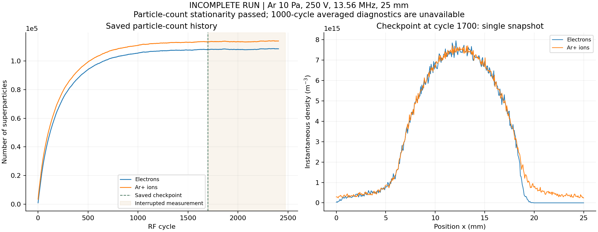

# 2026-11-17_Ar_10Pa_250V_13.56MHz_25mm

**미완료 실행 자료입니다.** 원본 C 버전의 기본 조건으로 1,700주기 입자 수 수렴을 확인했지만,
1,000주기 측정은 완료되지 않았습니다. 마지막 로그는 774주기 측정 후 누적 2,475주기 시작입니다.
보존된 재시작 데이터는 1,700주기 상태입니다. 현재 시뮬레이션은 실행 중이 아닙니다.

## 다운로드

| 자료 | 링크 | 크기 |
|---|---|---|
| 요약 ZIP: 보고서, 그림, CSV | [요약 ZIP 다운로드](https://github.com/YGLSNU/eduPIC_PAL_RF-sheath/raw/refs/heads/results/75mTorr/results/261117_initial/261117_initial_incomplete_summary.zip) | 0.56 MB |
| 전체 ZIP: 요약 + 원본 로그, 재시작 데이터, 소스, 예비 결과, 매뉴얼 | [전체 ZIP 다운로드](https://github.com/YGLSNU/eduPIC_PAL_RF-sheath/raw/refs/heads/results/75mTorr/results/261117_initial/261117_initial_incomplete_full.zip) | 12.17 MB |

직접 다운로드가 열리지 않으면 아래 파일 페이지에서 Download raw(다운로드 아이콘)를 선택하세요.

- [요약 ZIP 파일 페이지](261117_initial_incomplete_summary.zip)
- [전체 ZIP 파일 페이지](261117_initial_incomplete_full.zip)
- [보고서 바로 읽기](261117_initial_incomplete_report.md)
- [순간 밀도 CSV](261117_initial_incomplete_snapshot1700_density.csv) / [입자 수 CSV](261117_initial_incomplete_particle_counts.csv)

오른쪽 그림은 **단일 시점의 밀도이며 시간평균 결과가 아닙니다.**
ZIP을 풀고 이름이 report.html로 끝나는 파일을 브라우저에서 열면 그림과 설명을 함께 볼 수 있습니다.
CSV는 Excel에서 열 수 있습니다. 자세한 상태와 복구 기준은 보고서에 있습니다.

## 이름과 조건

파일명 형식: 날짜_가스_압력_전압진폭_주파수_전극간격_상태_자료종류.확장자

- 날짜 2026-11-17은 한국 시각 기준 실제 실행 시작일입니다.
- Ar, 10 Pa, 250 V(진폭), 13.56 MHz, 25 mm. 그 외 기본 조건: 350 K, 격자 400점, RF주기당 4,000단계.
- incomplete는 미완료 자료를 뜻합니다. summary는 요약, full은 전체 보관용입니다.
- early_preview/는 수렴 전 326–330주기의 별도 예비 측정이며 최종 데이터가 아닙니다.
- 자료 정리 시각: 2026-11-18T17:20:19+09:00. 원본 소스 버전: 32050728c961a317d6d6acd6bc86d026da403326.
- ZIP 내부 원본 파일명은 원래 실행 기록과의 대응을 위해 유지했습니다.
- 파일 무결성은 이름이 checksums.sha256로 끝나는 파일로 확인할 수 있습니다.
