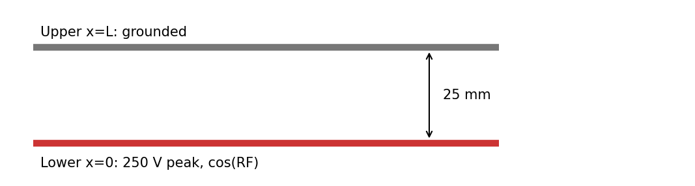
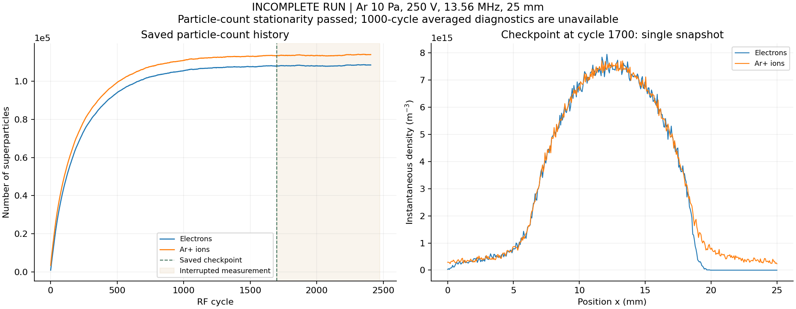
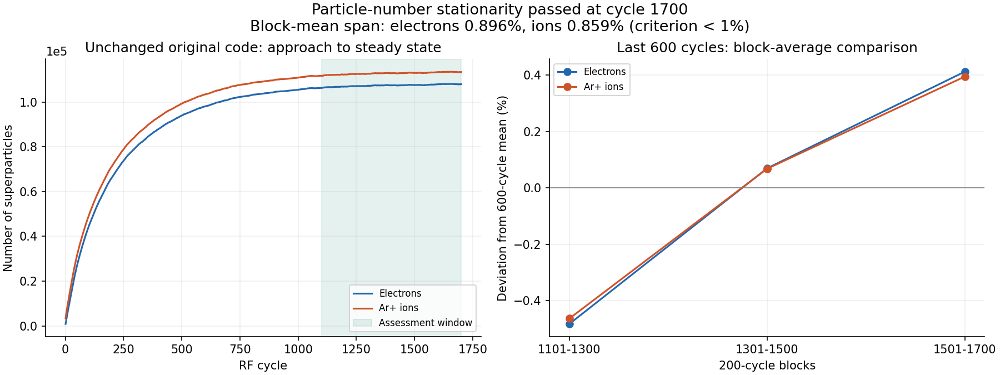

# 261117_initial · 기본 조건 초기 실행

[전체 실행 목록](https://github.com/YGLSNU/eduPIC_PAL_RF-sheath) · [이 조건군](https://github.com/YGLSNU/eduPIC_PAL_RF-sheath/tree/results/75mTorr)

**미완료** · 실행일 2026-11-17 (한국 시각) · 변경 조건: **초기 실행·RF1700 저장** · 보고서 갱신 2026-11-22

RF1700 체크포인트와 입자 수 이력을 보존했습니다. 장시간 측정의 최종 분포는 보존되지 않았습니다.

## 실행 조건

| 항목 | 값 |
|---|---|
| 기체 / 압력 / 온도 | Ar / 75.0062 mTorr (원조건 10 Pa) / 350 K |
| 인가 파형 / 주파수 | 정현파 / 13.56 MHz |
| 전압 / gap | 250 V peak / 25 mm |
| 전극 연결 | 하부 x=0 RF / 상부 x=L 접지 |
| 면적 / 형상 | 1D3V 동일 면적 평판, 환산 면적 1 cm²; 실제 지름·측벽 제외 |
| 표면 / 충돌 모델 | 흡수 경계, SEE·전자 반사 없음; ground-state Ar MCC |
| 격자 / 시간간격 / 입자 가중치 | 400점 / RF당 4000 전자 step / 70000 |
| 코드 | 원본 C/eduPIC.cc 계열, C++11 컴파일 |
| 소스 이력 | 32050728c961a317d6d6acd6bc86d026da403326 |
| 초기·재시작 상태 | 원본 초기화 후 저장 상태에서 연속 계산 |
| 측정 구간 | 저장 RF1700 순간 상태. 예비 RF326–330과 미완료 장시간 측정을 최종 정상상태 평균으로 사용하지 않음. |

상태와 그래프는 마지막 저장 자료이며 실시간 CPU 실행 화면은 아닙니다.

## 자료 범위

| 진단 | 저장·해석 범위 |
|---|---|
| 수렴·입자 수지 | 입자 수 이력·저장 상태의 안정성 검사 |
| 밀도 공간분포 | RF1700 단일 시점만 보존 |
| RF heating | 저장 자료 없음 |
| 전위·전기장 | 저장 자료 없음 |
| 평균 에너지·이온화 | 저장 자료 없음 |
| 에너지 분포 | 저장 자료 없음 |
| 전극 flux·손실 | 저장 자료 없음 |
| 전력 전달·손실 | 저장 자료 없음 |

## 수렴·입자 수지

입자 수 기록과 RF1700 순간 밀도; 시간평균 분포 아님

저장 시점의 입자 수 안정성

## 밀도 공간분포

순간 밀도 CSV는 시간평균과 구분합니다.

## 읽는 기준

- 위상 그림의 가로축은 RF 위상 t/T, 세로축은 위치 x입니다. 전극 방향은 위 조건표를 따릅니다. 위상 0은 cos 인가 전압의 양의 최댓값입니다.
- Heating은 위상 평균 j × 위상 평균 E입니다. 양수는 전기장에서 입자로, 음수는 반대 방향의 전달입니다. 순간 jE의 평균·온도 상승률과 구분합니다.
- 통계 중단 기준은 전체 물리·격자 오차나 모든 픽셀의 오차를 보증하지 않습니다. 소멸·미완료·짧은 진단을 정상 방전 측정과 구분합니다.
- 전력 표시는 W/m² 또는 W/m³입니다. 실제 전극 면적·회로 없이 발생기 총 W와 동일시하지 않습니다.

## 파일과 재시작

| 자료 | 다운로드 | 크기 |
|---|---|---:|
| incomplete full | [261117_initial_incomplete_full.zip](https://github.com/YGLSNU/eduPIC_PAL_RF-sheath/raw/refs/heads/results/75mTorr/results/261117_initial/261117_initial_incomplete_full.zip) | 11.60 MiB |
| incomplete overview | [261117_initial_incomplete_overview.pdf](https://github.com/YGLSNU/eduPIC_PAL_RF-sheath/raw/refs/heads/results/75mTorr/results/261117_initial/261117_initial_incomplete_overview.pdf) | 0.04 MiB |
| incomplete particle counts | [261117_initial_incomplete_particle_counts.csv](261117_initial_incomplete_particle_counts.csv) | 0.04 MiB |
| incomplete snapshot1700 density | [261117_initial_incomplete_snapshot1700_density.csv](261117_initial_incomplete_snapshot1700_density.csv) | 0.03 MiB |
| incomplete stationarity1700 | [261117_initial_incomplete_stationarity1700.pdf](https://github.com/YGLSNU/eduPIC_PAL_RF-sheath/raw/refs/heads/results/75mTorr/results/261117_initial/261117_initial_incomplete_stationarity1700.pdf) | 0.03 MiB |
| incomplete summary | [261117_initial_incomplete_summary.zip](https://github.com/YGLSNU/eduPIC_PAL_RF-sheath/raw/refs/heads/results/75mTorr/results/261117_initial/261117_initial_incomplete_summary.zip) | 0.54 MiB |

[전체 파일 목록·SHA256](files.json)

[기존 상세 기록](DETAILS.md)
