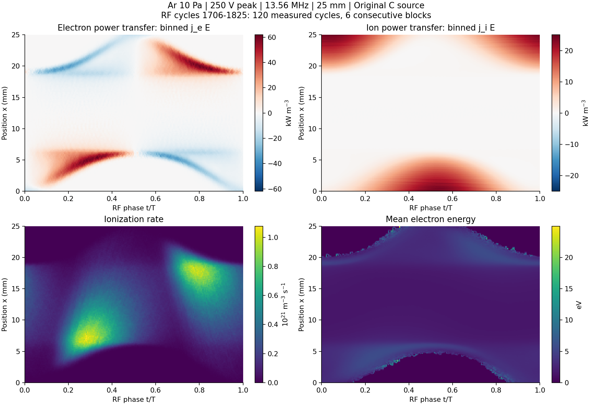
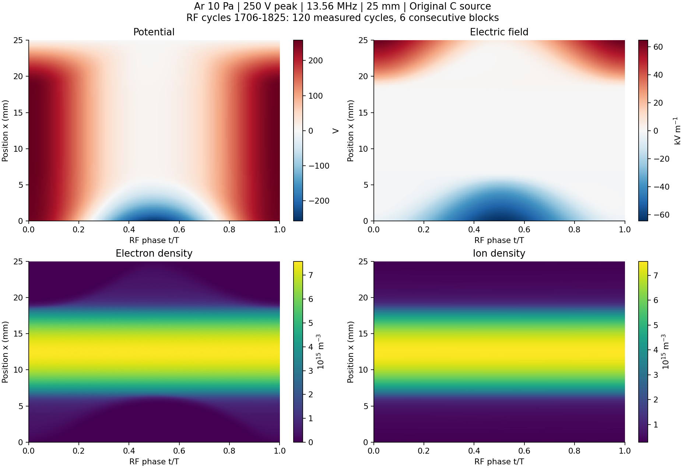
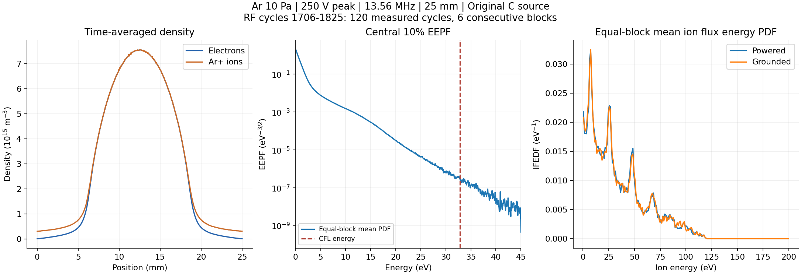
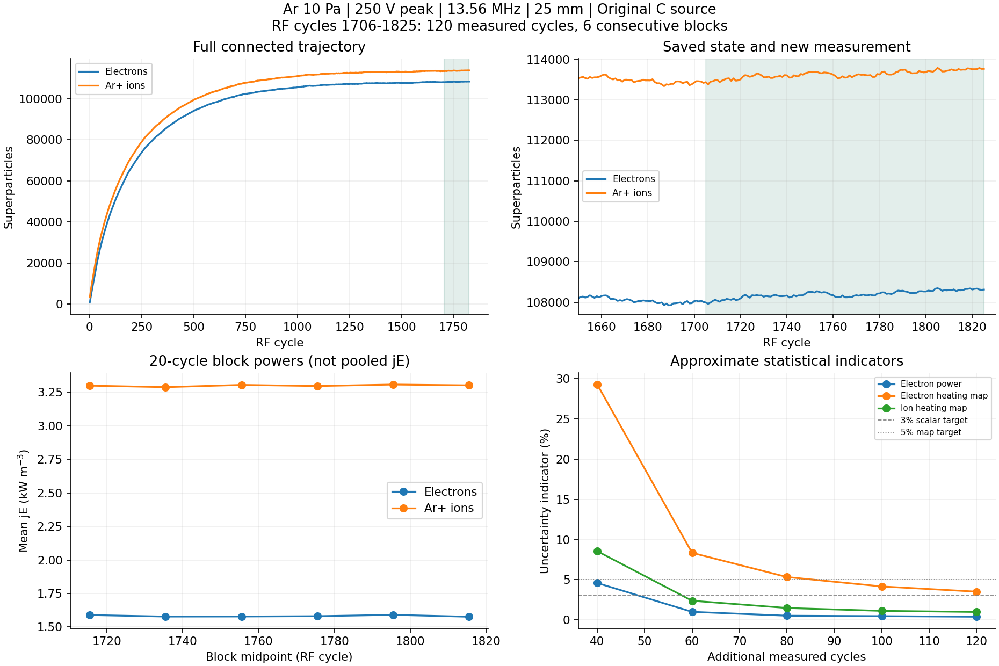
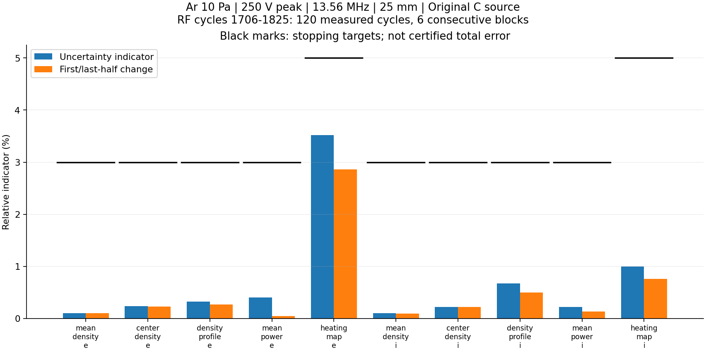

# 2026-11-18: 통계 기준에 따른 추가 측정

원본 C/eduPIC.cc, Ar 10 Pa, 350 K, 전압 진폭 250 V, 13.56 MHz, 전극 간격 25 mm.
1,705주기 체크포인트에서 재개했으며, 원본 시뮬레이션 소스와 물리 조건은 바꾸지 않았습니다.

**마지막 업로드 상태: 통계 기준 만족·계산 종료 / 저장 완료 1,825주기 / 새 측정 120주기.**
이는 업로드 당시 상태입니다. 브라우저 화면은 실시간 CPU 실행 상태를 나타내지 않습니다.

[최종 보고서·그림](README.md)

## 중단 기준

20주기씩 저장하고 최소 100주기부터 검사합니다. 다음을 두 번 연속 만족하면 자동 종료합니다.

- 전자·이온 평균/중심 밀도와 평균 전력: 블록 통계의 예상 불확실성 지표 및 전후반 변화 각각 3% 이내.
- 전자·이온 밀도 공간분포: 같은 지표를 분포 전체 L2 norm으로 정규화해 3% 이내.
- 전자·이온 heating 맵: 공간 40 × 위상 40으로 평균한 맵 전체의 L2 기준 5% 이내.
- 최근 600주기 입자 수: 200주기씩 세 평균의 범위 1% 미만, 선형 변화량 2% 미만.

Student-t 배수의 블록 표준오차에 양의 시간상관 보정을 사용합니다. 200주기 이상이면 40주기 단위 재집계도 비교합니다.
이는 대략적인 결과 취합용 중단 규칙이며 정확한 참값 대비 오차, 모든 픽셀의 5% 오차, 엄밀한 순차적 95% 신뢰수준을 보장하지 않습니다.
원본 400 × 200 맵은 모두 보관합니다. 최대 1,000주기 추가 측정 시 재평가를 위해 멈추며, 기준 미달 상태를 수렴으로 표기하지 않습니다.

## 구간별 원본과 재시작 파일

| 새 측정 RF주기 | 크기 | 다운로드 |
|---|---|---|
| 1706–1725 | 10.24 MB | [원본 결과·체크포인트 ZIP](https://github.com/YGLSNU/eduPIC_PAL_RF-sheath/raw/refs/heads/results/75mTorr/results/261118_measure120/261118_measure120_cycle1706-1725.zip) |
| 1726–1745 | 10.24 MB | [원본 결과·체크포인트 ZIP](https://github.com/YGLSNU/eduPIC_PAL_RF-sheath/raw/refs/heads/results/75mTorr/results/261118_measure120/261118_measure120_cycle1726-1745.zip) |
| 1746–1765 | 10.24 MB | [원본 결과·체크포인트 ZIP](https://github.com/YGLSNU/eduPIC_PAL_RF-sheath/raw/refs/heads/results/75mTorr/results/261118_measure120/261118_measure120_cycle1746-1765.zip) |
| 1766–1785 | 10.24 MB | [원본 결과·체크포인트 ZIP](https://github.com/YGLSNU/eduPIC_PAL_RF-sheath/raw/refs/heads/results/75mTorr/results/261118_measure120/261118_measure120_cycle1766-1785.zip) |
| 1786–1805 | 10.25 MB | [원본 결과·체크포인트 ZIP](https://github.com/YGLSNU/eduPIC_PAL_RF-sheath/raw/refs/heads/results/75mTorr/results/261118_measure120/261118_measure120_cycle1786-1805.zip) |
| 1806–1825 | 10.25 MB | [원본 결과·체크포인트 ZIP](https://github.com/YGLSNU/eduPIC_PAL_RF-sheath/raw/refs/heads/results/75mTorr/results/261118_measure120/261118_measure120_cycle1806-1825.zip) |

각 ZIP에는 해당 구간의 15개 DAT, info.txt, 로그, 검사 기록 및 마지막 picdata.bin이 있습니다.
현재 마지막 재시작 상태는 1825주기입니다.

- [시작 1,705주기 체크포인트·원본 소스](https://github.com/YGLSNU/eduPIC_PAL_RF-sheath/raw/refs/heads/results/75mTorr/results/261118_measure120/261118_measure120_input_cycle1705_restart.zip)
- [재시작 방법](261118_measure120_RESUME.md)
- [중단 기준 설정](261118_measure120_criteria.json)
- [검사 수치](261118_measure120_assessment.json)
- [파일 목록·체크섬](261118_measure120_manifest.json)

강제 종료 시 마지막으로 완전히 저장된 구간까지만 재개할 수 있습니다. 원본 코드는 난수 상태를 저장하지 않습니다.
중간 재시작으로 개별 궤적은 달라질 수 있으나 같은 조건의 통계적 연속 계산은 가능합니다.
원본 진단 누적값은 재시작 때 초기화되므로 이전 결과를 보관하고 후처리로 결합해야 합니다.


---

# 추가 측정 결과: 120 RF주기

상태: **정한 통계 기준을 만족하여 자동 종료**.
1,705주기 상태에서 이어서 1,706–1,825주기를 새로 측정했습니다.

- [결과 요약 ZIP 다운로드](https://github.com/YGLSNU/eduPIC_PAL_RF-sheath/raw/refs/heads/results/75mTorr/results/261118_measure120/261118_measure120_summary.zip): 보고서, 그림, PDF, CSV, 합산 DAT.
- [마지막 1,825주기 재시작 ZIP 다운로드](https://github.com/YGLSNU/eduPIC_PAL_RF-sheath/raw/refs/heads/results/75mTorr/results/261118_measure120/261118_measure120_restart_cycle1825.zip): 체크포인트, 원본 소스·조건, 재시작 설명.
- [전체 그림 PDF](261118_measure120_all_plots.pdf) / [CSV](csv) / [합산 DAT](aggregate_dat).
- [구간별 원본 결과·체크포인트](DETAILS.md).

## Heating·이온화·전자 에너지



## 전위·전기장·전자와 이온 밀도



## 밀도와 에너지 분포



## 입자 수·블록별 전력·통계 변화



## 마지막 중단 판정




# eduPIC 추가 측정: 기준 만족 후 자동 종료

**1,705주기 체크포인트에서 시작해 1,706–1,825주기, 총 120주기를 새로 측정했습니다.**
20주기씩 6개의 연속 구간을 따로 저장했습니다. 이전 5주기 결과는 이번 통계에 합치지 않았습니다.
원본 `C/eduPIC.cc`와 기본 조건은 그대로입니다. 계산 관리·통계·그림 작성만 별도 Python 스크립트로 수행했습니다.

| 실행 정보 | 값 |
|---|---|
| 상태 | 기준 만족 후 자동 종료 |
| 조건 | Ar 10 Pa, 350 K, 전압 진폭 250 V, 13.56 MHz, 전극 간격 25 mm |
| 수치 설정 | 공간 400점, RF주기당 전자 4,000단계, 이온 subcycle 20, 입자 가중치 70,000 |
| 실제 solver 시간 합계 | 32.75분 |
| 시작 / 종료 (한국 시각) | 2026-11-18T22:51:04.192861+09:00 / 2026-11-18T23:24:14.660540+09:00 |
| 저장 상태 | 1,825주기, 전자 108,314개·이온 113,766개 슈퍼입자 |
| 원본 소스 커밋 | 32050728c961a317d6d6acd6bc86d026da403326 |
| 원본 소스 SHA256 | 7c7679c0f0c98844940ea911bbb7581ec33f818e8d14427c9837ffdcf1ecea41 |

## 주요 수치

| 물리량 | 평균 | 예상 통계 불확실성 지표 |
|---|---|---|
| 공간평균 전자 밀도 | 3.02947e+15 m⁻³ | ±0.104% |
| 중앙 10% 전자 밀도 | 7.47687e+15 m⁻³ | ±0.234% |
| 평균 전자 전력밀도 | 1582.7 W/m³ | ±0.407% |
| 공간평균 이온 밀도 | 3.18107e+15 m⁻³ | ±0.100% |
| 중앙 10% 이온 밀도 | 7.47863e+15 m⁻³ | ±0.223% |
| 평균 이온 전력밀도 | 3298.66 W/m³ | ±0.218% |

밀도의 공간평균은 격자 끝점에 사다리꼴 가중치를 사용했고, 중앙 밀도는 전극 간격 중앙 10%의 평균입니다.
평균 전력은 원본 코드와 같은 공간 격자·위상의 산술평균입니다. 두 평균의 공간 가중치는 서로 다르므로 정의를 확인하세요.
전원·접지 전극의 평균 이온 입사 에너지는 정규화 IFEDF의 블록 평균 기준 33.322 / 33.423 eV입니다.
이온 에너지 분포의 꼬리나 두 전극의 차이는 이번 종료 기준에 포함되지 않았습니다.

## 자동 중단 판정

최소 100주기부터 20주기마다 판정하고 두 번 연속 통과하면 멈춥니다. 마지막 판정의 수치는 다음과 같습니다.

| 대상 | 통계 불확실성 지표 | 전후반 변화 | 각 기준 | 결과 |
|---|---|---|---|---|
| 공간평균 전자 밀도 | 0.104% | 0.099% | 3% | 통과 |
| 중앙 10% 전자 밀도 | 0.234% | 0.230% | 3% | 통과 |
| 전자 밀도 공간분포 | 0.325% | 0.270% | 3% | 통과 |
| 평균 전자 전력밀도 | 0.407% | 0.048% | 3% | 통과 |
| 전자 heating 맵 | 3.523% | 2.863% | 5% | 통과 |
| 공간평균 이온 밀도 | 0.100% | 0.095% | 3% | 통과 |
| 중앙 10% 이온 밀도 | 0.223% | 0.222% | 3% | 통과 |
| 이온 밀도 공간분포 | 0.674% | 0.500% | 3% | 통과 |
| 평균 이온 전력밀도 | 0.218% | 0.136% | 3% | 통과 |
| 이온 heating 맵 | 1.000% | 0.760% | 5% | 통과 |

최근 600주기의 전자·이온 입자 수에도 200주기씩 세 구간 평균의 범위 1% 미만, 선형 변화량 2% 미만을 요구했습니다.
최종 수치는 `2026-11-18_Ar_10Pa_250V_13.56MHz_25mm_adaptive_from1705_assessment.json`에 있습니다. 원본 코드의 네 가지 수치 안정성 조건도 각 구간에서 검사했습니다.

통계 지표는 블록 delete-one jackknife 표준오차에 Student-t(97.5 percentile) 배수와 양의 시간상관 보정을 적용했습니다.
이는 제한된 연속 표본에 대한 **예상 변동 지표**입니다. 반복적인 자동 판정으로 엄밀한 95% 순차적 신뢰수준을 보장하지 않습니다.
전후반 변화는 같은 개수의 첫·마지막 블록을 비교하며 블록 수가 홀수이면 가운데 블록을 제외합니다.
200주기 이상이면 40주기 재집계의 지표도 계산해 더 큰 쪽을 사용합니다. 현재 40주기 재집계 가능 여부: False.

Heating 기준은 원본 400 × 200 맵을 **공간 40 × RF위상 40**으로 평균한 후, 지표의 L2 norm을 평균 맵의 L2 norm으로 나눕니다.
공간 약 0.63 mm, 위상 0.025 RF주기(약 1.84 ns) 규모의 주요 구조를 비교합니다.
모든 픽셀, 특히 값이 0에 가까운 곳의 상대오차가 5% 이내라는 뜻이 아닙니다. 원본 해상도 맵과 CSV도 함께 보관했습니다.
격자·시간간격 오차와 모델 오차는 별도의 수렴 연구가 필요하며 이번 통계 지표에 포함되지 않습니다.

## 맵과 데이터 합산 방법

가로축은 RF 위상 t/T, 세로축은 전극 사이 위치 x입니다. x=0이 전원 전극, x=25 mm가 접지 전극입니다.
모든 측정 주기를 같은 위상에 모은 평균 맵이며, 개별 RF주기별 영화나 연속 시간 신호는 아닙니다.
양의 jE는 전기장→입자, 음의 jE는 입자→전기장 전력 전달입니다. Ohmic/sheath heating의 성분별 분해나 온도 상승률이 아닙니다.

- 전위, 전기장, 밀도, 전류, 이온화율: 같은 길이 블록의 산술평균.
- 평균 전자·이온 에너지: 각 위치·위상에서 밀도 가중 평균. 단순 에너지 산술평균이 아닙니다.
- 주 heating 맵: 합산한 위상 평균 전류와 전기장의 곱. 원본 코드의 누적·정규화 관례에 맞춥니다.
- 추가 `powere_mean_of_blocks` / `poweri_mean_of_blocks`: 블록마다 계산된 jE의 평균. 주 heating 맵과 구분해 제공합니다.
- EEPF와 IFEDF: `equal_block_mean` 파일은 구간별 정규화 분포의 산술평균입니다. 원본 코드는 히스토그램의 표본 수를 내보내지 않아 전체 입자·충돌 사건을 엄밀히 한데 모은 PDF와 같다고 주장하지 않습니다. 구간별 원본 PDF도 모두 제공합니다.

합산 jE와 블록별 jE 평균의 전체 전력 차이는 전자 0.0014%, 이온 0.0000%입니다.
텍스트 DAT의 출력 반올림 오차가 남습니다. 밀도 CSV의 좌표는 원본 소스의 격자식으로 정확하게 재구성했습니다.

## 결과와 재시작

`summary.zip`은 보고서·PNG·PDF·전체 변환 CSV 및 합산 DAT입니다.
각 `cycle시작-끝.zip`에는 원본 15개 DAT, info.txt, 로그, 검증 결과와 그 구간 끝의 `picdata.bin`이 있습니다.
`restart_cycle1825.zip`은 마지막 입자 상태와 원본 소스·설정·재시작 설명을 묶은 파일입니다.

새 폴더에서 체크포인트와 같은 소스를 사용해 다음처럼 실행하면 **추가 20주기**를 계산합니다.

```bash
g++ -std=c++11 -O3 -march=native source-eduPIC.cc -o edupic
./edupic 20 m > run.log 2>&1
```

`0`은 초기화 명령이므로 재개에 사용하지 마세요. 체크포인트는 반드시 소스와 조건을 함께 보관하세요.
난수 상태와 진단 누적값은 체크포인트에 없습니다. 재시작 후 궤적은 연속 실행과 달라질 수 있으며 이전 측정은 별도 합산해야 합니다.
관심 조건만 나중에 골라 추가 측정할 수 있습니다. 조건을 바꾼다면 새로운 조건에서 다시 수렴을 확인하세요.

원본 eduPIC: Z. Donko et al., Plasma Sources Science and Technology 30, 095017 (2021), GPLv3.
