# 261118_measure120 · 통계 기준에 따른 추가 측정

[전체 실행 목록](https://github.com/YGLSNU/eduPIC_PAL_RF-sheath) · [이 조건군](https://github.com/YGLSNU/eduPIC_PAL_RF-sheath/tree/results/75mTorr)

**통계 기준 충족** · 실행일 2026-11-18 (한국 시각) · 변경 조건: **추가 측정 120 RF** · 보고서 갱신 2026-11-22

저장된 플라즈마 상태에서 이어 측정했습니다. 최근 600주기 안정성과 3%/5% 측정 지표를 연속 두 번 충족했습니다.

## 실행 조건

| 항목 | 값 |
|---|---|
| 기체 / 압력 / 온도 | Ar / 75.0062 mTorr (원조건 10 Pa) / 350 K |
| 인가 파형 / 주파수 | 정현파 / 13.56 MHz |
| 전압 / gap | 250 V peak / 25 mm |
| 전극 연결 | 하부 x=0 RF / 상부 x=L 접지 |
| 면적 / 형상 | 1D3V 동일 면적 평판, 환산 면적 1 cm²; 실제 지름·측벽 제외 |
| 표면 / 충돌 모델 | 흡수 경계, SEE·전자 반사 없음; ground-state Ar MCC |
| 격자 / 시간간격 / 입자 가중치 | 400점 / RF당 4000 전자 step / 70000 |
| 코드 | 원본 C/eduPIC.cc 계열, C++11 컴파일 |
| 소스 이력 | 32050728c961a317d6d6acd6bc86d026da403326 |
| 초기·재시작 상태 | 원본 초기화 후 저장 상태에서 연속 계산 |
| 측정 구간 | RF1706–1825, 총120 RF; 이전5주기 제외 |

상태와 그래프는 마지막 저장 자료이며 실시간 CPU 실행 화면은 아닙니다.

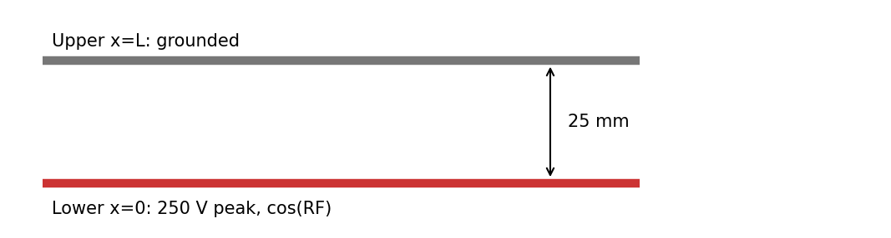

## 핵심 수치

| 물리량 | 값 |
|---|---|
| 공간·시간 평균 전자 밀도 | 3.0295e+15 m⁻³ |
| 공간·시간 평균 이온 밀도 | 3.1811e+15 m⁻³ |
| 최종 저장 / 새 측정 | RF1825 / 120 RF |

## 자료 범위

| 진단 | 제공 상태 | 저장·해석 범위 |
|---|---|---|
| 수렴·입자 수지 | 자료 있음 | 입자 수·측정 통계 기록 |
| 밀도 공간분포 | 자료 있음 | RF1706–1825, 6개20RF블록 평균 |
| RF heating | 자료 있음 | RF1706–1825, 6개20RF블록 평균 |
| 전위·전기장 | 자료 있음 | RF1706–1825, 6개20RF블록 평균 |
| 평균 에너지·이온화 | 자료 있음 | RF1706–1825, 6개20RF블록 평균 |
| 에너지 분포 | 자료 있음 | 정규화된 분포의 equal-block mean |
| 전극 flux·손실 | 자료 있음 | 원본 info.txt의 구간별 flux·이온 에너지 |
| 전력 전달·손실 | 부분 자료 | 위상 평균 j×E 및 원본 보고서의 평균 전력 |

## 수렴·입자 수지

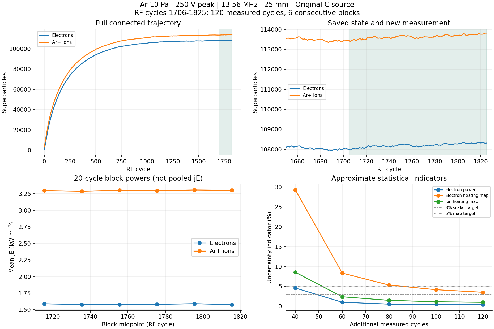

입자 수·측정 구간·측정 통계

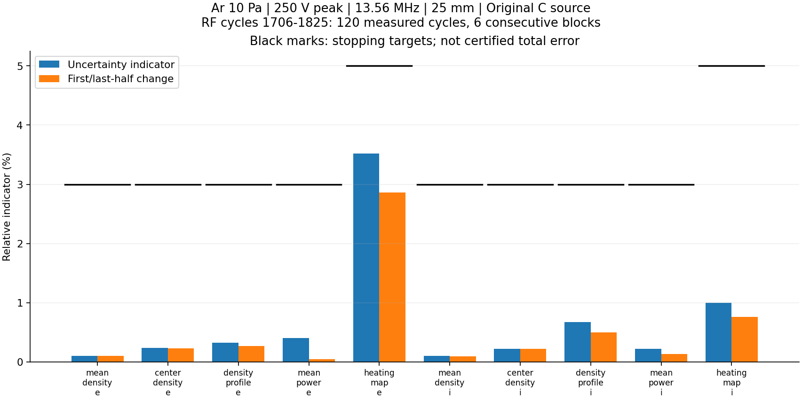

항목별 통계 중단 지표와 기준

## 밀도 공간분포

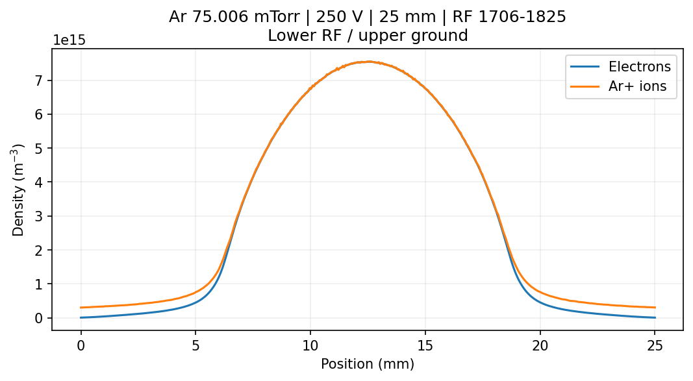

RF1706–1825 평균 전자·이온 밀도. x=0 하부 RF, x=25mm 상부 접지입니다.

## RF heating

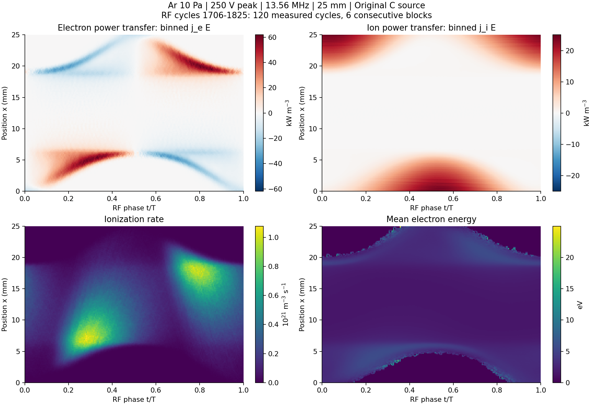

전자·이온 heating, 이온화율, 평균 전자 에너지; RF1706–1825, 6개20RF블록 평균

## 전위·전기장

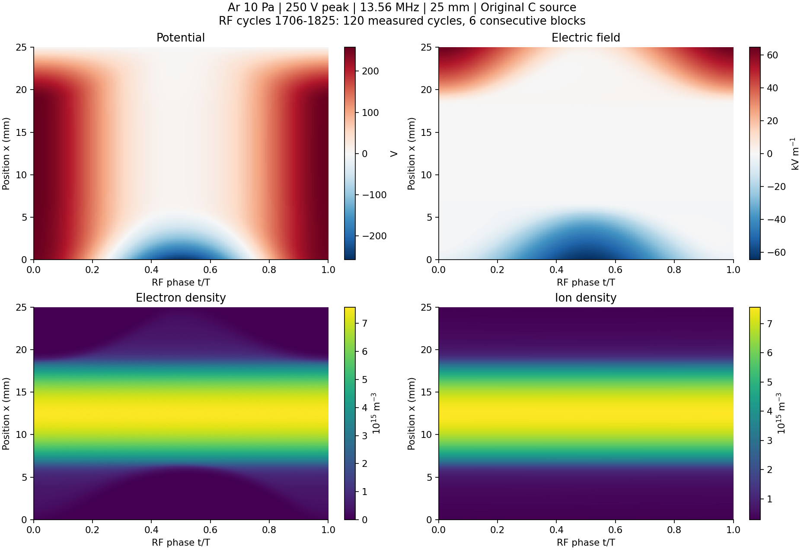

전위·전기장·전자·이온 밀도; 하부RF/상부접지

## 평균 에너지·이온화

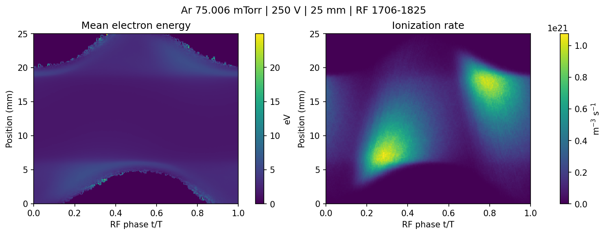

RF1706–1825의 평균 전자 에너지·이온화율

## 에너지 분포

전체 사건 수로 가중한 PDF와 구간별 정규화 PDF의 평균은 다릅니다. 저장 방식에 따른 정의를 유지했습니다.

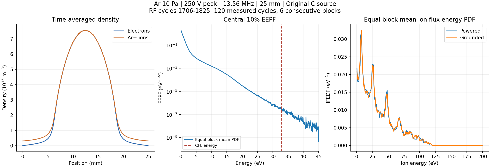

밀도 공간분포·중앙 EEPF·양 전극 이온 에너지 분포

## 전극 flux·손실

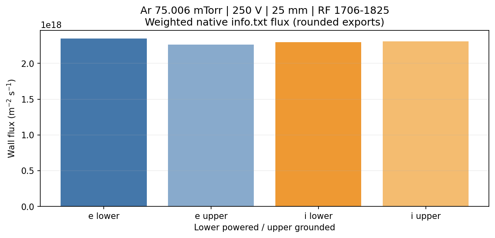

원본 info.txt의 구간별 flux를 측정 RF 길이로 가중 평균했습니다. 출력 반올림 정밀도를 유지합니다.

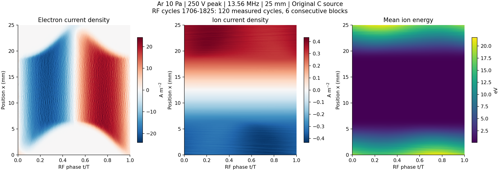

전류밀도와 양 전극 이온 에너지 진단; 총 단자 VI 전류와 구분

## 전력 전달·손실

완전한 충돌·벽·저장 에너지 수지는 이 원본 실행에 기록되지 않았습니다.

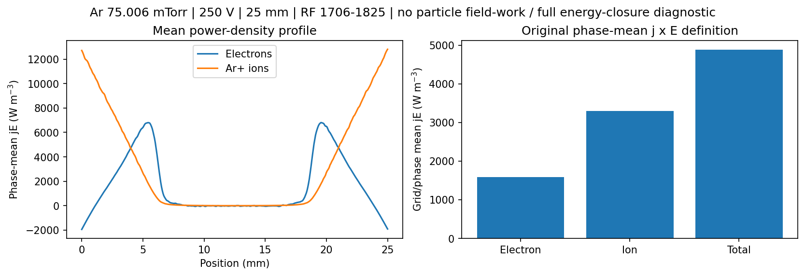

위상 평균 j×E의 공간분포와 원본 정의의 평균 전력밀도입니다. 입자 field-work와 구분합니다.

## 읽는 기준

- 위상 그림의 가로축은 RF 위상 t/T, 세로축은 위치 x입니다. 전극 방향은 위 조건표를 따릅니다. 위상 0은 cos 인가 전압의 양의 최댓값입니다.
- Heating은 위상 평균 j × 위상 평균 E입니다. 양수는 전기장에서 입자로, 음수는 반대 방향의 전달입니다. 순간 jE의 평균·온도 상승률과 구분합니다.
- 통계 중단 기준은 전체 물리·격자 오차나 모든 픽셀의 오차를 보증하지 않습니다. 소멸·미완료·짧은 진단을 정상 방전 측정과 구분합니다.
- 전력 표시는 W/m² 또는 W/m³입니다. 실제 전극 면적·회로 없이 발생기 총 W와 동일시하지 않습니다.

## 파일과 재시작

| 자료 | 다운로드 | 크기 |
|---|---|---:|
| 전체 그림 PDF | [261118_measure120_all_plots.pdf](https://github.com/YGLSNU/eduPIC_PAL_RF-sheath/raw/refs/heads/results/75mTorr/results/261118_measure120/261118_measure120_all_plots.pdf) | 443.8 KiB |
| cycle1706-1725 | [261118_measure120_cycle1706-1725.zip](https://github.com/YGLSNU/eduPIC_PAL_RF-sheath/raw/refs/heads/results/75mTorr/results/261118_measure120/261118_measure120_cycle1706-1725.zip) | 9.77 MiB |
| cycle1726-1745 | [261118_measure120_cycle1726-1745.zip](https://github.com/YGLSNU/eduPIC_PAL_RF-sheath/raw/refs/heads/results/75mTorr/results/261118_measure120/261118_measure120_cycle1726-1745.zip) | 9.77 MiB |
| cycle1746-1765 | [261118_measure120_cycle1746-1765.zip](https://github.com/YGLSNU/eduPIC_PAL_RF-sheath/raw/refs/heads/results/75mTorr/results/261118_measure120/261118_measure120_cycle1746-1765.zip) | 9.76 MiB |
| cycle1766-1785 | [261118_measure120_cycle1766-1785.zip](https://github.com/YGLSNU/eduPIC_PAL_RF-sheath/raw/refs/heads/results/75mTorr/results/261118_measure120/261118_measure120_cycle1766-1785.zip) | 9.77 MiB |
| cycle1786-1805 | [261118_measure120_cycle1786-1805.zip](https://github.com/YGLSNU/eduPIC_PAL_RF-sheath/raw/refs/heads/results/75mTorr/results/261118_measure120/261118_measure120_cycle1786-1805.zip) | 9.78 MiB |
| cycle1806-1825 | [261118_measure120_cycle1806-1825.zip](https://github.com/YGLSNU/eduPIC_PAL_RF-sheath/raw/refs/heads/results/75mTorr/results/261118_measure120/261118_measure120_cycle1806-1825.zip) | 9.77 MiB |
| input cycle1705 restart | [261118_measure120_input_cycle1705_restart.zip](https://github.com/YGLSNU/eduPIC_PAL_RF-sheath/raw/refs/heads/results/75mTorr/results/261118_measure120/261118_measure120_input_cycle1705_restart.zip) | 6.50 MiB |
| 최종 RF1825 재시작 | [261118_measure120_restart_cycle1825.zip](https://github.com/YGLSNU/eduPIC_PAL_RF-sheath/raw/refs/heads/results/75mTorr/results/261118_measure120/261118_measure120_restart_cycle1825.zip) | 6.53 MiB |
| 보고서·그림·수치 요약 | [261118_measure120_summary.zip](https://github.com/YGLSNU/eduPIC_PAL_RF-sheath/raw/refs/heads/results/75mTorr/results/261118_measure120/261118_measure120_summary.zip) | 12.65 MiB |
| 측정 구간 전극 flux CSV | [wall_flux.csv](data/wall_flux.csv) | 131 B |
| 후처리 근거·정밀도 | [audit_evidence.json](data/audit_evidence.json) | 1.1 KiB |

[전체 파일 목록·SHA256](files.json)

[기존 상세 기록](DETAILS.md)
