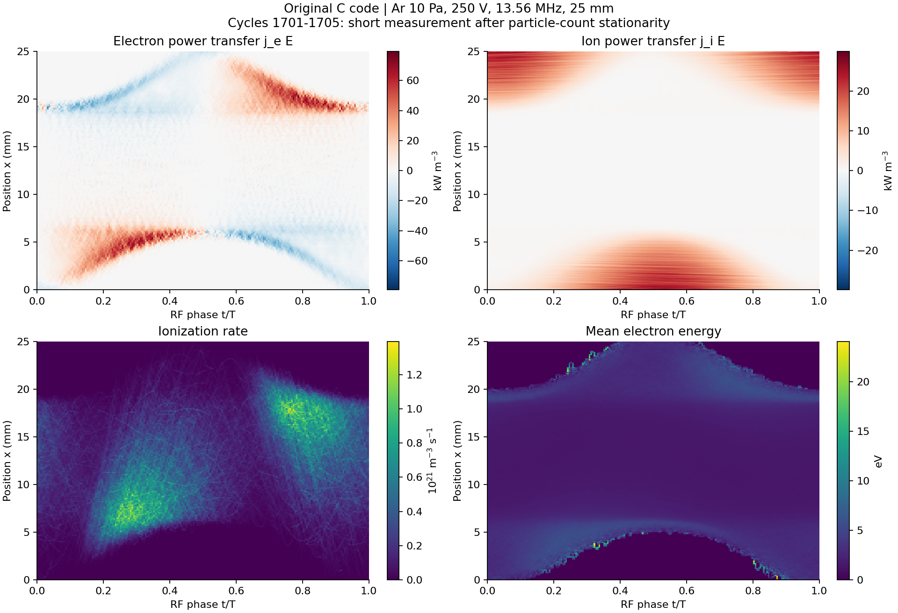
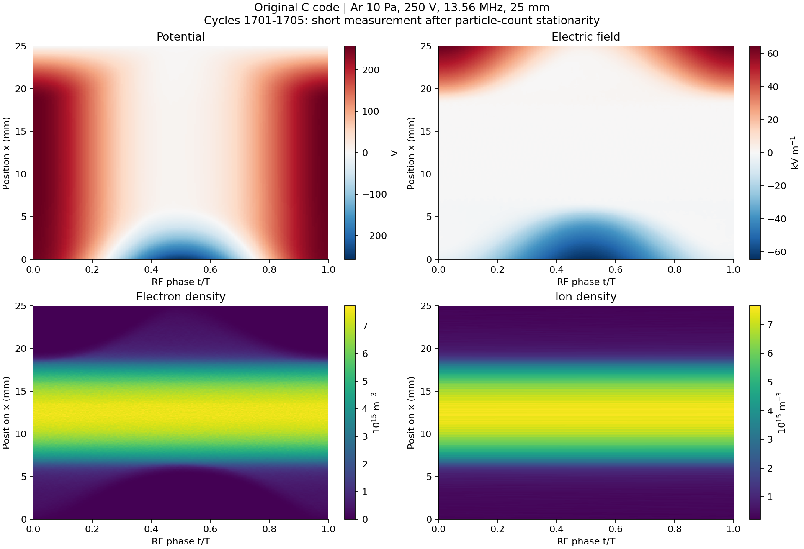
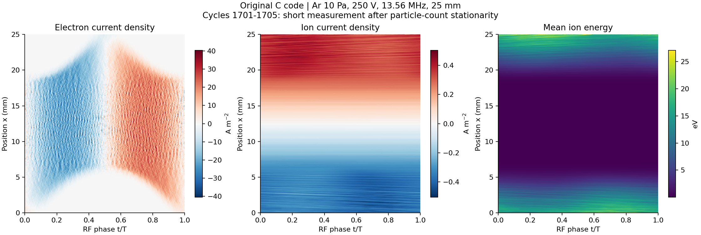
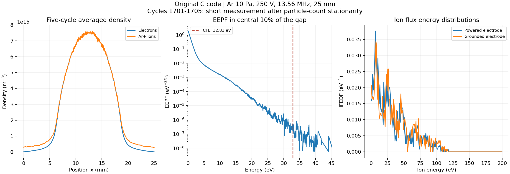

# 2026-11-18: 수렴 확인 후 5 RF주기 측정

**1,700주기 체크포인트에서 새로 측정한 1,701–1,705주기입니다. 이 5주기 실행은 완료됐습니다.**
중단 직전 2,470주기대의 복원 데이터나 1,000주기 장시간 측정 결과가 아닙니다.
원본 C 코드와 기본 물리 조건을 그대로 사용했습니다. 날짜는 새 측정 실행일(한국 시각)입니다.

| 항목 | 값 |
|---|---|
| 조건 | Ar 10 Pa, 350 K, 전압 진폭 250 V, 13.56 MHz, 전극 간격 25 mm |
| 계산 시간 | 83.0초 |
| 중심 부근 전자 밀도 | 7.4887e+15 m⁻³ |
| 평균 전자 / 이온 전력밀도 | 1.566 / 3.264 kW/m³ |
| 원본 코드의 안정성 검사 | 4개 기준 통과 |

## 다운로드와 보고서

- [전체 ZIP 다운로드](https://github.com/YGLSNU/eduPIC_PAL_RF-sheath/raw/refs/heads/results/75mTorr/results/261118_measure5/261118_measure5_full.zip): 원본 DAT, 입력/출력 체크포인트, 소스, 로그까지 포함 (24.98 MB).
- [요약 ZIP 다운로드](https://github.com/YGLSNU/eduPIC_PAL_RF-sheath/raw/refs/heads/results/75mTorr/results/261118_measure5/261118_measure5_summary.zip): 보고서, 그림, PDF, 모든 변환 CSV (7.17 MB).
- [보고서 읽기](261118_measure5_report.md) / [전체 그림 PDF](261118_measure5_all_plots.pdf) / [CSV 폴더](csv).
- [전체 ZIP 파일 페이지](261118_measure5_full.zip) / [요약 ZIP 파일 페이지](261118_measure5_summary.zip): 직접 링크가 열리지 않으면 Download raw를 선택하세요.

## Heating과 이온화

각 맵은 5주기를 같은 RF 위상에 모아 집계한 결과입니다. 가로축 t/T, 세로축 전극 사이 위치입니다.
x=0이 전원 전극, x=25 mm가 접지 전극입니다. 양의 jE는 전기장에서 입자로의 전력 전달을 뜻합니다.
Ohmic/sheath heating의 성분별 분해나 전자 온도 상승률은 아닙니다.

## 전위·전기장·밀도

## 전류와 이온 에너지

## 시간평균 밀도와 에너지 분포

5주기는 짧은 통계 표본이므로 세부 분포와 전극별 차이에는 통계 변동이 남습니다.
자세한 파일별 의미, 검증 결과와 실행 범위는 보고서를 참고하세요.
