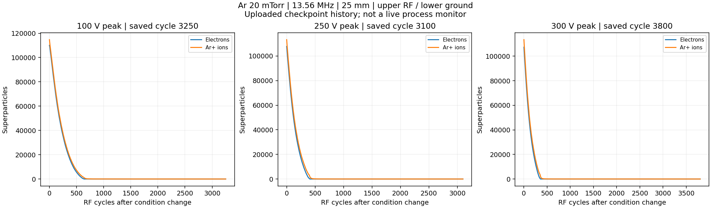
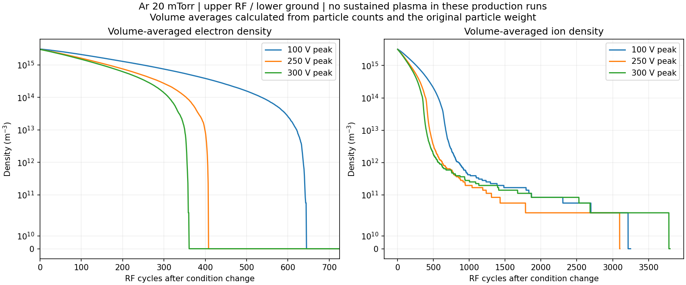

# 2026-11-19: Ar 20 mTorr, 상부 RF 전극 전압 비교

**계산 완료: 100·250·300 V 세 조건 모두 현재 모델에서 방전이 유지되지 않고 입자가 소멸했습니다. 정상 방전의 통계 수렴으로 판정하지 않았습니다.**

- [전체 결과 ZIP 바로 다운로드](https://github.com/YGLSNU/eduPIC_PAL_RF-sheath/raw/refs/heads/results/20mTorr-topRF/results/261119_gap25_V100-300/261119_gap25_V100-300_all_results.zip)
- [조건별 소멸 시점 CSV](261119_gap25_V100-300_extinction_summary.csv)
- [300 V 계산 입자 수 10배 검증](validation/README.md)

ZIP에는 비교 그래프, 조건별 보고서·CSV·PDF, 수정 소스, 초기 상태, 소멸 전·후 재시작 파일과 보조 검증을 포함합니다.
최종 빈 상태에서는 정상 방전 heating·EEPF·IFEDF 측정값이 없습니다.

공통 조건: **20 mTorr**, Ar 350 K, 13.56 MHz, 전극 간격 25 mm.
상부 x=25 mm에 정현파 전압을 인가하고 하부 x=0 mm를 접지했습니다. 표의 전압은 RMS가 아닌 최대 진폭입니다.

마지막 업로드: 2026-11-19T13:35:12.361322+09:00. 이 페이지는 저장된 상태이며 실시간 실행 상태가 아닙니다.

| 전압 | 상태 | 새 조건 누적 RF 주기 | 현재 측정 주기 | 결과와 다운로드 |
|---|---|---:|---:|---|
| 100 V peak | 입자 소멸·종료 | 3,250 | 0 | [결과·그림](100V/README.md) · [재시작 ZIP](https://github.com/YGLSNU/eduPIC_PAL_RF-sheath/raw/refs/heads/results/20mTorr-topRF/results/261119_gap25_V100-300/100V/261119_gap25_100V_restart.zip) · [소멸 전 상태](https://github.com/YGLSNU/eduPIC_PAL_RF-sheath/raw/refs/heads/results/20mTorr-topRF/results/261119_gap25_V100-300/100V/261119_gap25_100V_before_extinction_restart.zip) |
| 250 V peak | 입자 소멸·종료 | 3,100 | 0 | [결과·그림](250V/README.md) · [재시작 ZIP](https://github.com/YGLSNU/eduPIC_PAL_RF-sheath/raw/refs/heads/results/20mTorr-topRF/results/261119_gap25_V100-300/250V/261119_gap25_250V_restart.zip) · [소멸 전 상태](https://github.com/YGLSNU/eduPIC_PAL_RF-sheath/raw/refs/heads/results/20mTorr-topRF/results/261119_gap25_V100-300/250V/261119_gap25_250V_before_extinction_restart.zip) |
| 300 V peak | 입자 소멸·종료 | 3,800 | 0 | [결과·그림](300V/README.md) · [재시작 ZIP](https://github.com/YGLSNU/eduPIC_PAL_RF-sheath/raw/refs/heads/results/20mTorr-topRF/results/261119_gap25_V100-300/300V/261119_gap25_300V_restart.zip) · [소멸 전 상태](https://github.com/YGLSNU/eduPIC_PAL_RF-sheath/raw/refs/heads/results/20mTorr-topRF/results/261119_gap25_V100-300/300V/261119_gap25_300V_before_extinction_restart.zip) |

## 수렴·중단 기준

최근 600주기 입자 수를 200주기씩 나눈 세 평균의 범위가 1% 미만이고 선형 변화가 2% 미만이면 측정을 시작합니다.
20주기 단위로 측정하고 최소 100주기부터 검사하며, 다음 기준을 두 번 연속 만족하면 종료합니다.

- 전자·이온 평균/중심 밀도, 평균 전력, 밀도 공간분포: 불확실성 지표와 전후반 변화 각각 3% 이내.
- 전자·이온 heating: 40×40으로 평균한 맵의 전체 L2 기준 5% 이내.
- 최근 600주기 입자 수 안정성 기준도 계속 만족해야 합니다.

기존 실행과 같은 Student-t 블록 통계와 양의 시간상관 보정을 사용하며, 충분한 블록이 쌓이면 40주기 재집계도 확인합니다.
이 기준은 탐색적 통계 안정성 기준으로 전체 물리·수치 오차를 보장하지 않습니다. 상한이나 오류로 멈춘 경우 수렴으로 표시하지 않습니다.

## 계산과 재현

기존 수렴 입자 분포를 x→L−x, vx→−vx로 반전한 뒤 새 조건의 초기값으로 사용했습니다.
새 조건 적용 시 RF 주기 번호는 0부터 다시 세었고, 모든 초기 과도구간은 최종 평균에서 제외합니다.
압력은 입력·파일명·보고서에서 mTorr로 표시하며, 중성기체 밀도 계산에서만 SI로 변환합니다.
원본 격자 400점, RF 주기당 4000 시간 간격, 입자 가중치 70000 및 충돌·표면 물리는 유지했습니다.
모든 조건은 클라우드 작업 환경에서 계산되며 GitHub에는 코드·로그·결과·재시작 파일을 보관합니다.

원본 코드의 위상 평균 jE 진단을 유지했습니다. 측정 VI 입력, self-bias 회로, 형상 비대칭 등은 이번 변경에 포함하지 않습니다.

## 최종 조건별 비교

세 조건 모두 정상 방전의 통계 수렴 기준에 도달하기 전에 전자 입자가 소멸했습니다.
이후 남은 이온이 모두 빠져나간 빈 상태까지 계산하고 종료했습니다.
따라서 정상상태 heating·EEPF·IFEDF 측정값은 없습니다. 최종 빈 상태의 밀도와 입자 jE는 0입니다.

| 전압 V peak | 전자 수가 0이 된 주기 | 이온 수가 0이 된 주기 | 마지막 저장 주기 | 조건별 계산 시간 분 |
|---:|---:|---:|---:|---:|
| 100 | 645 | 3216 | 3250 | 35.69 |
| 250 | 408 | 3098 | 3100 | 24.13 |
| 300 | 361 | 3785 | 3800 | 22.01 |

[비교표 CSV 다운로드](261119_gap25_V100-300_extinction_summary.csv)

아래 그림의 밀도는 입자 수 × 입자 가중치 ÷ 계산 영역 부피로 구한 공간평균 밀도입니다.
입자 수가 적은 구간에서는 한 계산 입자 단위의 계단 변화가 나타납니다.

## 소멸 결과의 추가 확인

[300 V 계산 입자 수 10배 검증](validation/README.md): 동일한 초기 실제 밀도에서 가중치를 1/10로 줄인 계산도 전자 소멸을 보였습니다. 원래 계산은 361주기, 보조 계산은 345주기에 전자가 0이 되었습니다.
