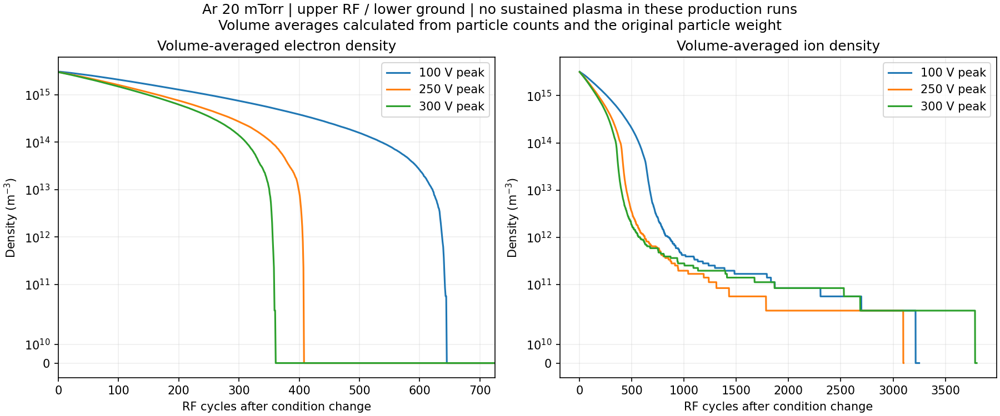

# 261119_gap25_V100-300 · gap25 mm 전압 비교

[전체 실행 목록](https://github.com/YGLSNU/eduPIC_PAL_RF-sheath) · [이 조건군](https://github.com/YGLSNU/eduPIC_PAL_RF-sheath/tree/results/20mTorr-topRF)

**전자 소멸** · 실행일 2026-11-19 (한국 시각) · 변경 조건: **gap25 mm · 100/250/300 V** · 보고서 갱신 2026-11-22

세 조건 모두 정상 방전 측정에 들어가기 전에 전자가 소멸했습니다. 소멸 과정과 재시작 상태를 보관합니다.

## 실행 조건

| 항목 | 값 |
|---|---|
| 기체 / 압력 / 온도 | Ar / 20 mTorr / 350 K |
| 인가 파형 / 주파수 | 정현파 / 13.56 MHz |
| 전압 / gap | 100, 250, 300 V peak / 25 mm |
| 전극 연결 | 상부 x=L RF / 하부 x=0 접지 |
| 면적 / 형상 | 1D3V 동일 면적 평판, 환산 면적 1 cm²; 실제 지름·측벽 제외 |
| 표면 / 충돌 모델 | 흡수 경계, SEE·전자 반사 없음; ground-state Ar MCC |
| 격자 / 시간간격 / 입자 가중치 | 400점 / RF당 4000 전자 step / 70000 |
| 코드 | 상부 RF로 수정한 C/eduPIC.cc 계열, C++11 컴파일 |
| 소스 이력 | 실행별 source ZIP·소스 SHA256 기록 참조 |
| 초기·재시작 상태 | 기존 수렴 입자 분포를 반전한 공통 상태; 변경 조건의 과도구간은 측정에서 제외 |
| 측정 구간 | 정상 방전의 최종 측정 0 RF. 전자 소멸 뒤 남은 이온이 빠져나간 구간까지 기록. |

상태와 그래프는 마지막 저장 자료이며 실시간 CPU 실행 화면은 아닙니다.

## 조건별 결과

| V peak | 상태 | 종료 RF | 측정 RF | 평균 전자 밀도 m⁻³ | 보고서 |
|---:|---|---:|---:|---:|---|
| 100 | 전자 소멸 | 3250 | 0 | — | [그림·다운로드](100V/README.md) |
| 250 | 전자 소멸 | 3100 | 0 | — | [그림·다운로드](250V/README.md) |
| 300 | 전자 소멸 | 3800 | 0 | — | [그림·다운로드](300V/README.md) |

## 자료 범위

| 진단 | 저장·해석 범위 |
|---|---|
| 수렴·입자 수지 | 전 구간 입자 수와 전자·이온 소멸 시점 |
| 밀도 공간분포 | 입자 수에서 환산한 체적평균 밀도의 시간 이력 |
| RF heating | 저장 자료 없음 |
| 전위·전기장 | 저장 자료 없음 |
| 평균 에너지·이온화 | 저장 자료 없음 |
| 에너지 분포 | 저장 자료 없음 |
| 전극 flux·손실 | 저장 자료 없음 |
| 전력 전달·손실 | 저장 자료 없음 |

## 수렴·입자 수지

조건별 공간평균 밀도 감쇠·소멸; 정상 방전의 평균 밀도 비교가 아님

## 밀도 공간분포

정상 방전의 공간분포와 heating·에너지 분포는 없습니다.

## 읽는 기준

- 위상 그림의 가로축은 RF 위상 t/T, 세로축은 위치 x입니다. 전극 방향은 위 조건표를 따릅니다. 위상 0은 cos 인가 전압의 양의 최댓값입니다.
- Heating은 위상 평균 j × 위상 평균 E입니다. 양수는 전기장에서 입자로, 음수는 반대 방향의 전달입니다. 순간 jE의 평균·온도 상승률과 구분합니다.
- 통계 중단 기준은 전체 물리·격자 오차나 모든 픽셀의 오차를 보증하지 않습니다. 소멸·미완료·짧은 진단을 정상 방전 측정과 구분합니다.
- 전력 표시는 W/m² 또는 W/m³입니다. 실제 전극 면적·회로 없이 발생기 총 W와 동일시하지 않습니다.

## 파일과 재시작

| 자료 | 다운로드 | 크기 |
|---|---|---:|
| 전체 결과 | [261119_gap25_V100-300_all_results.zip](https://github.com/YGLSNU/eduPIC_PAL_RF-sheath/raw/refs/heads/results/20mTorr-topRF/results/261119_gap25_V100-300/261119_gap25_V100-300_all_results.zip) | 9.73 MiB |
| 조건 비교 | [261119_gap25_V100-300_comparison.csv](261119_gap25_V100-300_comparison.csv) | 0.00 MiB |
| extinction summary | [261119_gap25_V100-300_extinction_summary.csv](261119_gap25_V100-300_extinction_summary.csv) | 0.00 MiB |
| 공통 초기 상태 | [261119_gap25_V100-300_initial_state.zip](https://github.com/YGLSNU/eduPIC_PAL_RF-sheath/raw/refs/heads/results/20mTorr-topRF/results/261119_gap25_V100-300/261119_gap25_V100-300_initial_state.zip) | 6.51 MiB |

[전체 파일 목록·SHA256](files.json)

[기존 상세 기록](DETAILS.md)
