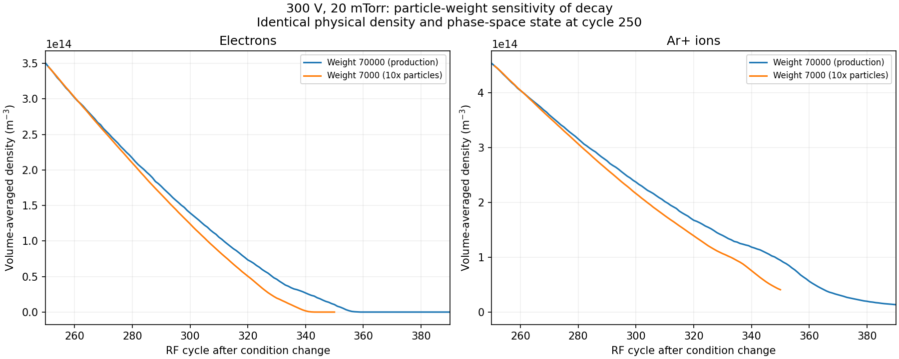

# 계산 입자 수 민감도 확인: 300 V

물리 조건은 20 mTorr, 300 V peak로 유지했습니다. 원래 계산의 250주기 입자 상태에서 각 계산 입자를 10개로 복제하고 가중치를 70000에서 7000으로 줄였습니다.
입자의 위치·속도와 초기 실제 밀도·전하·RF 위상이 보존되는 것을 확인했습니다.

| 항목 | 원래 계산 | 계산 입자 10배 |
|---|---:|---:|
| 입자 가중치 | 70000 | 7000 |
| 전자 수가 처음 0이 된 RF 주기 | 361 | 345 |

두 계산 모두 전자가 소멸했습니다. 소멸 시점은 달라지므로, 이것을 수치 오차 전체가 검증되었다는 뜻이나 실제 실험의 방전 유지 한계로 해석하지 않습니다.
보조 계산은 전자 수가 0인 350주기에 종료했고, 남은 이온의 완전 소멸까지 진행하지 않았습니다.

[검증 원본·소스·입력/종료 체크포인트 ZIP](300V_weight7000_verification.zip)
