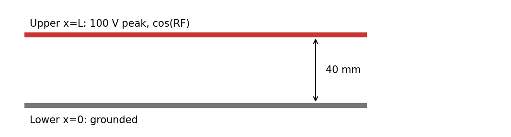
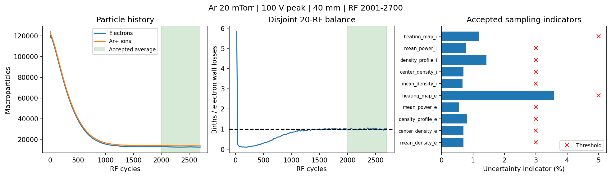
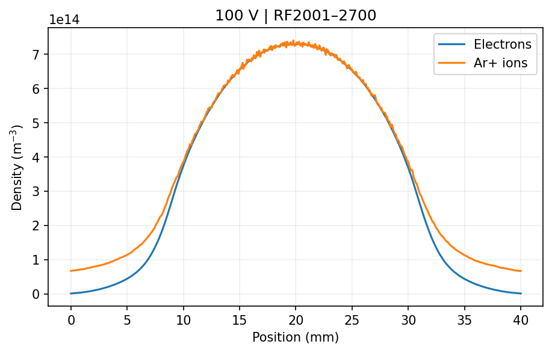
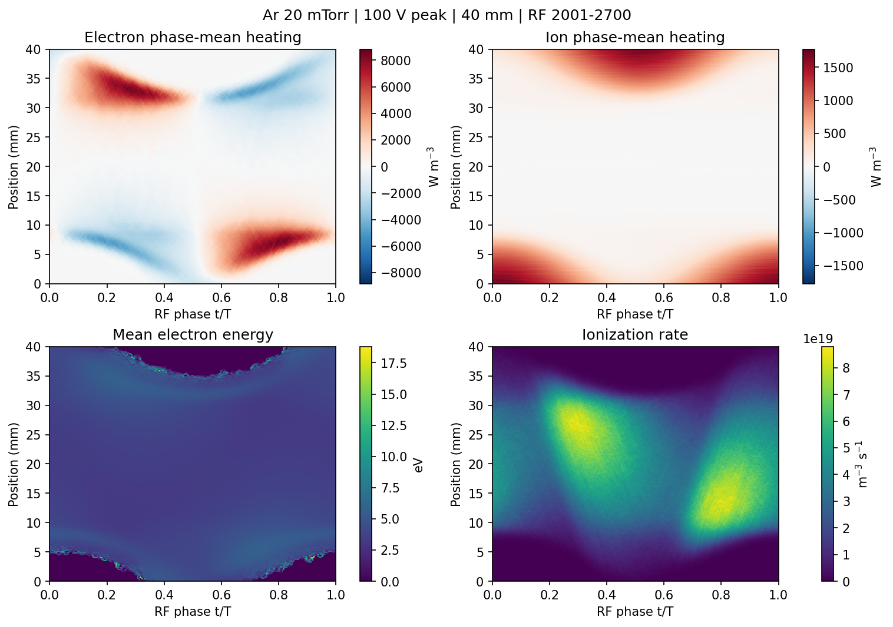
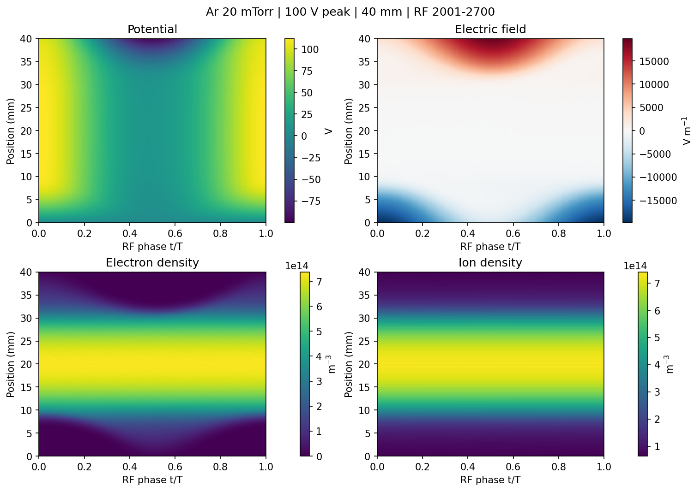
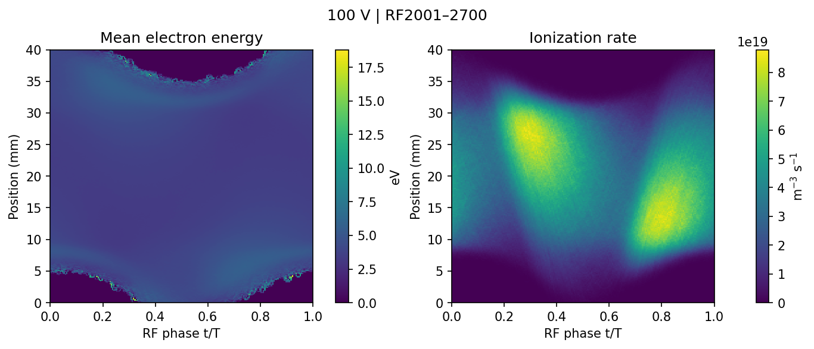
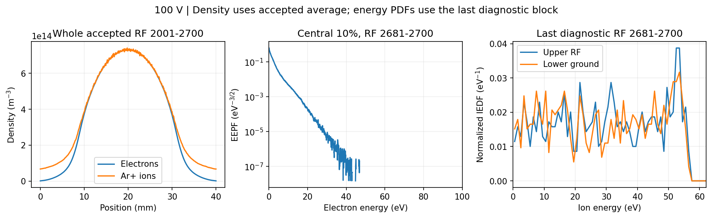
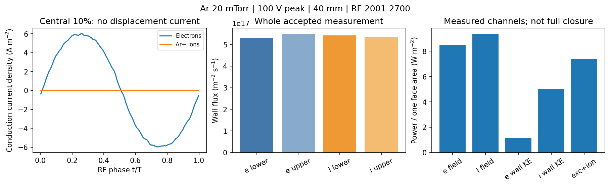
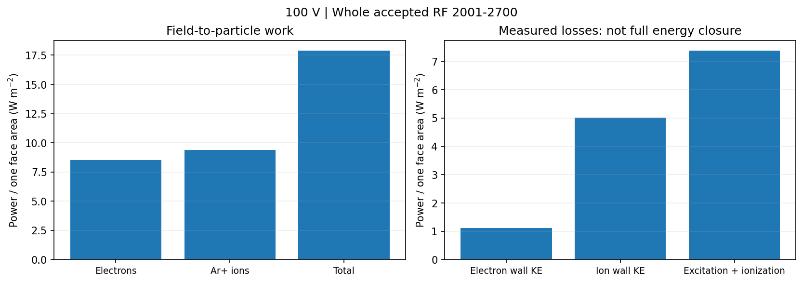

# 261120_gap40_V100-500 · 100 V · gap40 mm

[전체 실행 목록](https://github.com/YGLSNU/eduPIC_PAL_RF-sheath) · [이 조건군](https://github.com/YGLSNU/eduPIC_PAL_RF-sheath/tree/results/20mTorr-topRF) · [실행 비교](https://github.com/YGLSNU/eduPIC_PAL_RF-sheath/blob/results/20mTorr-topRF/results/261120_gap40_V100-500/README.md)

**통계 기준 충족** · 실행일 2026-11-20 (한국 시각) · 변경 조건: **gap40 mm · 100 V** · 보고서 갱신 2026-11-22

600 RF 입자 수 안정성과 밀도·평균량3%, heating5%의 통계 지표를 연속 두 번 충족한 뒤 종료했습니다.

## 실행 조건

| 항목 | 값 |
|---|---|
| 기체 / 압력 / 온도 | Ar / 20 mTorr / 350 K |
| 인가 파형 / 주파수 | 정현파 / 13.56 MHz |
| 전압 / gap | 100 V peak / 40 mm |
| 전극 연결 | 상부 x=L RF / 하부 x=0 접지 |
| 면적 / 형상 | 1D3V 동일 면적 평판, 환산 면적 1 cm²; 실제 지름·측벽 제외 |
| 표면 / 충돌 모델 | 흡수 경계, SEE·전자 반사 없음; ground-state Ar MCC |
| 격자 / 시간간격 / 입자 가중치 | 640점 / RF당 4000 전자 step / 112000 |
| 코드 | 상부 RF로 수정한 C/eduPIC.cc 계열, C++11 컴파일 |
| 소스 이력 | source ZIP의 source-eduPIC.cc SHA256 bd1d85cdbfd875c5bfd5df29ccefcd24da03b8776bdccde1148588453cc1586c |
| 초기·재시작 상태 | 25mm 공통 조밀 입자 상태의 x×1.6, 가중치70000→112000으로 물리 밀도·속도분포 보존; 과도구간 제외 |
| 측정 구간 | RF2001–2700 (700 RF); EEPF·IEDF만 마지막 진단 RF2681–2700 |

상태와 그래프는 마지막 저장 자료이며 실시간 CPU 실행 화면은 아닙니다.

## 핵심 수치

| 물리량 | 값 |
|---|---|
| 공간·시간 평균 전자 밀도 | 3.5523e+14 m⁻³ |
| 공간·시간 평균 이온 밀도 | 3.8690e+14 m⁻³ |
| 생성/전자 벽 손실 | 0.99481 |
| 종료 / 측정 RF | 2700 / 700 |

## 자료 범위

| 진단 | 저장·해석 범위 |
|---|---|
| 수렴·입자 수지 | 전 구간 입자 수·생성/손실·최종 통계 지표 |
| 밀도 공간분포 | RF2001–2700 (700 RF) |
| RF heating | RF2001–2700 (700 RF) |
| 전위·전기장 | RF2001–2700 (700 RF) |
| 평균 에너지·이온화 | RF2001–2700 (700 RF) |
| 에너지 분포 | 밀도:RF2001–2700 (700 RF); EEPF·IEDF:RF2681–2700 |
| 전극 flux·손실 | RF2001–2700 (700 RF) |
| 전력 전달·손실 | RF2001–2700 (700 RF) |

## 수렴·입자 수지

녹색 구간이 최종 평균 구간입니다. 통계 지표는 총 오차를 뜻하지 않습니다.

## 밀도 공간분포

전체 측정 구간의 평균 전자·이온 밀도

## RF heating

각 조건의 상세 그림은 자체 색상 범위입니다. 전압 간 공통 범위 비교는 상위 비교 페이지를 사용하세요.

전자·이온의 위상 평균 j×E, 평균 전자 에너지, 이온화율

## 전위·전기장

x=0 하부 접지, x=40mm 상부 RF; 위상0은 인가 전압 양의 최댓값

## 평균 에너지·이온화

전체 측정 구간의 평균 전자 에너지·이온화율

## 에너지 분포

EEPF의 전체 측정 사건 수가 보존되지 않아 정규화된 블록을 임의로 합치지 않았습니다. 마지막20RF 분포를 명확히 구분해 제공합니다.

전체 측정 평균 밀도와 마지막 진단의 EEPF·IEDF

## 전극 flux·손실

양 전극의 flux는 전체 측정 사건 수로 계산했습니다. 평균 이온 입사 에너지는 마지막 진단에서 상부29.85eV, 하부29.08eV입니다.

중앙부 전도전류밀도·전극 입자 flux·측정된 전력 채널

## 전력 전달·손실

field-work는 이산 입자 속도 갱신의 일이며, 벽 항은 운동에너지 유출입니다. 미계측 기체 전달·저장 항이 있어 완전한 전력 폐합이나 전체 벽 열부하를 뜻하지 않습니다.

전체 측정 구간의 측정된 전력 채널

## 읽는 기준

- 위상 그림의 가로축은 RF 위상 t/T, 세로축은 위치 x입니다. 전극 방향은 위 조건표를 따릅니다. 위상 0은 cos 인가 전압의 양의 최댓값입니다.
- Heating은 위상 평균 j × 위상 평균 E입니다. 양수는 전기장에서 입자로, 음수는 반대 방향의 전달입니다. 순간 jE의 평균·온도 상승률과 구분합니다.
- 통계 중단 기준은 전체 물리·격자 오차나 모든 픽셀의 오차를 보증하지 않습니다. 소멸·미완료·짧은 진단을 정상 방전 측정과 구분합니다.
- 전력 표시는 W/m² 또는 W/m³입니다. 실제 전극 면적·회로 없이 발생기 총 W와 동일시하지 않습니다.

## 파일과 재시작

| 자료 | 다운로드 | 크기 |
|---|---|---:|
| 261120 gap40 100V core | [261120_gap40_100V_core.zip](https://github.com/YGLSNU/eduPIC_PAL_RF-sheath/raw/refs/heads/results/20mTorr-topRF/results/261120_gap40_V100-500/100V/261120_gap40_100V_core.zip) | 23.78 MiB |
| 261120 gap40 100V measurements part01 | [261120_gap40_100V_measurements_part01.zip](https://github.com/YGLSNU/eduPIC_PAL_RF-sheath/raw/refs/heads/results/20mTorr-topRF/results/261120_gap40_V100-500/100V/261120_gap40_100V_measurements_part01.zip) | 21.08 MiB |
| 261120 gap40 100V measurements part02 | [261120_gap40_100V_measurements_part02.zip](https://github.com/YGLSNU/eduPIC_PAL_RF-sheath/raw/refs/heads/results/20mTorr-topRF/results/261120_gap40_V100-500/100V/261120_gap40_100V_measurements_part02.zip) | 21.12 MiB |
| 261120 gap40 100V measurements part03 | [261120_gap40_100V_measurements_part03.zip](https://github.com/YGLSNU/eduPIC_PAL_RF-sheath/raw/refs/heads/results/20mTorr-topRF/results/261120_gap40_V100-500/100V/261120_gap40_100V_measurements_part03.zip) | 21.10 MiB |
| 261120 gap40 100V measurements part04 | [261120_gap40_100V_measurements_part04.zip](https://github.com/YGLSNU/eduPIC_PAL_RF-sheath/raw/refs/heads/results/20mTorr-topRF/results/261120_gap40_V100-500/100V/261120_gap40_100V_measurements_part04.zip) | 21.19 MiB |
| 261120 gap40 100V measurements part05 | [261120_gap40_100V_measurements_part05.zip](https://github.com/YGLSNU/eduPIC_PAL_RF-sheath/raw/refs/heads/results/20mTorr-topRF/results/261120_gap40_V100-500/100V/261120_gap40_100V_measurements_part05.zip) | 21.18 MiB |
| 261120 gap40 100V measurements part06 | [261120_gap40_100V_measurements_part06.zip](https://github.com/YGLSNU/eduPIC_PAL_RF-sheath/raw/refs/heads/results/20mTorr-topRF/results/261120_gap40_V100-500/100V/261120_gap40_100V_measurements_part06.zip) | 21.19 MiB |
| 261120 gap40 100V measurements part07 | [261120_gap40_100V_measurements_part07.zip](https://github.com/YGLSNU/eduPIC_PAL_RF-sheath/raw/refs/heads/results/20mTorr-topRF/results/261120_gap40_V100-500/100V/261120_gap40_100V_measurements_part07.zip) | 21.20 MiB |
| 261120 gap40 100V measurements part08 | [261120_gap40_100V_measurements_part08.zip](https://github.com/YGLSNU/eduPIC_PAL_RF-sheath/raw/refs/heads/results/20mTorr-topRF/results/261120_gap40_V100-500/100V/261120_gap40_100V_measurements_part08.zip) | 21.16 MiB |
| 261120 gap40 100V measurements part09 | [261120_gap40_100V_measurements_part09.zip](https://github.com/YGLSNU/eduPIC_PAL_RF-sheath/raw/refs/heads/results/20mTorr-topRF/results/261120_gap40_V100-500/100V/261120_gap40_100V_measurements_part09.zip) | 20.09 MiB |
| 평균 밀도·heating 공간분포 | [profiles.csv](data/profiles.csv) | 0.07 MiB |
| 마지막20RF 중앙 EEPF | [eepf_last_block.csv](data/eepf_last_block.csv) | 0.03 MiB |
| 마지막20RF 양 전극 IEDF | [ifed_last_block.csv](data/ifed_last_block.csv) | 0.01 MiB |
| 전체 측정 전극 flux | [wall_flux.csv](data/wall_flux.csv) | 0.00 MiB |
| 전체 측정 전력 채널 | [power_channels.csv](data/power_channels.csv) | 0.00 MiB |
| 중단 통계 지표 | [sampling_indicators.csv](data/sampling_indicators.csv) | 0.00 MiB |
| 진단 수치·검증 기록 | [diagnostics.json](data/diagnostics.json) | 0.00 MiB |

[전체 파일 목록·SHA256](files.json)
