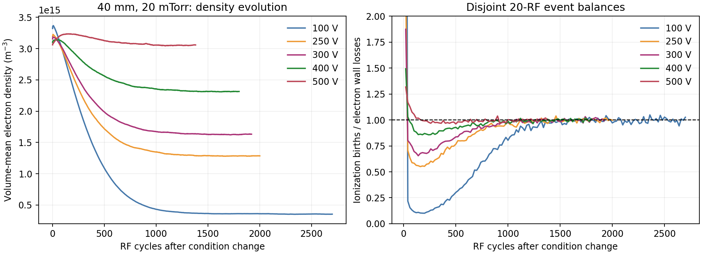
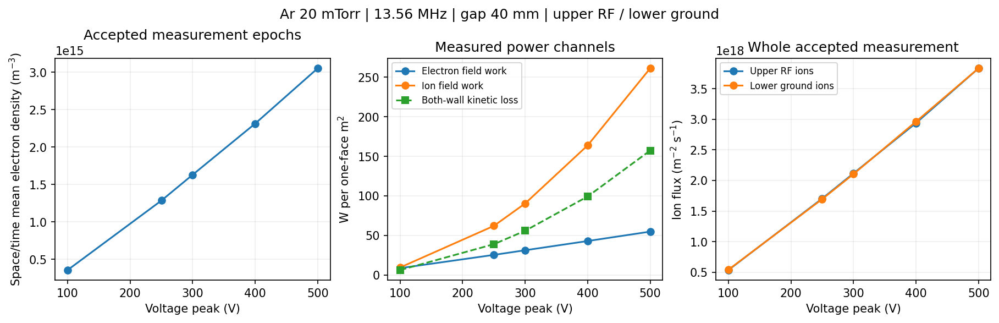
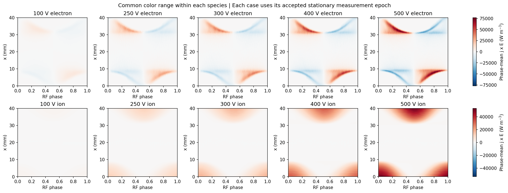

# 261120_gap40_V100-500 · gap40 mm 전압 비교

[전체 실행 목록](https://github.com/YGLSNU/eduPIC_PAL_RF-sheath) · [이 조건군](https://github.com/YGLSNU/eduPIC_PAL_RF-sheath/tree/results/20mTorr-topRF)

**통계 기준 충족** · 실행일 2026-11-20 (한국 시각) · 변경 조건: **gap40 mm · 100/250/300/400/500 V** · 보고서 갱신 2026-11-22

다섯 조건 모두 전자 소멸 없이 정한 통계 중단 기준을 충족했습니다. 기존 조밀 입자 상태를 이용한 방전 유지 시험이며 점화 전압 시험과 구분합니다.

## 실행 조건

| 항목 | 값 |
|---|---|
| 기체 / 압력 / 온도 | Ar / 20 mTorr / 350 K |
| 인가 파형 / 주파수 | 정현파 / 13.56 MHz |
| 전압 / gap | 100, 250, 300, 400, 500 V peak / 40 mm |
| 전극 연결 | 상부 x=L RF / 하부 x=0 접지 |
| 면적 / 형상 | 1D3V 동일 면적 평판, 환산 면적 1 cm²; 실제 지름·측벽 제외 |
| 표면 / 충돌 모델 | 흡수 경계, SEE·전자 반사 없음; ground-state Ar MCC |
| 격자 / 시간간격 / 입자 가중치 | 640점 / RF당 4000 전자 step / 112000 |
| 코드 | 상부 RF로 수정한 C/eduPIC.cc 계열, C++11 컴파일 |
| 소스 이력 | 실행 source ZIP·config의 SHA256 및 샘플러 검증 기록 참조 |
| 초기·재시작 상태 | 기존25mm 상태를40mm로 변환하면서 물리 밀도와 속도 분포 보존; 과도구간 제외 |
| 측정 구간 | 전압별140/120/180/700 등 상이함; 아래 표와 개별 보고서의 정확한 RF 구간 참조 |

상태와 그래프는 마지막 저장 자료이며 실시간 CPU 실행 화면은 아닙니다.

## 조건별 결과

| V peak | 상태 | 종료 RF | 측정 RF | 평균 전자 밀도 m⁻³ | 보고서 |
|---:|---|---:|---:|---:|---|
| 100 | 통계 기준 충족 | 2700 | 700 | 3.552e+14 | [그림·다운로드](100V/README.md) |
| 250 | 통계 기준 충족 | 2001 | 180 | 1.284e+15 | [그림·다운로드](250V/README.md) |
| 300 | 통계 기준 충족 | 1921 | 140 | 1.630e+15 | [그림·다운로드](300V/README.md) |
| 400 | 통계 기준 충족 | 1801 | 140 | 2.314e+15 | [그림·다운로드](400V/README.md) |
| 500 | 통계 기준 충족 | 1381 | 120 | 3.053e+15 | [그림·다운로드](500V/README.md) |

## 자료 범위

| 진단 | 저장·해석 범위 |
|---|---|
| 수렴·입자 수지 | 전압별 종료·안정성·측정 구간 |
| 밀도 공간분포 | 각 조건의 최종 측정 평균 |
| RF heating | 각 조건의 최종 측정 평균 |
| 전위·전기장 | 100/250/300/400/500V 상세 보고서 |
| 평균 에너지·이온화 | 각 조건의 상세 보고서 |
| 에너지 분포 | 마지막20RF 분포를 상세 보고서에 별도 표시 |
| 전극 flux·손실 | 전체 측정 사건 수로 계산한 상·하부 flux |
| 전력 전달·손실 | field-work·벽 운동에너지·측정된 충돌 문턱 채널; W/m² |

## 수렴·입자 수지

전체 과도구간을 포함한 밀도·생성/손실 이력

## 밀도 공간분포

밀도·측정된 전력 채널·양 전극 이온 flux의 전압 의존성

## RF heating

종별로 공통 색상 범위를 사용한 비교. 개별 조건의 세부 구조는 상세 보고서에서 확인하세요.

## 전위·전기장

## 평균 에너지·이온화

## 에너지 분포

## 전극 flux·손실

## 전력 전달·손실

## 읽는 기준

- 위상 그림의 가로축은 RF 위상 t/T, 세로축은 위치 x입니다. 전극 방향은 위 조건표를 따릅니다. 위상 0은 cos 인가 전압의 양의 최댓값입니다.
- Heating은 위상 평균 j × 위상 평균 E입니다. 양수는 전기장에서 입자로, 음수는 반대 방향의 전달입니다. 순간 jE의 평균·온도 상승률과 구분합니다.
- 통계 중단 기준은 전체 물리·격자 오차나 모든 픽셀의 오차를 보증하지 않습니다. 소멸·미완료·짧은 진단을 정상 방전 측정과 구분합니다.
- 전력 표시는 W/m² 또는 W/m³입니다. 실제 전극 면적·회로 없이 발생기 총 W와 동일시하지 않습니다.

## 파일과 재시작

| 자료 | 다운로드 | 크기 |
|---|---|---:|
| 조건 비교 | [261120_gap40_V100-500_comparison.pdf](https://github.com/YGLSNU/eduPIC_PAL_RF-sheath/raw/refs/heads/results/20mTorr-topRF/results/261120_gap40_V100-500/261120_gap40_V100-500_comparison.pdf) | 0.03 MiB |
| 진행 중 시점의 백업 (최종 결과와 구분) | [261120_gap40_V100-500_running_checkpoint.zip](https://github.com/YGLSNU/eduPIC_PAL_RF-sheath/raw/refs/heads/results/20mTorr-topRF/results/261120_gap40_V100-500/261120_gap40_V100-500_running_checkpoint.zip) | 51.06 MiB |
| 실행 소스·공통 초기 상태 | [261120_gap40_V100-500_source_and_initial_state.zip](https://github.com/YGLSNU/eduPIC_PAL_RF-sheath/raw/refs/heads/results/20mTorr-topRF/results/261120_gap40_V100-500/261120_gap40_V100-500_source_and_initial_state.zip) | 6.57 MiB |
| 보고서·그림·수치 요약 | [261120_gap40_V100-500_summary.csv](261120_gap40_V100-500_summary.csv) | 0.00 MiB |

[전체 파일 목록·SHA256](files.json)

[기존 상세 기록](DETAILS.md)
