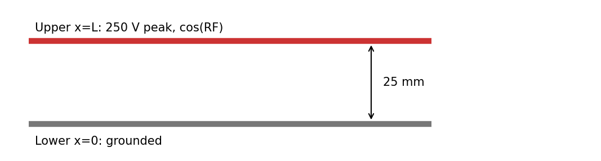
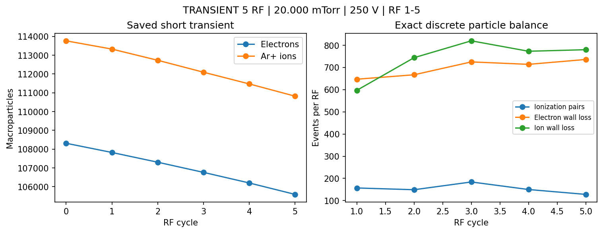
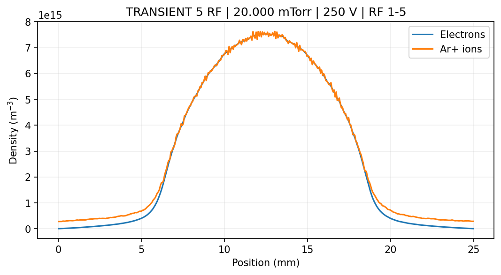
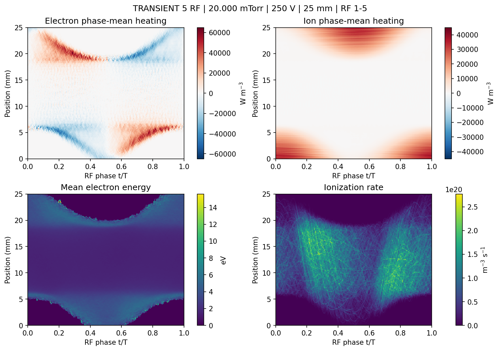
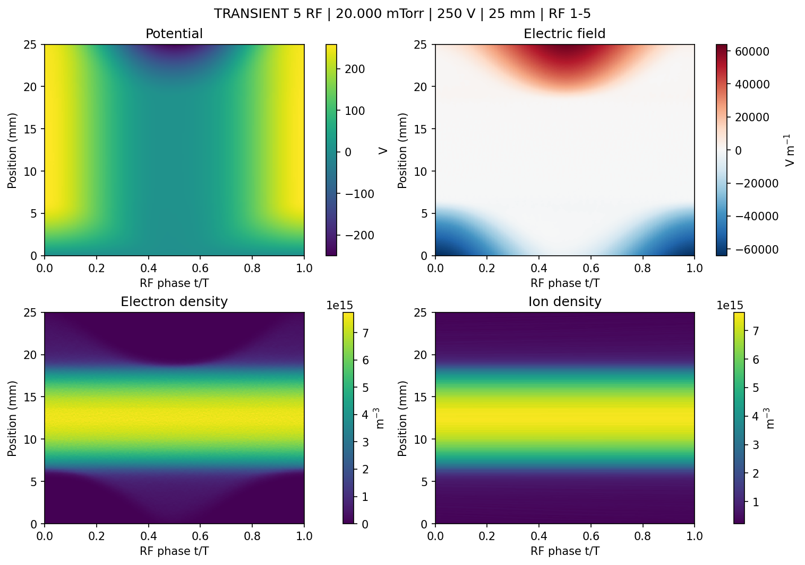
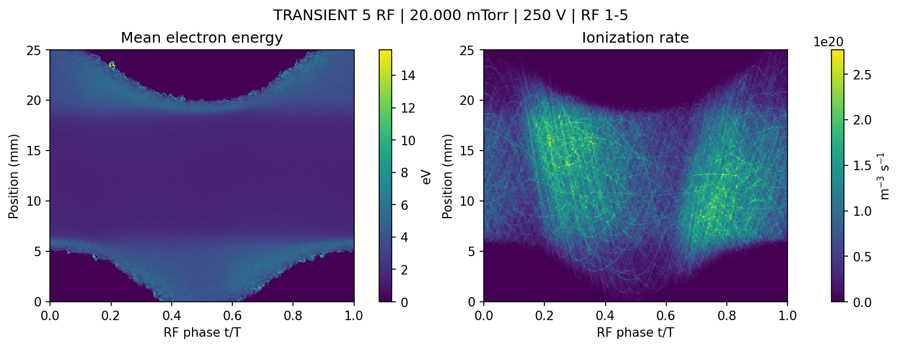
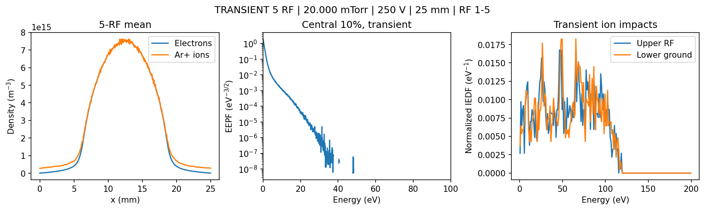
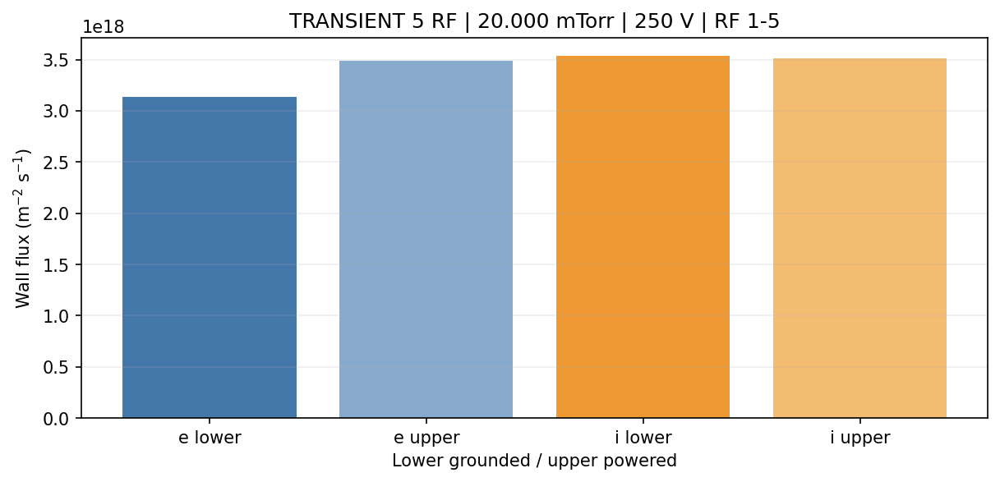
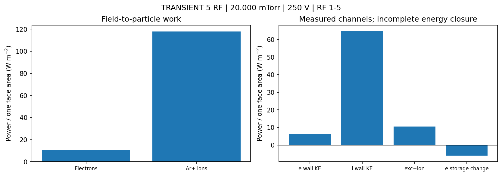

# 261120_loss-check · 20.000 mTorr · 250 V · RF1–5 진단

[전체 실행 목록](https://github.com/YGLSNU/eduPIC_PAL_RF-sheath) · [이 조건군](https://github.com/YGLSNU/eduPIC_PAL_RF-sheath/tree/results/20mTorr-topRF) · [실행 비교](https://github.com/YGLSNU/eduPIC_PAL_RF-sheath/blob/results/20mTorr-topRF/results/261120_loss-check/README.md)

**과도구간 진단** · 실행일 2026-11-20 (한국 시각) · 변경 조건: **20.000 mTorr, 250 V, 시작상태 RF0** · 보고서 갱신 2026-11-22

5 RF 과도구간 진단입니다. 이 그림은 정상상태 수렴 결과가 아니며, 원인 분석용 재시작 표본입니다.

## 실행 조건

| 항목 | 값 |
|---|---|
| 기체 / 압력 / 온도 | Ar / 20 mTorr / 350 K |
| 인가 파형 / 주파수 | 정현파 / 13.56 MHz |
| 전압 / gap | 250 V peak / 25 mm |
| 전극 연결 | 상부 x=L RF / 하부 x=0 접지 |
| 면적 / 형상 | 1D3V 동일 면적 평판, 환산 면적 1 cm²; 실제 지름·측벽 제외 |
| 표면 / 충돌 모델 | 흡수 경계, SEE·전자 반사 없음; ground-state Ar MCC |
| 격자 / 시간간격 / 입자 가중치 | 400점 / RF당 4000 전자 step / 70000 |
| 코드 | 상부 RF C/eduPIC.cc + 입자·에너지 수지 기록 진단; C++11 컴파일 |
| 소스 이력 | 진단 소스 SHA256 5acbe3b6b8aa8f73655cbdcfcb95c75f2d490607f070700ac7e67d943b7ec4ef |
| 초기·재시작 상태 | 20mTorr_250V_from0: 전자108314, 이온113766 계산 입자에서 시작 |
| 측정 구간 | RF1–5, 5 RF 과도구간 진단; 정상상태 평균이 아닙니다. 동일 초기 상태의 압력 대조는 250 V·RF1–5 두 조건입니다. |

상태와 그래프는 마지막 저장 자료이며 실시간 CPU 실행 화면은 아닙니다.

## 핵심 수치

| 물리량 | 값 |
|---|---|
| 생성 / 전자 벽 손실 | 768 / 3489 = 0.2201 |
| 전자 수 변화 | 108314→105593 (-2.512%) |
| 입자 수지 잔차 | e=0, i=0 |

## 자료 범위

| 진단 | 제공 상태 | 저장·해석 범위 |
|---|---|---|
| 수렴·입자 수지 | 자료 있음 | 5 RF 생성·손실; 정상상태 판정 없음 |
| 밀도 공간분포 | 자료 있음 | 5 RF 과도구간 평균 |
| RF heating | 자료 있음 | 5 RF 과도구간의 위상 평균 |
| 전위·전기장 | 자료 있음 | 5 RF 과도구간의 위상 평균 |
| 평균 에너지·이온화 | 자료 있음 | 5 RF 과도구간; heating 묶음 그림 |
| 에너지 분포 | 자료 있음 | 5 RF 정규화 분포 |
| 전극 flux·손실 | 자료 있음 | 5 RF 입자 흡수 사건 수; particle_balance.csv |
| 전력 전달·손실 | 부분 자료 | 입자 field-work·벽 운동에너지·운동에너지 변화·추정 충돌 손실; summary.json |

## 수렴·입자 수지

5 RF 입자 수·생성/손실. 정상상태 수렴 판정이 아닙니다.

## 밀도 공간분포

5 RF 과도구간 평균 밀도 공간분포

## RF heating

TRANSIENT 5 RF | 20.000 mTorr | 250 V | 25 mm | RF 1-5

## 전위·전기장

TRANSIENT 5 RF | 20.000 mTorr | 250 V | 25 mm | RF 1-5

## 평균 에너지·이온화

5 RF 과도구간 평균 전자 에너지·이온화율

## 에너지 분포

이온·전자 분포의 표본 길이는 5 RF이며 정상상태 통계가 아닙니다.

## 전극 flux·손실

5 RF 흡수 사건 수로 구한 상·하부 전극 flux

## 전력 전달·손실

전자 저장 운동에너지가 변하는 과도구간입니다. 이온·기체·전기장 저장 항을 모두 포함한 완전한 전력 폐합이 아닙니다.

5 RF의 field-work·벽 운동에너지·저장 전자 운동에너지 변화

## 읽는 기준

- 위상 그림의 가로축은 RF 위상 t/T, 세로축은 위치 x입니다. 전극 방향은 위 조건표를 따릅니다. 위상 0은 cos 인가 전압의 양의 최댓값입니다.
- Heating은 위상 평균 j × 위상 평균 E입니다. 양수는 전기장에서 입자로, 음수는 반대 방향의 전달입니다. 순간 jE의 평균·온도 상승률과 구분합니다.
- 통계 중단 기준은 전체 물리·격자 오차나 모든 픽셀의 오차를 보증하지 않습니다. 소멸·미완료·짧은 진단을 정상 방전 측정과 구분합니다.
- 전력 표시는 W/m² 또는 W/m³입니다. 실제 전극 면적·회로 없이 발생기 총 W와 동일시하지 않습니다.

## 파일과 재시작

| 자료 | 다운로드 | 크기 |
|---|---|---:|
| eepf | [eepf.csv](data/eepf.csv) | 27.6 KiB |
| ifed | [ifed.csv](data/ifed.csv) | 3.8 KiB |
| info | [info.txt](data/info.txt) | 2.5 KiB |
| particle_balance | [particle_balance.csv](data/particle_balance.csv) | 1.1 KiB |
| profiles | [profiles.csv](data/profiles.csv) | 43.2 KiB |
| summary | [summary.json](data/summary.json) | 1.1 KiB |
| 5 RF 전극 flux CSV | [wall_flux.csv](data/wall_flux.csv) | 145 B |
| 5 RF 측정 전력 채널 CSV | [power_channels.csv](data/power_channels.csv) | 254 B |

[전체 파일 목록·SHA256](files.json)
