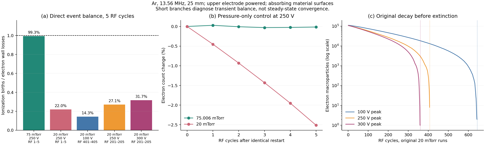

# 261120_loss-check · 소멸 원인·압력 대조 진단

[전체 실행 목록](https://github.com/YGLSNU/eduPIC_PAL_RF-sheath) · [이 조건군](https://github.com/YGLSNU/eduPIC_PAL_RF-sheath/tree/results/20mTorr-topRF)

**과도구간 진단** · 실행일 2026-11-20 (한국 시각) · 변경 조건: **벽 손실 진단 · 20↔75.006 mTorr 대조** · 보고서 갱신 2026-11-22

동일 초기 상태에서 압력만 바꾼 대조 계산 및 소멸 과정의 짧은 재시작 진단입니다. 정상상태의 전압·압력 의존성으로 해석하지 않습니다.

## 실행 조건

| 항목 | 값 |
|---|---|
| 기체 / 압력 / 온도 | Ar / 20 mTorr / 350 K |
| 인가 파형 / 주파수 | 정현파 / 13.56 MHz |
| 전압 / gap | 100, 250, 300 V peak / 25 mm |
| 전극 연결 | 상부 x=L RF / 하부 x=0 접지 |
| 면적 / 형상 | 1D3V 동일 면적 평판, 환산 면적 1 cm²; 실제 지름·측벽 제외 |
| 표면 / 충돌 모델 | 흡수 경계, SEE·전자 반사 없음; ground-state Ar MCC |
| 격자 / 시간간격 / 입자 가중치 | 400점 / RF당 4000 전자 step / 70000 |
| 코드 | 상부 RF로 수정한 C/eduPIC.cc 계열, C++11 컴파일 |
| 소스 이력 | 실행별 source ZIP·소스 SHA256 기록 참조 |
| 초기·재시작 상태 | 기존 수렴 입자 분포를 반전한 공통 상태; 변경 조건의 과도구간은 측정에서 제외 |
| 측정 구간 | 조건별5 RF 진단; 실제 압력·시작 RF는 balance_summary.csv/json 참조 |

상태와 그래프는 마지막 저장 자료이며 실시간 CPU 실행 화면은 아닙니다.

## 자료 범위

| 진단 | 저장·해석 범위 |
|---|---|
| 수렴·입자 수지 | 5 RF 과도구간의 입자 생성·손실 |
| 밀도 공간분포 | 조건별5 RF 과도구간 원시 진단 보존 |
| RF heating | 조건별5 RF 과도구간 원시 진단 보존 |
| 전위·전기장 | 조건별5 RF 과도구간 원시 진단 보존 |
| 평균 에너지·이온화 | 조건별5 RF 과도구간 원시 진단 보존 |
| 에너지 분포 | 조건별5 RF 과도구간 원시 진단 보존 |
| 전극 flux·손실 | 전자·이온 벽 흡수 사건 수 |
| 전력 전달·손실 | 입자 field-work·벽 운동에너지·저장에너지 변화; 과도구간 |

## 수렴·입자 수지

전자 생성·벽 손실과 동일 초기 상태의 압력 대조

| 진단 | 압력 mTorr | RF 구간 | 생성/전자 벽 손실 |
|---|---:|---|---:|
| 20mTorr_100V_from400 | 20.000 | 401–405 | 0.143 |
| 20mTorr_250V_from0 | 20.000 | 1–5 | 0.220 |
| 20mTorr_250V_from200 | 20.000 | 201–205 | 0.271 |
| 20mTorr_300V_from200 | 20.000 | 201–205 | 0.317 |
| 75.006mTorr_250V_from0 | 75.006 | 1–5 | 0.993 |

## 전극 flux·손실

## 전력 전달·손실

## 밀도 공간분포

조건별 위상 그림과 분포는 위 진단 보고서 링크에서 확인합니다.

## RF heating

- [20.000 mTorr · 100 V · RF401–405 진단 그림](100V_RF401-405/README.md)
- [20.000 mTorr · 250 V · RF1–5 진단 그림](250V_RF1-5/README.md)
- [20.000 mTorr · 250 V · RF201–205 진단 그림](250V_RF201-205/README.md)
- [20.000 mTorr · 300 V · RF201–205 진단 그림](300V_RF201-205/README.md)
- [75.006 mTorr · 250 V · RF1–5 진단 그림](75mT_250V_RF1-5/README.md)

## 전위·전기장

조건별 위상 그림과 분포는 위 진단 보고서 링크에서 확인합니다.

## 평균 에너지·이온화

조건별 위상 그림과 분포는 위 진단 보고서 링크에서 확인합니다.

## 에너지 분포

조건별 위상 그림과 분포는 위 진단 보고서 링크에서 확인합니다.

## 읽는 기준

- 위상 그림의 가로축은 RF 위상 t/T, 세로축은 위치 x입니다. 전극 방향은 위 조건표를 따릅니다. 위상 0은 cos 인가 전압의 양의 최댓값입니다.
- Heating은 위상 평균 j × 위상 평균 E입니다. 양수는 전기장에서 입자로, 음수는 반대 방향의 전달입니다. 순간 jE의 평균·온도 상승률과 구분합니다.
- 통계 중단 기준은 전체 물리·격자 오차나 모든 픽셀의 오차를 보증하지 않습니다. 소멸·미완료·짧은 진단을 정상 방전 측정과 구분합니다.
- 전력 표시는 W/m² 또는 W/m³입니다. 실제 전극 면적·회로 없이 발생기 총 W와 동일시하지 않습니다.

## 파일과 재시작

| 자료 | 다운로드 | 크기 |
|---|---|---:|
| 261120 loss-check | [261120_loss-check.pdf](https://github.com/YGLSNU/eduPIC_PAL_RF-sheath/raw/refs/heads/results/20mTorr-topRF/results/261120_loss-check/261120_loss-check.pdf) | 0.02 MiB |
| all | [261120_loss-check_all.zip](https://github.com/YGLSNU/eduPIC_PAL_RF-sheath/raw/refs/heads/results/20mTorr-topRF/results/261120_loss-check/261120_loss-check_all.zip) | 51.68 MiB |
| balance summary | [261120_loss-check_balance_summary.csv](261120_loss-check_balance_summary.csv) | 0.00 MiB |

[전체 파일 목록·SHA256](files.json)

[기존 상세 기록](DETAILS.md)
