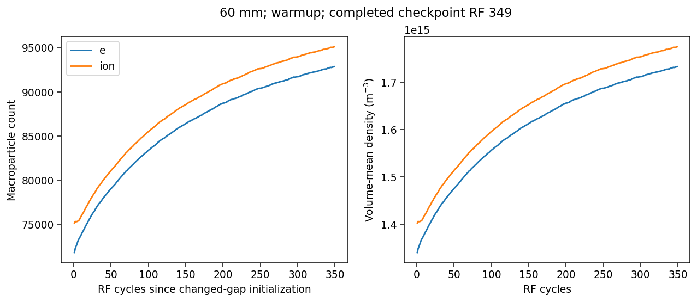
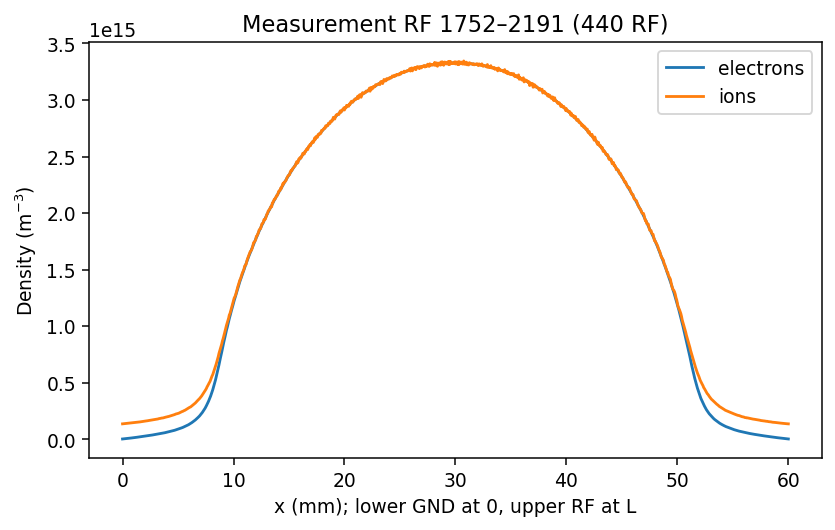
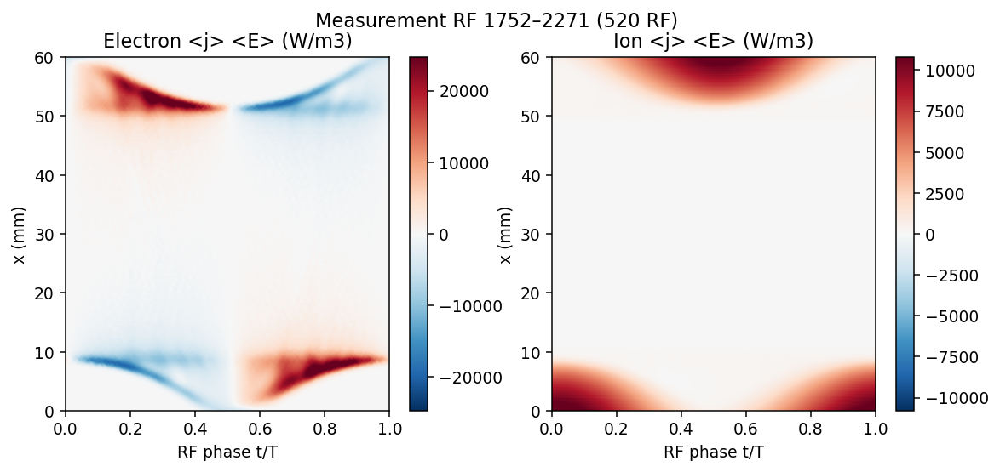
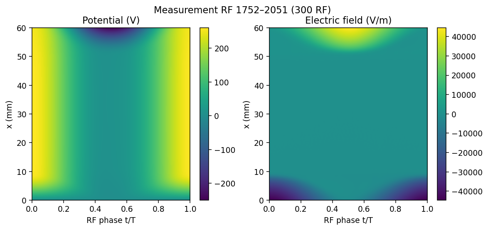
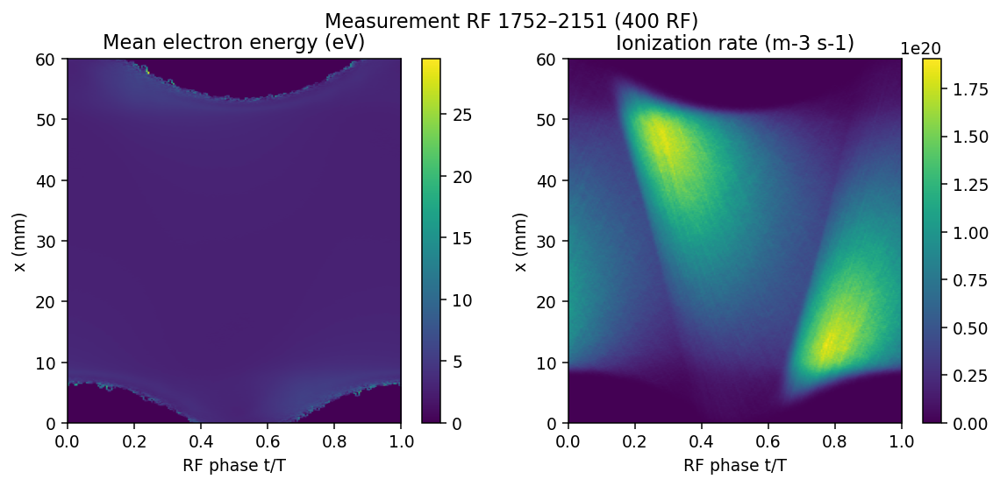
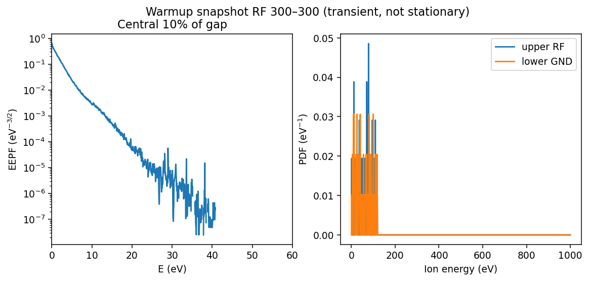
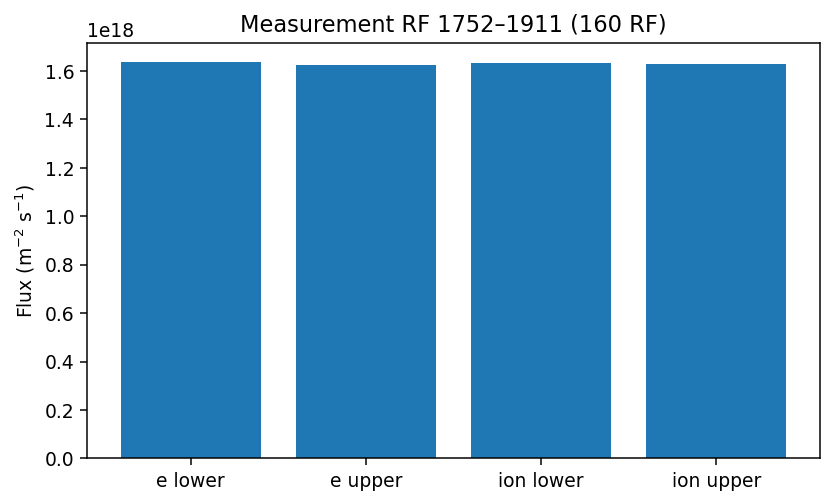
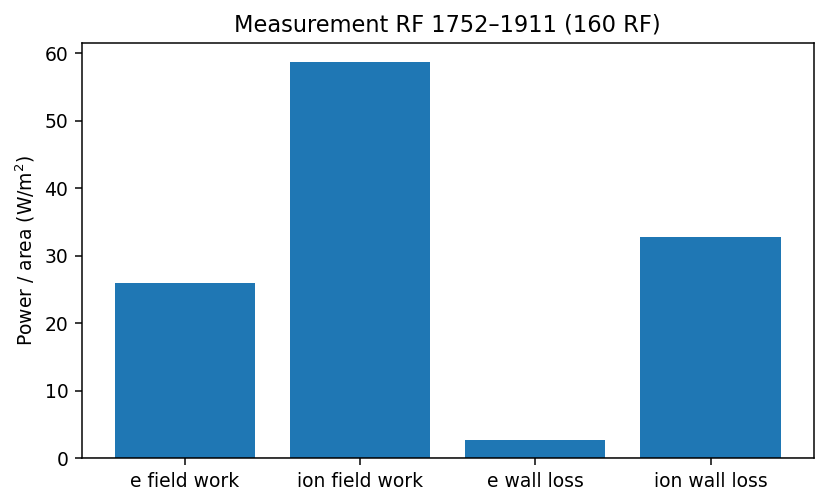

# 261123_BRH_gap25-120 · BRH · gap 60 mm · 250 V

[전체 실행 목록](https://github.com/YGLSNU/eduPIC_PAL_RF-sheath) · [이 조건군](https://github.com/YGLSNU/eduPIC_PAL_RF-sheath/tree/results/20mTorr-topRF) · [실행 비교](https://github.com/YGLSNU/eduPIC_PAL_RF-sheath/blob/results/20mTorr-topRF/results/261123_BRH_gap25-120/README.md)

**계산 중** · 실행일 2026-11-23 (한국 시각) · 변경 조건: **BRH gap 60 mm** · 보고서 갱신 2026-11-23T16:55:32+09:00

배경 입자 수 안정화 중 아직 BRH 왕복 진단 측정 전입니다. 입자 수 안정화나 EEDF만으로 BRH 발생을 판정하지 않습니다.

## 실행 조건

| 항목 | 값 |
|---|---|
| 기체 / 압력 / 온도 | Ar / 20 mTorr / 350 K |
| 인가 파형 / 주파수 | 정현파 / 13.56 MHz |
| 전압 / gap | 250 V peak / 60 mm |
| 전극 연결 | 상부 x=L RF / 하부 x=0 접지 |
| 면적 / 형상 | 1D3V 동일 면적 평판, 환산 면적 1 cm²; 실제 지름·측벽 제외 |
| 표면 / 충돌 모델 | 흡수 벽, SEE·물질 반사 없음; ground-state Ar optical-depth MCC (탄성·여기·이온화); binary Coulomb 충돌 없음 |
| 격자 / 시간간격 / 입자 가중치 | 961점 / RF당 8000 전자 step / 112000 |
| 코드 | 40mm 기준 C/eduPIC.cc 계열을 C++11로 컴파일; 8k step/RF, 동일 optical-depth MCC, 수동 BRH 입자 진단 |
| 소스 이력 | control SHA256 734ca36277917791d6e48860de1d6b084194a8649fec382170da8f2fd26412a1; 진단 소스·헤더 SHA는 검증 기록/ZIP 참조 |
| 초기·재시작 상태 | 40mm·250V RF2001 저장 입자에서 분포 재표본·x 변환·시간 stagger 변환. gap별 초기 물리 밀도와 가중치 고정. 과도구간은 정상 측정에서 제외. |
| 측정 구간 | Warmup snapshot RF 300–300 (transient, not stationary) |

상태와 그래프는 마지막 저장 자료이며 실시간 CPU 실행 화면은 아닙니다.

[BRH 진단·판정 기준](../METHOD.md)

## 핵심 수치

| 물리량 | 값 |
|---|---|
| 저장 체크포인트 | RF 349 |
| 정상 측정 누적 | 0 RF |
| 현재 단계 | warmup |
| 안정성 확인 | {"passed": false, "available_RF": 349, "required_RF": 600} |
| 진행 상태 갱신 | 2026-11-23T16:46:46.880056+09:00 |

## 자료 범위

| 진단 | 제공 상태 | 저장·해석 범위 |
|---|---|---|
| 수렴·입자 수지 | 자료 있음 | 실제 저장된 RF 구간; 아래 그림 설명 참조 |
| 밀도 공간분포 | 자료 있음 | 실제 저장된 RF 구간; 아래 그림 설명 참조 |
| RF heating | 자료 있음 | 실제 저장된 RF 구간; 아래 그림 설명 참조 |
| 전위·전기장 | 자료 있음 | 실제 저장된 RF 구간; 아래 그림 설명 참조 |
| 평균 에너지·이온화 | 자료 있음 | 실제 저장된 RF 구간; 아래 그림 설명 참조 |
| 에너지 분포 | 자료 있음 | 실제 저장된 RF 구간; 아래 그림 설명 참조 |
| 전극 flux·손실 | 자료 있음 | 실제 저장된 RF 구간; 아래 그림 설명 참조 |
| 전력 전달·손실 | 자료 있음 | 실제 저장된 RF 구간; 아래 그림 설명 참조 |

## 수렴·입자 수지

저장된 이력 RF1–349. 체적 평균은 입자 수에서 계산한 값이며 공간분포와 다릅니다.

## 밀도 공간분포

Warmup snapshot RF 300–300 (transient, not stationary)

## RF heating

Warmup snapshot RF 300–300 (transient, not stationary)

## 전위·전기장

Warmup snapshot RF 300–300 (transient, not stationary)

## 평균 에너지·이온화

Warmup snapshot RF 300–300 (transient, not stationary)

## 에너지 분포

Warmup snapshot RF 300–300 (transient, not stationary); 정규화된 서로 다른 블록 EEPF는 임의로 합치지 않습니다.

## 전극 flux·손실

Warmup snapshot RF 300–300 (transient, not stationary)

## 전력 전달·손실

Warmup snapshot RF 300–300 (transient, not stationary); 이산 field work와 벽 운동에너지 유출. 전체 전력 폐합은 아닙니다.

## BRH 왕복·위상·에너지 진단

**자료 없음:** 아직 BRH 왕복 진단 측정 전입니다. 입자 수 안정화나 EEDF만으로 BRH 발생을 판정하지 않습니다.

## 읽는 기준

- 위상 그림의 가로축은 RF 위상 t/T, 세로축은 위치 x입니다. 전극 방향은 위 조건표를 따릅니다. 위상 0은 cos 인가 전압의 양의 최댓값입니다.
- Heating은 위상 평균 j × 위상 평균 E입니다. 양수는 전기장에서 입자로, 음수는 반대 방향의 전달입니다. 순간 jE의 평균·온도 상승률과 구분합니다.
- 통계 중단 기준은 전체 물리·격자 오차나 모든 픽셀의 오차를 보증하지 않습니다. 소멸·미완료·짧은 진단을 정상 방전 측정과 구분합니다.
- 전력 표시는 W/m² 또는 W/m³입니다. 실제 전극 면적·회로 없이 발생기 총 W와 동일시하지 않습니다.

## 파일과 재시작

| 자료 | 다운로드 | 크기 |
|---|---|---:|
| 저장된 실행 상태·실제 RF·종료 사유 | [status.json](status.json) | 1.4 KiB |
| 표준 진단 원시 수치·이력: Warmup snapshot RF 300–300 (transient, not stationary) | [261123_60mm_core.zip](https://github.com/YGLSNU/eduPIC_PAL_RF-sheath/raw/refs/heads/results/20mTorr-topRF/results/261123_BRH_gap25-120/60mm/261123_60mm_core.zip) | 9.11 MiB |
| 입자 수 이력 CSV | [history.csv](history.csv) | 5.4 KiB |
| 재시작 입자·동반 상태 (저장 RF 249; 보고서의 최신 RF와 다를 수 있음) | [261123_60mm_restart.zip](https://github.com/YGLSNU/eduPIC_PAL_RF-sheath/raw/refs/heads/results/20mTorr-topRF/results/261123_BRH_gap25-120/60mm/261123_60mm_restart.zip) | 5.37 MiB |
| 재시작 파일 provenance | [restart_manifest.json](restart_manifest.json) | 188 B |

[전체 파일 목록·SHA256](files.json)
