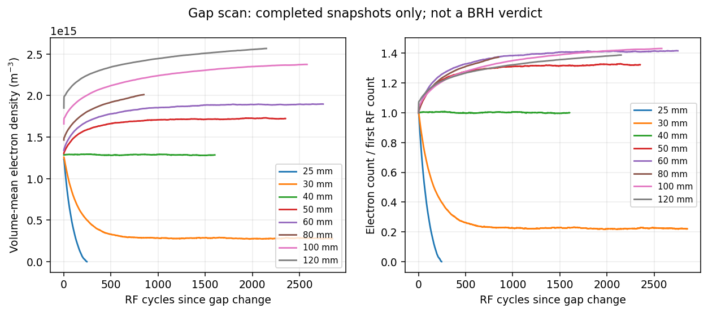
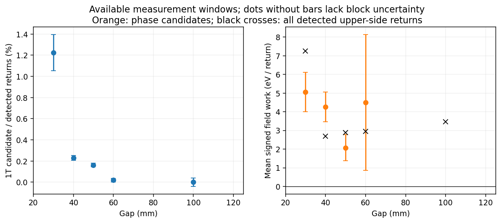
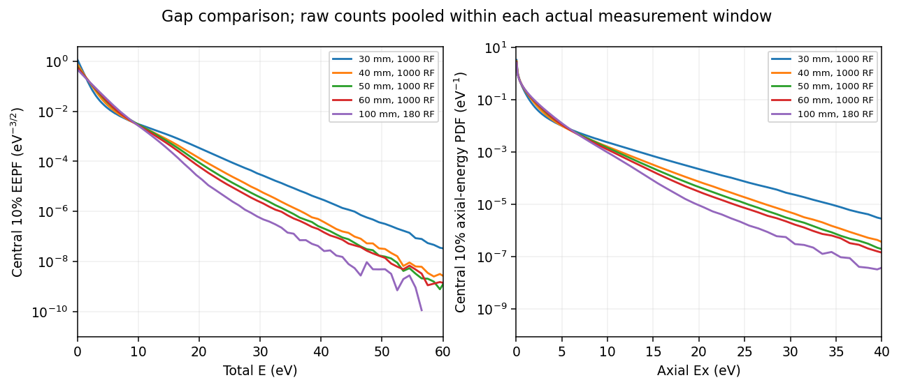
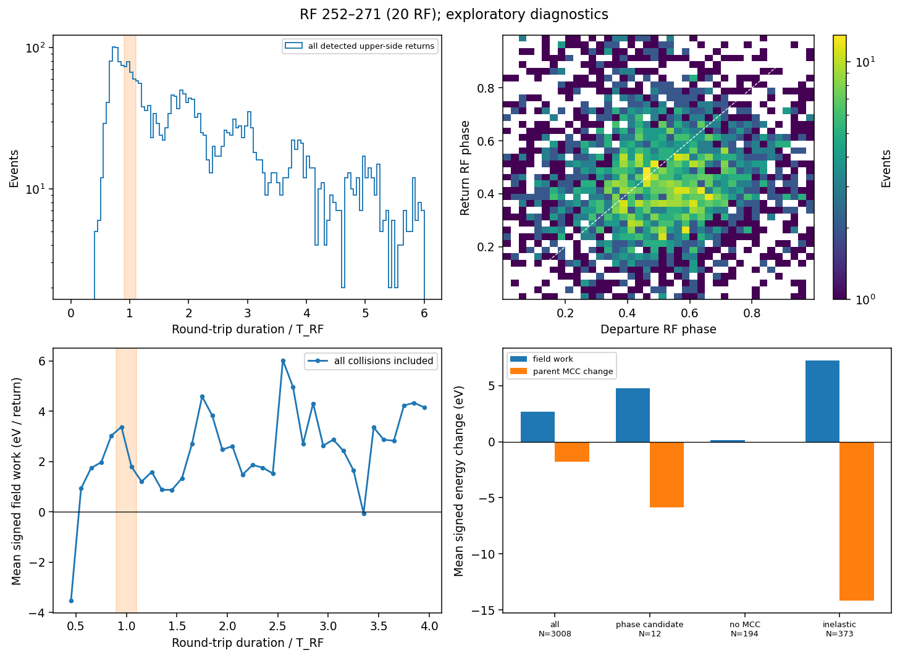

# 261123_BRH_gap25-120 · Bounce resonance heating · gap 스캔

[전체 실행 목록](https://github.com/YGLSNU/eduPIC_PAL_RF-sheath) · [이 조건군](https://github.com/YGLSNU/eduPIC_PAL_RF-sheath/tree/results/20mTorr-topRF)

**계산 중** · 실행일 2026-11-23 (한국 시각) · 변경 조건: **BRH · gap25/30/40/50/60/80/100/120 mm** · 보고서 갱신 2026-11-24T11:59:46+09:00

250 V에서 gap만 바꾸며 넓은 에너지 분포와 충돌을 포함한 전자 왕복·위상 재현성·signed field work를 비교합니다. 아래는 마지막 완결 블록의 저장 기록입니다. 진행 중인 gap의 결과 및 BRH 여부를 최종값으로 해석하지 않습니다.

## 실행 조건

| 항목 | 값 |
|---|---|
| 기체 / 압력 / 온도 | Ar / 20 mTorr / 350 K |
| 인가 파형 / 주파수 | 정현파 / 13.56 MHz |
| 전압 / gap | 250 V peak / [25, 30, 40, 50, 60, 80, 100, 120] mm |
| 전극 연결 | 상부 x=L RF / 하부 x=0 접지 |
| 면적 / 형상 | 1D3V 동일 면적 평판, 환산 면적 1 cm²; 실제 지름·측벽 제외 |
| 표면 / 충돌 모델 | 흡수 벽, SEE·물질 반사 없음; ground-state Ar optical-depth MCC (탄성·여기·이온화); binary Coulomb 충돌 없음 |
| 격자 / 시간간격 / 입자 가중치 | 401–1921 (dx ≤62.5 µm)점 / RF당 8000 전자 step / 112000 |
| 코드 | 40mm 기준 C/eduPIC.cc 계열을 C++11로 컴파일; 8k step/RF, 동일 optical-depth MCC, 수동 BRH 입자 진단 |
| 소스 이력 | control SHA256 734ca36277917791d6e48860de1d6b084194a8649fec382170da8f2fd26412a1; 진단 소스·헤더 SHA는 검증 기록/ZIP 참조 |
| 초기·재시작 상태 | 40mm·250V RF2001 저장 입자에서 분포 재표본·x 변환·시간 stagger 변환. gap별 초기 물리 밀도와 가중치 고정. 과도구간은 정상 측정에서 제외. |
| 측정 구간 | 안정화: 마지막600RF의 3×200RF 평균 변화<1%, fitted drift<2%. 정상 진단: 최소200RF, 20RF블록. 평균량/밀도3%, heating5% 및 BRH 통계 별도. 상한1000RF에서 미충족은 미수렴으로 표시. |

상태와 그래프는 마지막 저장 자료이며 실시간 CPU 실행 화면은 아닙니다.

[Gap별 파라미터·전자별 반복 가열 요약](comparison/README.md) · [BRH 진단·판정·재시작](METHOD.md) · [실행 코드와 명령](https://github.com/YGLSNU/eduPIC_PAL_RF-sheath/blob/simulation/20mTorr-topRF/scripts/brh_scan/README.md)

## 조건별 결과

| Gap mm | 상태 | 종료 RF | 측정 RF | 평균 전자 밀도 m⁻³ | 보고서 |
|---:|---|---:|---:|---:|---|
| 25 | 전자 소멸 | 245 | 0 | — | [그림·다운로드](25mm/README.md) |
| 30 | 측정 상한·기준 미충족 | 2851 | 1000 | 2.798e+14 | [그림·다운로드](30mm/README.md) |
| 40 | 측정 상한·기준 미충족 | 1602 | 1000 | 1.286e+15 | [그림·다운로드](40mm/README.md) |
| 50 | 측정 상한·기준 미충족 | 2351 | 1000 | 1.720e+15 | [그림·다운로드](50mm/README.md) |
| 60 | 측정 상한·기준 미충족 | 2751 | 1000 | 1.892e+15 | [그림·다운로드](60mm/README.md) |
| 80 | 계산 중 | 849 | 0 | — | [그림·다운로드](80mm/README.md) |
| 100 | 계산 중 | 2580 | 180 | 2.371e+15 | [그림·다운로드](100mm/README.md) |
| 120 | 계산 중 | 2149 | 0 | — | [그림·다운로드](120mm/README.md) |

## 자료 범위

| 진단 | 제공 상태 | 저장·해석 범위 |
|---|---|---|
| 수렴·입자 수지 | 자료 있음 | 실제 저장된 RF 구간; 아래 그림 설명 참조 |
| 밀도 공간분포 | 부분 자료 | gap별 상세 보고서의 실제 측정 구간을 따릅니다. 아직 미측정인 조건은 사유를 표시합니다. |
| RF heating | 부분 자료 | gap별 상세 보고서의 실제 측정 구간을 따릅니다. 아직 미측정인 조건은 사유를 표시합니다. |
| 전위·전기장 | 부분 자료 | gap별 상세 보고서의 실제 측정 구간을 따릅니다. 아직 미측정인 조건은 사유를 표시합니다. |
| 평균 에너지·이온화 | 부분 자료 | gap별 상세 보고서의 실제 측정 구간을 따릅니다. 아직 미측정인 조건은 사유를 표시합니다. |
| 에너지 분포 | 부분 자료 | gap별 상세 보고서의 실제 측정 구간을 따릅니다. 아직 미측정인 조건은 사유를 표시합니다. |
| 전극 flux·손실 | 부분 자료 | gap별 상세 보고서의 실제 측정 구간을 따릅니다. 아직 미측정인 조건은 사유를 표시합니다. |
| 전력 전달·손실 | 부분 자료 | gap별 상세 보고서의 실제 측정 구간을 따릅니다. 아직 미측정인 조건은 사유를 표시합니다. |

## Gap별 결과 요약

[전자 밀도·에너지 환산 온도·쉬스 출구 에너지·흡수 전력·이온화율 및 전자 UID별 반복 횟수·에너지 변화](comparison/README.md). 측정이 추가되면 함께 갱신됩니다.

## 수렴·입자 수지

체적 평균 밀도·입자 수의 진행 이력. 안정화 과도구간 포함.

## 밀도 공간분포

gap별 상세 보고서의 실제 측정 구간을 따릅니다. 아직 미측정인 조건은 사유를 표시합니다.

조건별 상세 보고서: [25 mm](25mm/README.md) · [30 mm](30mm/README.md) · [40 mm](40mm/README.md) · [50 mm](50mm/README.md) · [60 mm](60mm/README.md) · [80 mm](80mm/README.md) · [100 mm](100mm/README.md) · [120 mm](120mm/README.md)

## RF heating

gap별 상세 보고서의 실제 측정 구간을 따릅니다. 아직 미측정인 조건은 사유를 표시합니다.

조건별 상세 보고서: [25 mm](25mm/README.md) · [30 mm](30mm/README.md) · [40 mm](40mm/README.md) · [50 mm](50mm/README.md) · [60 mm](60mm/README.md) · [80 mm](80mm/README.md) · [100 mm](100mm/README.md) · [120 mm](120mm/README.md)

## 전위·전기장

gap별 상세 보고서의 실제 측정 구간을 따릅니다. 아직 미측정인 조건은 사유를 표시합니다.

조건별 상세 보고서: [25 mm](25mm/README.md) · [30 mm](30mm/README.md) · [40 mm](40mm/README.md) · [50 mm](50mm/README.md) · [60 mm](60mm/README.md) · [80 mm](80mm/README.md) · [100 mm](100mm/README.md) · [120 mm](120mm/README.md)

## 평균 에너지·이온화

gap별 상세 보고서의 실제 측정 구간을 따릅니다. 아직 미측정인 조건은 사유를 표시합니다.

조건별 상세 보고서: [25 mm](25mm/README.md) · [30 mm](30mm/README.md) · [40 mm](40mm/README.md) · [50 mm](50mm/README.md) · [60 mm](60mm/README.md) · [80 mm](80mm/README.md) · [100 mm](100mm/README.md) · [120 mm](120mm/README.md)

## 에너지 분포

gap별 상세 보고서의 실제 측정 구간을 따릅니다. 아직 미측정인 조건은 사유를 표시합니다.

조건별 상세 보고서: [25 mm](25mm/README.md) · [30 mm](30mm/README.md) · [40 mm](40mm/README.md) · [50 mm](50mm/README.md) · [60 mm](60mm/README.md) · [80 mm](80mm/README.md) · [100 mm](100mm/README.md) · [120 mm](120mm/README.md)

## 전극 flux·손실

gap별 상세 보고서의 실제 측정 구간을 따릅니다. 아직 미측정인 조건은 사유를 표시합니다.

조건별 상세 보고서: [25 mm](25mm/README.md) · [30 mm](30mm/README.md) · [40 mm](40mm/README.md) · [50 mm](50mm/README.md) · [60 mm](60mm/README.md) · [80 mm](80mm/README.md) · [100 mm](100mm/README.md) · [120 mm](120mm/README.md)

## 전력 전달·손실

gap별 상세 보고서의 실제 측정 구간을 따릅니다. 아직 미측정인 조건은 사유를 표시합니다.

조건별 상세 보고서: [25 mm](25mm/README.md) · [30 mm](30mm/README.md) · [40 mm](40mm/README.md) · [50 mm](50mm/README.md) · [60 mm](60mm/README.md) · [80 mm](80mm/README.md) · [100 mm](100mm/README.md) · [120 mm](120mm/README.md)

## BRH 왕복·위상·에너지 진단

왕복 진단의 자료·그림·사건 통계는 조건별 상세 보고서에서 제공합니다.

[25 mm](25mm/README.md#brh-왕복위상에너지-진단) · [30 mm](30mm/README.md#brh-왕복위상에너지-진단) · [40 mm](40mm/README.md#brh-왕복위상에너지-진단) · [50 mm](50mm/README.md#brh-왕복위상에너지-진단) · [60 mm](60mm/README.md#brh-왕복위상에너지-진단) · [80 mm](80mm/README.md#brh-왕복위상에너지-진단) · [100 mm](100mm/README.md#brh-왕복위상에너지-진단) · [120 mm](120mm/README.md#brh-왕복위상에너지-진단)

## 기본1T 반복 후보·EEDF의 gap 비교

600RF 배경 안정화 뒤 수집한 측정 구간만 비교하며, 별도20RF pilot은 제외합니다. 단일gap이나 통계 중단 기준 전 자료만으로 BRH를 확정하지 않습니다. error bar는20/40RF 블록 불확실도 지표이며, 막대가 없는 점은 아직 블록 추정이 없습니다.

검출 왕복 사건 중 기본1T 후보의 비율과 signed field work. 전체 전자의 BRH 밀도 분율이 아닙니다. 검은×는 전체 검출 왕복의 평균입니다.

각gap의 실제 측정 RF를 범례에 표시했습니다. 중앙10%, E<500eV로 정규화한 원시 counts 기반 비교입니다.

| Gap mm | 상태 | 측정 RF | 왕복 / 1T후보 | 후보 UID | 후보 % | 후보 field work eV/왕복 |
|---:|---|---|---:|---:|---:|---:|
| 30 | measurement_limit_reached | 1852–2851 (1000RF) | 32281 / 395 | 352 | 1.224 | 5.052 |
| 40 | measurement_limit_reached | 603–1602 (1000RF) | 212801 / 488 | 455 | 0.229 | 4.257 |
| 50 | measurement_limit_reached | 1352–2351 (1000RF) | 200379 / 323 | 305 | 0.161 | 2.075 |
| 60 | measurement_limit_reached | 1752–2751 (1000RF) | 168729 / 33 | 33 | 0.020 | 4.494 |
| 100 | running | 2401–2580 (180RF) | 13809 / 0 | 0 | 0.000 | — |

## 40mm 짧은 예비 진단 · 본 스캔과 구분

[20RF 예비 진단의 조건·수치·그림·다운로드](pilot40mm/README.md). 본 gap 스캔의 수렴 결과가 아니며 BRH 확정 자료로 사용하지 않습니다.

실제20RF의 왕복·위상·signed energy 진단. 상세 페이지에 위치별 EEPF와 순간 일 지도도 있습니다.

## 읽는 기준

- 위상 그림의 가로축은 RF 위상 t/T, 세로축은 위치 x입니다. 전극 방향은 위 조건표를 따릅니다. 위상 0은 cos 인가 전압의 양의 최댓값입니다.
- Heating은 위상 평균 j × 위상 평균 E입니다. 양수는 전기장에서 입자로, 음수는 반대 방향의 전달입니다. 순간 jE의 평균·온도 상승률과 구분합니다.
- 통계 중단 기준은 전체 물리·격자 오차나 모든 픽셀의 오차를 보증하지 않습니다. 소멸·미완료·짧은 진단을 정상 방전 측정과 구분합니다.
- 전력 표시는 W/m² 또는 W/m³입니다. 실제 전극 면적·회로 없이 발생기 총 W와 동일시하지 않습니다.

## 파일과 재시작

| 자료 | 다운로드 | 크기 |
|---|---|---:|
| 조건별 진행 요약 CSV | [summary.csv](summary.csv) | 1.3 KiB |
| 공통 설정 | [config.json](config.json) | 1.6 KiB |
| 수렴·중단 기준 | [criteria.json](criteria.json) | 2.3 KiB |
| 수동 진단·재시작 검증 | [diagnostics_validated.json](diagnostics_validated.json) | 1.3 KiB |
| 측정 제어·통합·압축·상한 중단 실행 검증 | [measurement_engine_validated.json](measurement_engine_validated.json) | 1.5 KiB |
| gap별 BRH 사건·에너지·불확실도 요약 CSV | [brh_gap_summary.csv](brh_gap_summary.csv) | 922 B |
| 실행 소스·진단·설정·원본40mm 기준 입자 | [261123_BRH_source.zip](https://github.com/YGLSNU/eduPIC_PAL_RF-sheath/raw/refs/heads/results/20mTorr-topRF/results/261123_BRH_gap25-120/261123_BRH_source.zip) | 2.85 MiB |

[전체 파일 목록·SHA256](files.json)
