# 261124_BRH_gap20-80_step5 · BRH · gap 75 mm · 250 V

[전체 실행 목록](https://github.com/YGLSNU/eduPIC_PAL_RF-sheath) · [이 조건군](https://github.com/YGLSNU/eduPIC_PAL_RF-sheath/tree/results/20mTorr-topRF) · [실행 비교](https://github.com/YGLSNU/eduPIC_PAL_RF-sheath/blob/results/20mTorr-topRF/results/261124_BRH_gap20-80_step5/README.md)

**계산 중** · 실행일 2026-11-24 (한국 시각) · 변경 조건: **BRH gap 75 mm** · 보고서 갱신 2026-11-26T14:51:34+09:00

위상·입자 진단 측정 중; 최종 BRH 판정 전 GitHub의 입자·UID·MCC optical depth·RNG 상태와 누적 원시 counts를 복원했습니다. 이전 개별 20RF native 행렬은 백업되지 않아 누적 평균/사건 통계는 합치되 블록 불확실도는 재개 후 구간에서 별도 평가합니다. 검출된 상부 기준 왕복 124766개, 고유 UID 16814개. 위상 반복 후보 1개(고유 UID 1개). 검출 왕복 중 후보 비율 0.001%. 후보의 평균 signed field work -4.764 eV/왕복. 충돌을 합친 후보의 순 운동에너지 변화 -4.768 eV/왕복. 전체 전자의 BRH 밀도 분율이 아닙니다. 탐색 진단. 반복 위상와 signed work를 gap 간 비교하고 격자·seed·정의 민감도를 확인하기 전 BRH 확정으로 해석하지 않습니다.

## 실행 조건

| 항목 | 값 |
|---|---|
| 기체 / 압력 / 온도 | Ar / 20 mTorr / 350 K |
| 인가 파형 / 주파수 | 정현파 / 13.56 MHz |
| 전압 / gap | 250 V peak / 75 mm |
| 전극 연결 | 상부 x=L RF / 하부 x=0 접지 |
| 면적 / 형상 | 1D3V 동일 면적 평판, 환산 면적 1 cm²; 실제 지름·측벽 제외 |
| 표면 / 충돌 모델 | 흡수 벽, SEE·물질 반사 없음; ground-state Ar optical-depth MCC (탄성·여기·이온화); binary Coulomb 충돌 없음 |
| 격자 / 시간간격 / 입자 가중치 | 1201점 / RF당 8000 전자 step / 112000 |
| 코드 | 40mm 기준 C/eduPIC.cc 계열을 C++11로 컴파일; 8k step/RF, 동일 optical-depth MCC, 수동 BRH 입자 진단 |
| 소스 이력 | control SHA256 734ca36277917791d6e48860de1d6b084194a8649fec382170da8f2fd26412a1; 진단 소스·헤더 SHA는 검증 기록/ZIP 참조 |
| 초기·재시작 상태 | 40mm·250V RF2001 저장 입자에서 분포 재표본·x 변환·시간 stagger 변환. gap별 초기 물리 밀도와 가중치 고정. 과도구간은 정상 측정에서 제외. |
| 측정 구간 | Measurement RF 1801–2720 (920 RF); pre-resume aggregate restored; uncertainty assessed separately after resume |

상태와 그래프는 마지막 저장 자료이며 실시간 CPU 실행 화면은 아닙니다.

[BRH 진단·판정 기준](../METHOD.md)

## 핵심 수치

| 물리량 | 값 |
|---|---|
| 저장 체크포인트 | RF 2720 |
| 정상 측정 누적 | 920 RF |
| 현재 단계 | measurement |
| 안정성 확인 | {"e": {"block_mean_span": 0.009661834739328506, "fitted_drift": 0.014756926056274544, "passed": true}, "i": {"block_mean_span": 0.009520284009148401, "fitted_drift": 0.014550174202511961, "passed": true}, "passed": true} |
| 진행 상태 갱신 | 2026-11-26T14:43:42.980331+09:00 |

## 자료 범위

| 진단 | 제공 상태 | 저장·해석 범위 |
|---|---|---|
| 수렴·입자 수지 | 자료 있음 | 실제 저장된 RF 구간; 아래 그림 설명 참조 |
| 밀도 공간분포 | 자료 있음 | 실제 저장된 RF 구간; 아래 그림 설명 참조 |
| RF heating | 자료 있음 | 실제 저장된 RF 구간; 아래 그림 설명 참조 |
| 전위·전기장 | 자료 있음 | 실제 저장된 RF 구간; 아래 그림 설명 참조 |
| 평균 에너지·이온화 | 자료 있음 | 실제 저장된 RF 구간; 아래 그림 설명 참조 |
| 에너지 분포 | 자료 있음 | 실제 저장된 RF 구간; 아래 그림 설명 참조 |
| 전극 flux·손실 | 자료 있음 | 실제 저장된 RF 구간; 아래 그림 설명 참조 |
| 전력 전달·손실 | 자료 있음 | 실제 저장된 RF 구간; 아래 그림 설명 참조 |

## 수렴·입자 수지

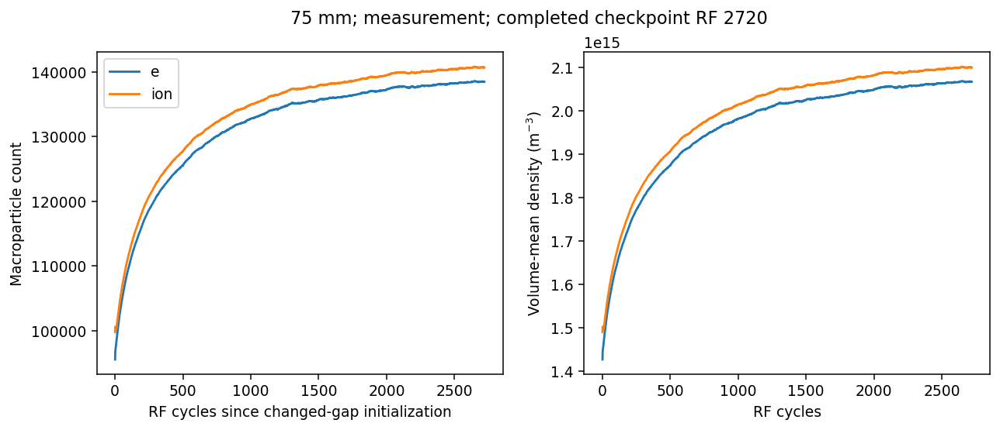

저장된 이력 RF1–2720. 체적 평균은 입자 수에서 계산한 값이며 공간분포와 다릅니다.

## 밀도 공간분포

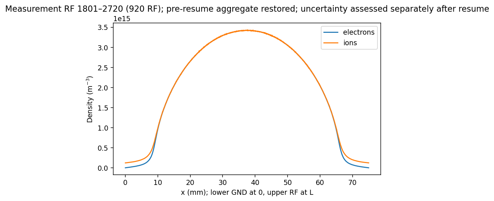

Measurement RF 1801–2720 (920 RF); pre-resume aggregate restored; uncertainty assessed separately after resume

## RF heating

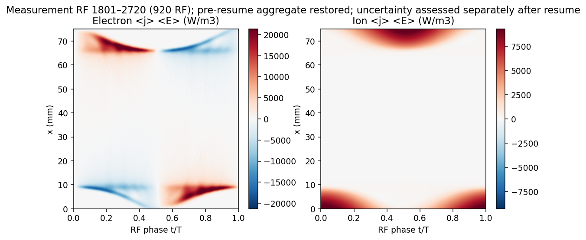

Measurement RF 1801–2720 (920 RF); pre-resume aggregate restored; uncertainty assessed separately after resume

## 전위·전기장

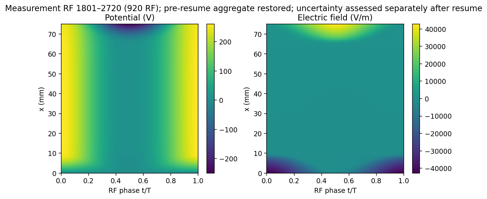

Measurement RF 1801–2720 (920 RF); pre-resume aggregate restored; uncertainty assessed separately after resume

## 평균 에너지·이온화

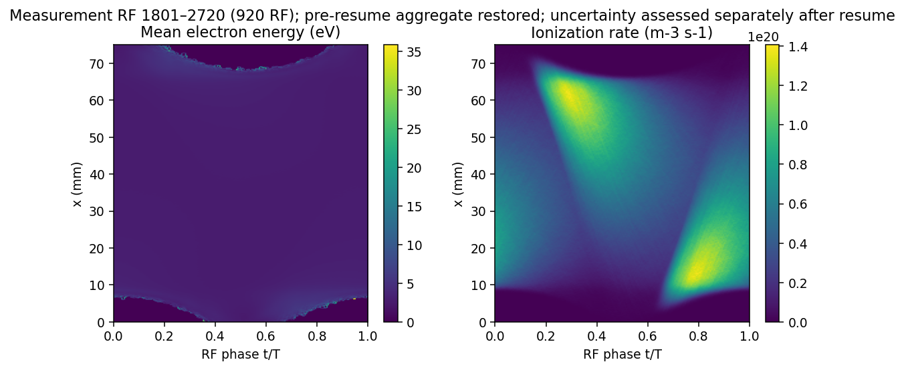

Measurement RF 1801–2720 (920 RF); pre-resume aggregate restored; uncertainty assessed separately after resume

## 에너지 분포

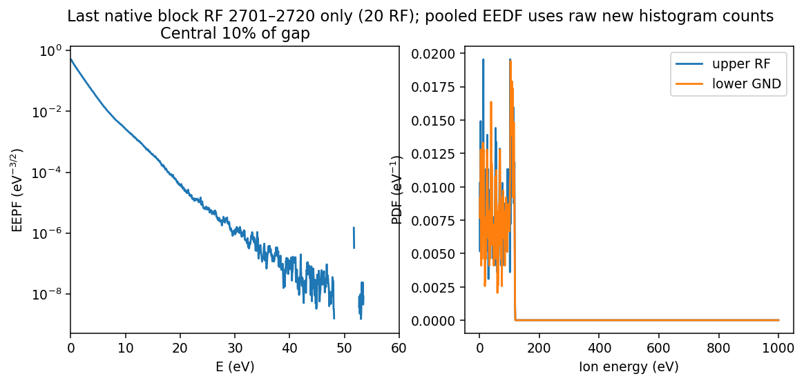

Last native block RF 2701–2720 only (20 RF); pooled EEDF uses raw new histogram counts; 정규화된 서로 다른 블록 EEPF는 임의로 합치지 않습니다.

## 전극 flux·손실

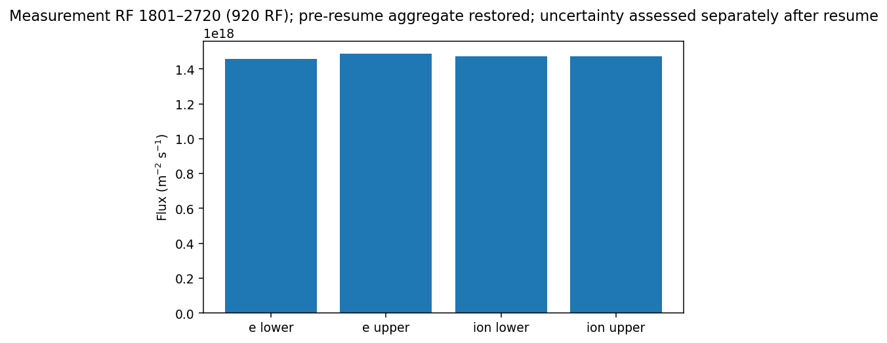

Measurement RF 1801–2720 (920 RF); pre-resume aggregate restored; uncertainty assessed separately after resume

## 전력 전달·손실

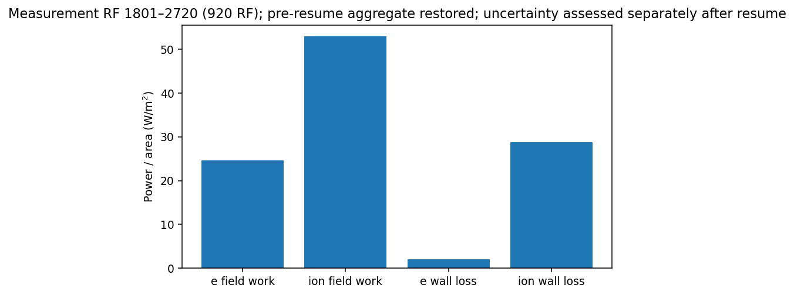

Measurement RF 1801–2720 (920 RF); pre-resume aggregate restored; uncertainty assessed separately after resume; 이산 field work와 벽 운동에너지 유출. 전체 전력 폐합은 아닙니다.

## BRH 왕복·위상·에너지 진단

검출된 상부 기준 왕복 124766개, 고유 UID 16814개. 위상 반복 후보 1개(고유 UID 1개). 검출 왕복 중 후보 비율 0.001%. 후보의 평균 signed field work -4.764 eV/왕복. 충돌을 합친 후보의 순 운동에너지 변화 -4.768 eV/왕복. 전체 전자의 BRH 밀도 분율이 아닙니다. 탐색 진단. 반복 위상와 signed work를 gap 간 비교하고 격자·seed·정의 민감도를 확인하기 전 BRH 확정으로 해석하지 않습니다.

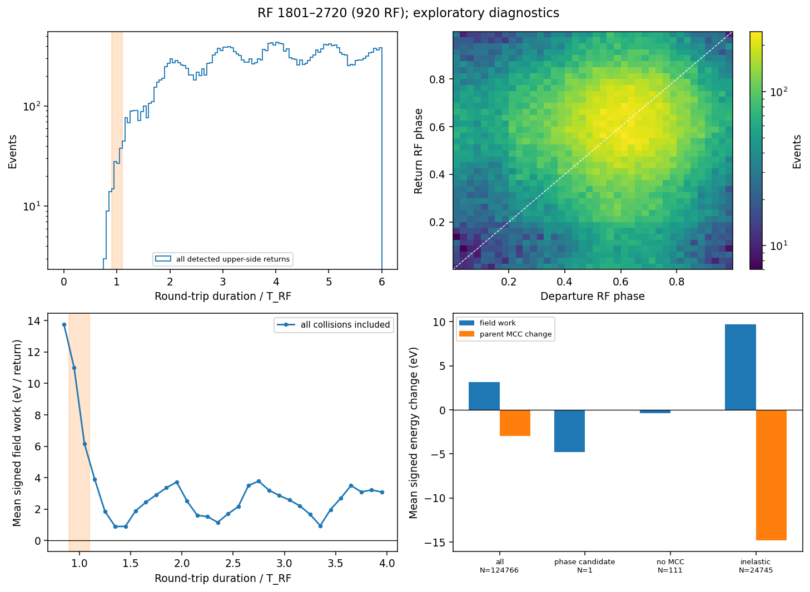

RF 1801–2720 (920 RF); exploratory diagnostics; 에너지 부호와 독립적으로 정한 반복 위상 후보. 충돌/경계 검출 조건은 METHOD 참조.

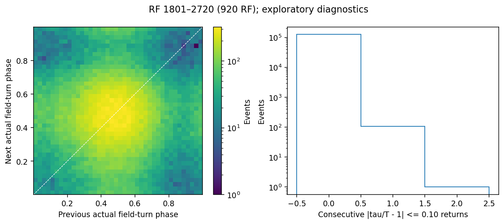

RF 1801–2720 (920 RF); exploratory diagnostics; 실제 전기장 회전 시각의 위상 재현성과 연속 왕복 횟수. 기준면 재도착 위상과 구분합니다.

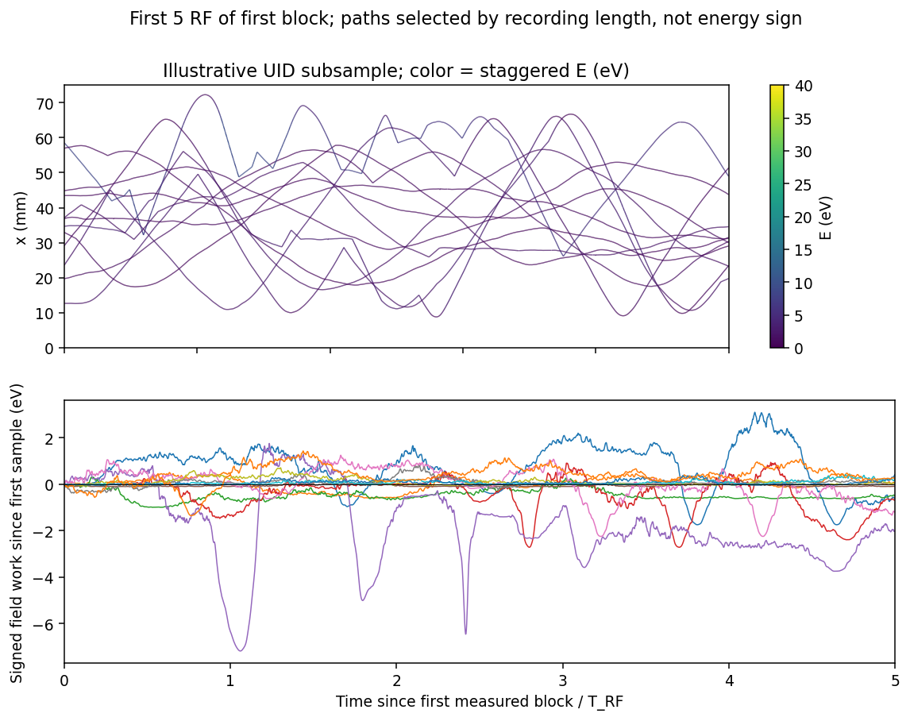

첫 측정 블록의 처음5RF, 해시 추출 UID 중 기록이 긴 최대12개 궤적 예시. 집단 전체의 BRH 증거로 단독 사용하지 않습니다.

## 위치별 EEPF·Ex 및 위상별 EEDF

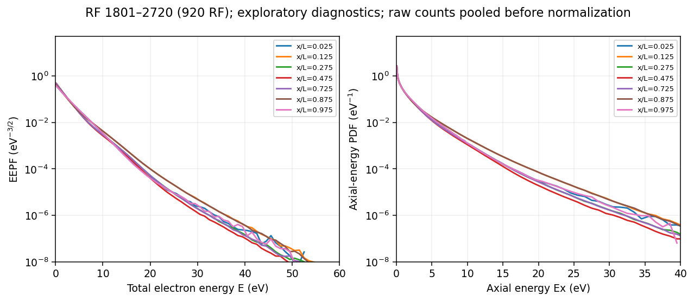

RF 1801–2720 (920 RF); exploratory diagnostics; 전체 E와 Ex를 구분합니다. 각 위치에서 E<500eV 사건으로 정규화.

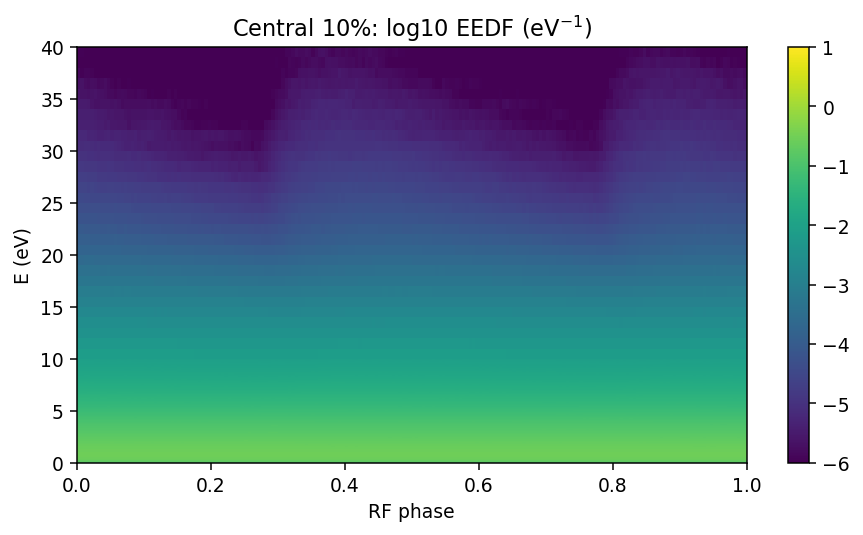

RF 1801–2720 (920 RF); exploratory diagnostics; 중앙10%의 위상별 EEDF.

## 순간 전기장 일 지도

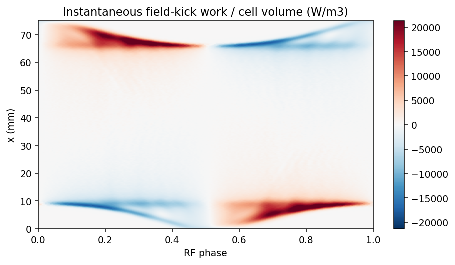

RF 1801–2720 (920 RF); exploratory diagnostics; 순간 kick 에너지의 평균. 표준 heating의 <j>×<E>와 다릅니다.

## 읽는 기준

- 위상 그림의 가로축은 RF 위상 t/T, 세로축은 위치 x입니다. 전극 방향은 위 조건표를 따릅니다. 위상 0은 cos 인가 전압의 양의 최댓값입니다.
- Heating은 위상 평균 j × 위상 평균 E입니다. 양수는 전기장에서 입자로, 음수는 반대 방향의 전달입니다. 순간 jE의 평균·온도 상승률과 구분합니다.
- 통계 중단 기준은 전체 물리·격자 오차나 모든 픽셀의 오차를 보증하지 않습니다. 소멸·미완료·짧은 진단을 정상 방전 측정과 구분합니다.
- 전력 표시는 W/m² 또는 W/m³입니다. 실제 전극 면적·회로 없이 발생기 총 W와 동일시하지 않습니다.

## 파일과 재시작

| 자료 | 다운로드 | 크기 |
|---|---|---:|
| 저장된 실행 상태·실제 RF·종료 사유 | [status.json](status.json) | 11.6 KiB |
| 표준 진단 원시 수치·이력: Measurement RF 1801–2720 (920 RF); pre-resume aggregate restored; uncertainty assessed separately after resume | [261124_75mm_core.zip](https://github.com/YGLSNU/eduPIC_PAL_RF-sheath/raw/refs/heads/results/20mTorr-topRF/results/261124_BRH_gap20-80_step5/75mm/261124_75mm_core.zip) | 14.33 MiB |
| 입자 수 이력 CSV | [history.csv](history.csv) | 49.4 KiB |
| 재시작 입자·동반 상태 (저장 RF 2700; 보고서의 최신 RF와 다를 수 있음) | [261124_75mm_restart.zip](https://github.com/YGLSNU/eduPIC_PAL_RF-sheath/raw/refs/heads/results/20mTorr-topRF/results/261124_BRH_gap20-80_step5/75mm/261124_75mm_restart.zip) | 11.52 MiB |
| 재시작 파일 provenance | [restart_manifest.json](restart_manifest.json) | 190 B |
| BRH 사건·원시 energy counts·probe·일 지도 (1/4; 분할 시 모두 받기) | [261124_75mm_BRH_data_p01.zip](https://github.com/YGLSNU/eduPIC_PAL_RF-sheath/raw/refs/heads/results/20mTorr-topRF/results/261124_BRH_gap20-80_step5/75mm/261124_75mm_BRH_data_p01.zip) | 41.64 MiB |
| BRH 사건·원시 energy counts·probe·일 지도 (2/4; 분할 시 모두 받기) | [261124_75mm_BRH_data_p02.zip](https://github.com/YGLSNU/eduPIC_PAL_RF-sheath/raw/refs/heads/results/20mTorr-topRF/results/261124_BRH_gap20-80_step5/75mm/261124_75mm_BRH_data_p02.zip) | 48.00 MiB |
| BRH 사건·원시 energy counts·probe·일 지도 (3/4; 분할 시 모두 받기) | [261124_75mm_BRH_data_p03.zip](https://github.com/YGLSNU/eduPIC_PAL_RF-sheath/raw/refs/heads/results/20mTorr-topRF/results/261124_BRH_gap20-80_step5/75mm/261124_75mm_BRH_data_p03.zip) | 46.36 MiB |
| BRH 사건·원시 energy counts·probe·일 지도 (4/4; 분할 시 모두 받기) | [261124_75mm_BRH_data_p04.zip](https://github.com/YGLSNU/eduPIC_PAL_RF-sheath/raw/refs/heads/results/20mTorr-topRF/results/261124_BRH_gap20-80_step5/75mm/261124_75mm_BRH_data_p04.zip) | 20.75 MiB |
| BRH 수치·표본 수·해석 범위 | [measurement_summary.json](measurement_summary.json) | 10.3 KiB |
| 위치별 EEPF CSV (raw count 포함) | [position_eepf.csv](data/position_eepf.csv) | 297.5 KiB |

[전체 파일 목록·SHA256](files.json)
