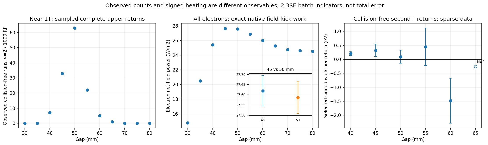

# 무충돌 약1RF 연속 왕복과 signed 전력

기존 BRH 원자료를 다시 읽은 보조 분석입니다. 솔버·기존 수렴 기준·측정 상한·승인 gap은 변경하지 않습니다.

종료된 측정 조건 중 관측 연속 구간 수 최대: 50 mm (63개). **BRH 순가열 최대점은 미확정입니다.**

| gap mm | 상태 | 측정 RF | 관측 연속 구간 ≥2 | 두 번째 이후 왕복 수 | 음의 field work 수 |
|---:|---|---:|---:|---:|---:|
| 20 | extinguished | 0 | — | — | — |
| 25 | extinguished | 0 | — | — | — |
| 30 | measurement_limit_reached | 1000 | 0 | 0 | 0 |
| 35 | measurement_limit_reached | 1000 | 0 | 0 | 0 |
| 40 | measurement_limit_reached | 1000 | 7 | 7 | 0 |
| 45 | measurement_limit_reached | 1000 | 33 | 35 | 14 |
| 50 | measurement_limit_reached | 1000 | 63 | 64 | 29 |
| 55 | measurement_limit_reached | 1000 | 22 | 23 | 7 |
| 60 | measurement_limit_reached | 1000 | 5 | 5 | 5 |
| 65 | measurement_limit_reached | 1000 | 1 | 1 | 1 |
| 70 | measurement_limit_reached | 1000 | 0 | 0 | 0 |
| 75 | measurement_limit_reached | 1000 | 0 | 0 | 0 |
| 80 | measurement_limit_reached | 1000 | 0 | 0 | 0 |

전체 전자 field-kick 순전력의 근접한 두 점:
- 45 mm: 27.6199 W/m², 탐색적 변동 지표 ±0.0752 W/m².
- 50 mm: 27.5862 W/m², 탐색적 변동 지표 ±0.0782 W/m².

45·50 mm의 전력 차이는 이 변동 지표보다 작습니다. 전체 전자 흡수 전력의 근접점과 특정 BRH 과정에 기인한 순가열 최대점을 구분합니다.

약1RF: 원래 |τ/T−1|≤0.1 flag를 그대로 사용합니다. 모든 관측 왕복에서 탄성·여기·이온화 충돌 수가 0이고 같은 UID의 출발/도착 시간이 이어져야 합니다. 한 연속 구간에서 관측 왕복 3개는 구간1개·두 번째 이후 사건2개입니다.

필터를 통과한 사건 수도 적고 signed work에는 음의 기여가 있습니다. 20/40RF 막대는 탐색적 변동 지표이며 전체 오차·정상 수렴·peak 신뢰도를 보증하지 않습니다. 전체 전자 전력과 선택된 왕복의 전기장 일을 구분합니다. 80 mm가 running이면 부분 자료입니다. 20/25 mm 소멸은 관측 수 0으로 비교하지 않습니다.

[요약 CSV](collisionfree_gap_summary.csv) · [정의·원자료 SHA256·해석 범위](analysis_provenance.json) · [재현 분석 코드](review_collisionfree.py)

- [30 mm 무충돌 관측 왕복 원자료](30mm_collisionfree_returns.csv.gz)
- [35 mm 무충돌 관측 왕복 원자료](35mm_collisionfree_returns.csv.gz)
- [40 mm 무충돌 관측 왕복 원자료](40mm_collisionfree_returns.csv.gz)
- [45 mm 무충돌 관측 왕복 원자료](45mm_collisionfree_returns.csv.gz)
- [50 mm 무충돌 관측 왕복 원자료](50mm_collisionfree_returns.csv.gz)
- [55 mm 무충돌 관측 왕복 원자료](55mm_collisionfree_returns.csv.gz)
- [60 mm 무충돌 관측 왕복 원자료](60mm_collisionfree_returns.csv.gz)
- [65 mm 무충돌 관측 왕복 원자료](65mm_collisionfree_returns.csv.gz)
- [70 mm 무충돌 관측 왕복 원자료](70mm_collisionfree_returns.csv.gz)
- [75 mm 무충돌 관측 왕복 원자료](75mm_collisionfree_returns.csv.gz)
- [80 mm 무충돌 관측 왕복 원자료](80mm_collisionfree_returns.csv.gz)
