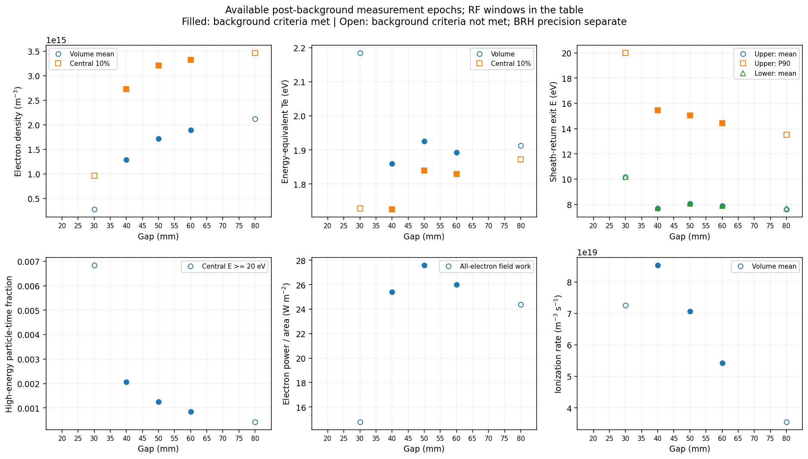
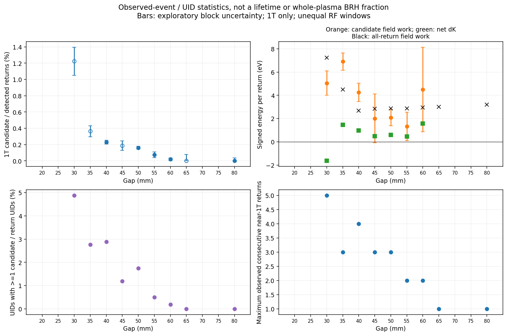
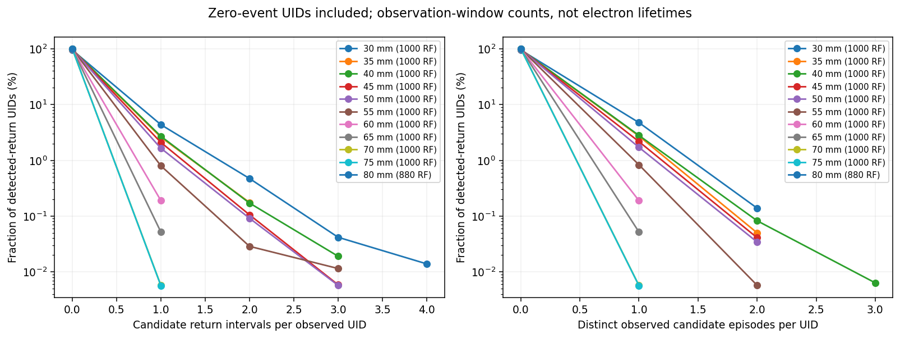
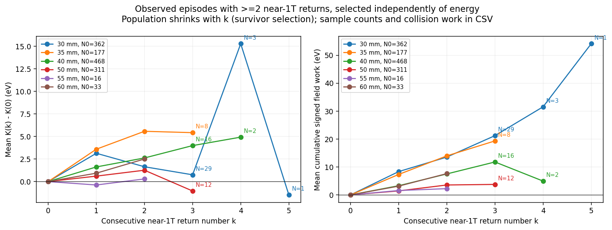
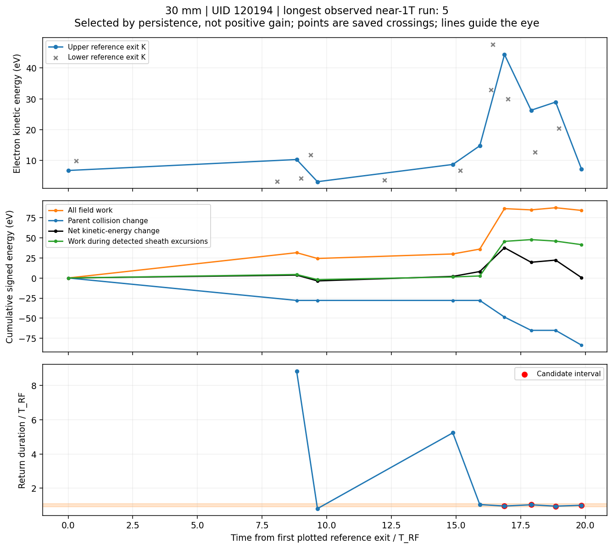
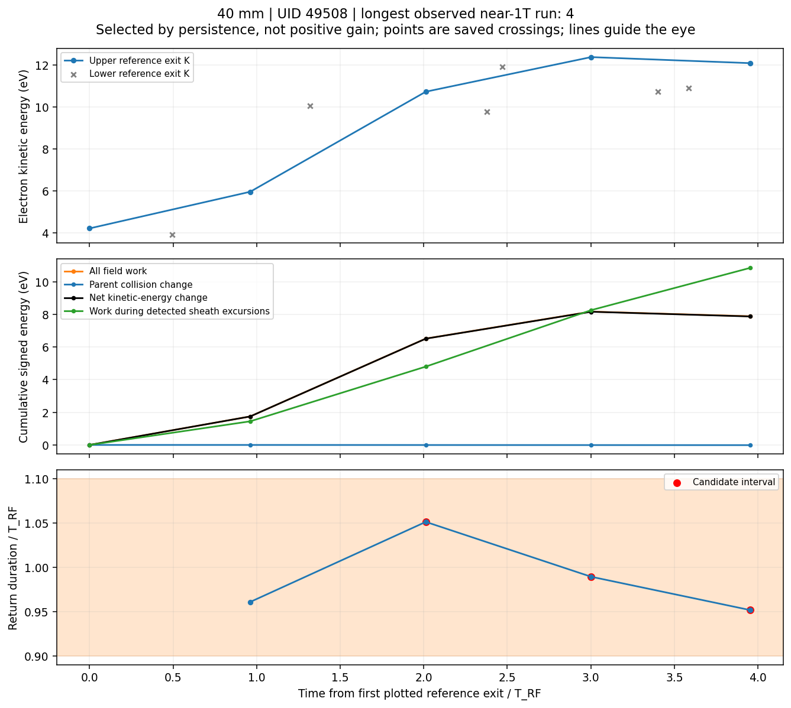
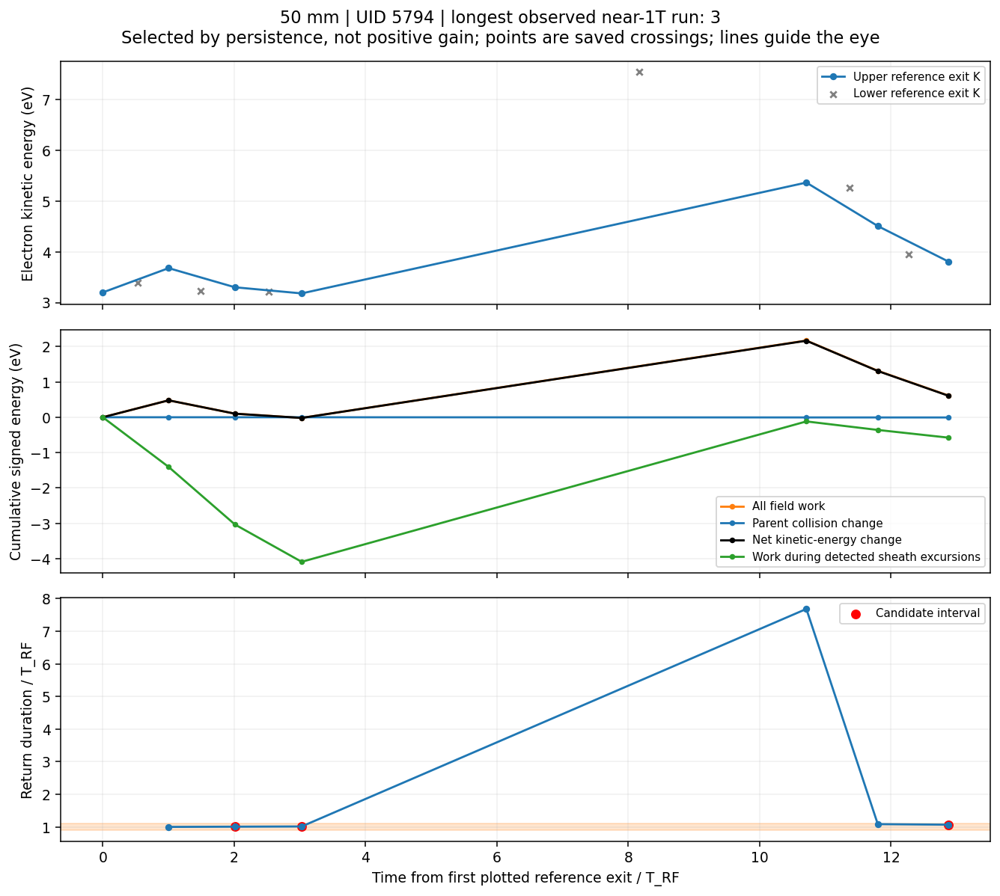
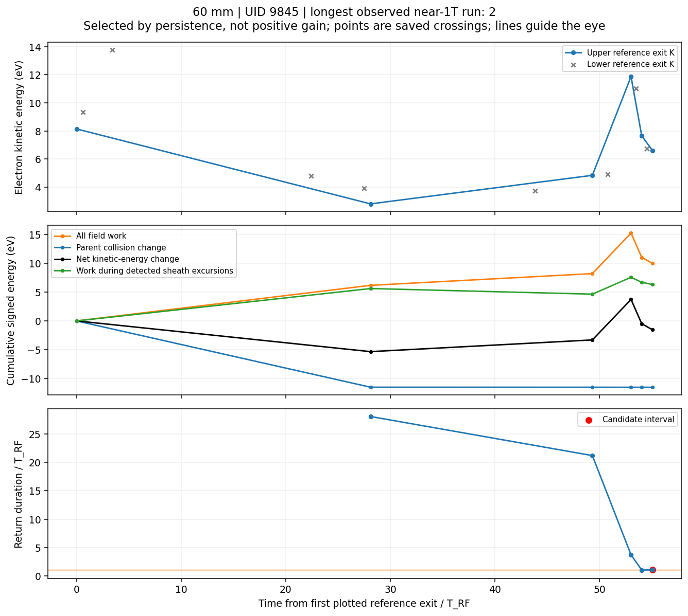

# 261124_BRH_gap20-80_step5 · Gap별 플라즈마 파라미터·전자별 BRH 후보 요약

[전체 실행 목록](https://github.com/YGLSNU/eduPIC_PAL_RF-sheath) · [이 조건군](https://github.com/YGLSNU/eduPIC_PAL_RF-sheath/tree/results/20mTorr-topRF) · [실행 비교](https://github.com/YGLSNU/eduPIC_PAL_RF-sheath/blob/results/20mTorr-topRF/results/261124_BRH_gap20-80_step5/README.md)

**계산 중** · 실행일 2026-11-24 (한국 시각) · 변경 조건: **BRH gap20–80 mm 비교** · 보고서 갱신 2026-11-24T15:43:48+09:00

13개 계획 조건의 실제 상태와 확보된 측정만 비교합니다. 실행일은 원 계산 시작일이며 보고서 갱신일과 구분합니다. 기존 조건 재사용은 CSV의 reused_from_run·execution_date와 개별 보고서에 표시합니다. 모든 gap 완료·BRH 확정을 뜻하지 않습니다.

## 실행 조건

| 항목 | 값 |
|---|---|
| 기체 / 압력 / 온도 | Ar / 20 mTorr / 350 K |
| 인가 파형 / 주파수 | 정현파 / 13.56 MHz |
| 전압 / gap | 250 V peak / [20, 25, 30, 35, 40, 45, 50, 55, 60, 65, 70, 75, 80] mm |
| 전극 연결 | 상부 x=L RF / 하부 x=0 접지 |
| 면적 / 형상 | 1D3V 동일 면적 평판, 환산 면적 1 cm²; 실제 지름·측벽 제외 |
| 표면 / 충돌 모델 | 흡수 벽, SEE·물질 반사 없음; ground-state Ar optical-depth MCC (탄성·여기·이온화); binary Coulomb 충돌 없음 |
| 격자 / 시간간격 / 입자 가중치 | 321–1281 (dx ≤62.5 µm)점 / RF당 8000 전자 step / 112000 |
| 코드 | 40mm 기준 C/eduPIC.cc 계열을 C++11로 컴파일; 8k step/RF, 동일 optical-depth MCC, 수동 BRH 입자 진단 |
| 소스 이력 | control SHA256 734ca36277917791d6e48860de1d6b084194a8649fec382170da8f2fd26412a1; 진단 소스·헤더 SHA는 검증 기록/ZIP 참조 |
| 초기·재시작 상태 | 40mm·250V RF2001 저장 입자에서 분포 재표본·x 변환·시간 stagger 변환. gap별 초기 물리 밀도와 가중치 고정. 과도구간은 정상 측정에서 제외. |
| 측정 구간 | 아래 gap별 RF 구간 표. 원래 측정 epoch만 사용; warmup·pilot·폐기된 epoch 제외. |

상태와 그래프는 마지막 저장 자료이며 실시간 CPU 실행 화면은 아닙니다.

[전체 gap 진행·개별 결과](../README.md) · [진단 정의·수렴 기준](../METHOD.md)

## 자료 범위

| 진단 | 제공 상태 | 저장·해석 범위 |
|---|---|---|
| 수렴·입자 수지 | 부분 자료 | 저장 자료 없음 |
| 밀도 공간분포 | 자료 있음 | 실제 저장된 RF 구간; 아래 그림 설명 참조 |
| RF heating | 부분 자료 | 저장 자료 없음 |
| 전위·전기장 | 부분 자료 | 저장 자료 없음 |
| 평균 에너지·이온화 | 부분 자료 | 저장 자료 없음 |
| 에너지 분포 | 부분 자료 | 저장 자료 없음 |
| 전극 flux·손실 | 부분 자료 | 저장 자료 없음 |
| 전력 전달·손실 | 부분 자료 | 저장 자료 없음 |

## 수렴·입자 수지

| Gap mm | 상태 | 측정 RF 구간 | 배경 기준 | BRH 포함 전체 기준 |
|---:|---|---|---|---|
| [20](../20mm/README.md) | 전자 소멸 | 측정 전 / 정의 불가 | — | — |
| [25](../25mm/README.md) | 전자 소멸 | 측정 전 / 정의 불가 | — | — |
| [30](../30mm/README.md) | 1000 RF 상한·기준 미충족 | 1852–2851 (1000 RF) | 미충족 | 미충족 |
| [35](../35mm/README.md) | 대기 | 측정 전 / 정의 불가 | — | — |
| [40](../40mm/README.md) | 1000 RF 상한·기준 미충족 | 603–1602 (1000 RF) | 충족 | 미충족 |
| [45](../45mm/README.md) | 대기 | 측정 전 / 정의 불가 | — | — |
| [50](../50mm/README.md) | 1000 RF 상한·기준 미충족 | 1352–2351 (1000 RF) | 충족 | 미충족 |
| [55](../55mm/README.md) | 대기 | 측정 전 / 정의 불가 | — | — |
| [60](../60mm/README.md) | 1000 RF 상한·기준 미충족 | 1752–2751 (1000 RF) | 충족 | 미충족 |
| [65](../65mm/README.md) | 계산 중 | 측정 전 / 정의 불가 | — | — |
| [70](../70mm/README.md) | 대기 | 측정 전 / 정의 불가 | — | — |
| [75](../75mm/README.md) | 대기 | 측정 전 / 정의 불가 | — | — |
| [80](../80mm/README.md) | 계산 중 | 측정 전 / 정의 불가 | — | — |

배경 기준 충족과 BRH 통계 기준 충족은 별도입니다. 상한 종료를 수렴 완료로 표시하지 않습니다. 소멸·미측정 gap은 비교 그래프에서 0으로 채우지 않습니다.

## 밀도 공간분포

전자 밀도는 체적 평균과 중앙10%를 구분합니다. Te_eff=2〈E〉/3는 입자 수로 가중한 에너지 환산 온도(eV)이며, 비맥스웰 분포의 단일 열역학 온도나 drift를 뺀 온도가 아닙니다. Eout은 유효 쉬스 전기장 반사 후 x/L=0.75(상부),0.25(하부) 기준면에서 벌크 방향으로 나오는 전자의 전체 에너지이며 각 검출 반사 사건을 동일 가중합니다. 단일 beam 에너지나 PROES 궤적 에너지와 동일시하지 않습니다. Ex·중앙값·P10/P90도 CSV에 있습니다. 전력은 순간 이산 field work의 합/시간/면적이며 발생기 총 전력과 다릅니다.

실제 측정 epoch의 평균. 채운 점은 배경 기준 충족, 빈 점은 미충족. Eout P90은 분포의 90백분위수이며 오차막대가 아닙니다.

## RF heating

조건별 원자료·공간/위상 지도: [20 mm](../20mm/README.md) · [25 mm](../25mm/README.md) · [30 mm](../30mm/README.md) · [35 mm](../35mm/README.md) · [40 mm](../40mm/README.md) · [45 mm](../45mm/README.md) · [50 mm](../50mm/README.md) · [55 mm](../55mm/README.md) · [60 mm](../60mm/README.md) · [65 mm](../65mm/README.md) · [70 mm](../70mm/README.md) · [75 mm](../75mm/README.md) · [80 mm](../80mm/README.md)

## 전위·전기장

조건별 원자료·공간/위상 지도: [20 mm](../20mm/README.md) · [25 mm](../25mm/README.md) · [30 mm](../30mm/README.md) · [35 mm](../35mm/README.md) · [40 mm](../40mm/README.md) · [45 mm](../45mm/README.md) · [50 mm](../50mm/README.md) · [55 mm](../55mm/README.md) · [60 mm](../60mm/README.md) · [65 mm](../65mm/README.md) · [70 mm](../70mm/README.md) · [75 mm](../75mm/README.md) · [80 mm](../80mm/README.md)

## 평균 에너지·이온화

조건별 원자료·공간/위상 지도: [20 mm](../20mm/README.md) · [25 mm](../25mm/README.md) · [30 mm](../30mm/README.md) · [35 mm](../35mm/README.md) · [40 mm](../40mm/README.md) · [45 mm](../45mm/README.md) · [50 mm](../50mm/README.md) · [55 mm](../55mm/README.md) · [60 mm](../60mm/README.md) · [65 mm](../65mm/README.md) · [70 mm](../70mm/README.md) · [75 mm](../75mm/README.md) · [80 mm](../80mm/README.md)

## 에너지 분포

조건별 원자료·공간/위상 지도: [20 mm](../20mm/README.md) · [25 mm](../25mm/README.md) · [30 mm](../30mm/README.md) · [35 mm](../35mm/README.md) · [40 mm](../40mm/README.md) · [45 mm](../45mm/README.md) · [50 mm](../50mm/README.md) · [55 mm](../55mm/README.md) · [60 mm](../60mm/README.md) · [65 mm](../65mm/README.md) · [70 mm](../70mm/README.md) · [75 mm](../75mm/README.md) · [80 mm](../80mm/README.md)

## 전극 flux·손실

조건별 원자료·공간/위상 지도: [20 mm](../20mm/README.md) · [25 mm](../25mm/README.md) · [30 mm](../30mm/README.md) · [35 mm](../35mm/README.md) · [40 mm](../40mm/README.md) · [45 mm](../45mm/README.md) · [50 mm](../50mm/README.md) · [55 mm](../55mm/README.md) · [60 mm](../60mm/README.md) · [65 mm](../65mm/README.md) · [70 mm](../70mm/README.md) · [75 mm](../75mm/README.md) · [80 mm](../80mm/README.md)

## 전력 전달·손실

조건별 원자료·공간/위상 지도: [20 mm](../20mm/README.md) · [25 mm](../25mm/README.md) · [30 mm](../30mm/README.md) · [35 mm](../35mm/README.md) · [40 mm](../40mm/README.md) · [45 mm](../45mm/README.md) · [50 mm](../50mm/README.md) · [55 mm](../55mm/README.md) · [60 mm](../60mm/README.md) · [65 mm](../65mm/README.md) · [70 mm](../70mm/README.md) · [75 mm](../75mm/README.md) · [80 mm](../80mm/README.md)

## Gap별 BRH 후보 비교

1T 후보는 에너지 부호와 무관하게 |tau/T−1|≤0.1인 왕복이 연속2회 이상인 경우입니다. 2T/3T 등 다른 공명 차수는 이 지표에 포함되지 않습니다.

오차막대는 기존20/40RF 블록의 탐색적 불확실도입니다. 수치/모델 오차와 반복 중단의 신뢰수준을 보증하지 않습니다.

## 전자 UID별 반복 횟수

| Gap mm | 검출 왕복 UID | 후보 보유 UID | 후보 왕복 사건 | 후보 episode | 후보 사건/보유 UID 평균 | UID당 최대 사건 | 최대 연속 1T 왕복 |
|---:|---:|---:|---:|---:|---:|---:|---:|
| 30 | 7204 | 352 | 395 | 362 | 1.122 | 4 | 5 |
| 40 | 15773 | 455 | 488 | 470 | 1.073 | 3 | 4 |
| 50 | 17499 | 305 | 323 | 311 | 1.059 | 3 | 3 |
| 60 | 17436 | 33 | 33 | 33 | 1.000 | 1 | 2 |

후보 사건은 연속 두 번째 왕복부터 집계합니다. 예: 연속5회 왕복은 후보4사건·episode1개입니다. 떨어진 후보 episode가 같은 UID에서 반복될 수 있습니다. 분모는 약1/16 해시 표본 중 완전한 상부 기준 왕복이 검출된 UID입니다. 전체 전자나 벽에 도달한 모든 전자가 아닙니다. 관측 시작/끝·검출 경계로 잘린 사건이 있고, 장수명 전자는 관측 기회가 더 많습니다. 이 수치만으로 “전자당 평생 BRH 횟수”를 정할 수 없습니다.

0회인 UID를 포함한 분포. 관측 창이 서로 다르며 전자 수명 전체의 횟수가 아닙니다.

## 반복 횟수에 따른 집단 에너지

에너지 증가 사례만 고르지 않았습니다. 처음부터 관측된 연속≥2회 후보 episode를 모았으며 각 k의 UID·episode·원시 에너지 값은 CSV에 있습니다. 순 에너지는 충돌 때문에 감소하거나 포화할 수 있습니다. 이 그림의 각 k는 동일 집단 전체를 끝까지 추적한 평균이 아니며, 긴 episode의 생존 선택을 포함합니다.

누적 전기장 일과 실제 순 에너지 변화를 분리합니다. k가 클수록 남는 episode가 적으므로 서로 다른 생존 집단의 평균입니다.

## 개별 전자의 반복 가열·충돌 이력

에너지는 저장된 기준면 출구에서의 실제 반 step 운동에너지입니다. 점을 이은 선은 연속 시간 궤적을 복원한 것이 아닙니다. 주황: 궤도 전체 전기장 일, 파랑: parent 전자 충돌 변화, 검정: 둘의 합=순 운동에너지 변화. 녹색은 검출된 쉬스 접근·반사·출구 구간의 전기장 일로, 주황의 일부입니다. 이온화로 daughter에 넘어간 에너지는 parent 손실에 포함됩니다. 상부 기준 왕복만 누적하여 양쪽 왕복의 중복 가산을 피했습니다.

30 mm, UID 120194: 최대 지속 길이→작은 UID 순으로 선택. 모든 전자의 대표값이 아닙니다.

40 mm, UID 49508: 최대 지속 길이→작은 UID 순으로 선택. 모든 전자의 대표값이 아닙니다.

50 mm, UID 5794: 최대 지속 길이→작은 UID 순으로 선택. 모든 전자의 대표값이 아닙니다.

60 mm, UID 9845: 최대 지속 길이→작은 UID 순으로 선택. 모든 전자의 대표값이 아닙니다.

## 읽는 기준

- 위상 그림의 가로축은 RF 위상 t/T, 세로축은 위치 x입니다. 전극 방향은 위 조건표를 따릅니다. 위상 0은 cos 인가 전압의 양의 최댓값입니다.
- Heating은 위상 평균 j × 위상 평균 E입니다. 양수는 전기장에서 입자로, 음수는 반대 방향의 전달입니다. 순간 jE의 평균·온도 상승률과 구분합니다.
- 통계 중단 기준은 전체 물리·격자 오차나 모든 픽셀의 오차를 보증하지 않습니다. 소멸·미완료·짧은 진단을 정상 방전 측정과 구분합니다.
- 전력 표시는 W/m² 또는 W/m³입니다. 실제 전극 면적·회로 없이 발생기 총 W와 동일시하지 않습니다.

## 파일과 재시작

| 자료 | 다운로드 | 크기 |
|---|---|---:|
| gap별 파라미터 CSV | [gap_parameters.csv](data/gap_parameters.csv) | 4.2 KiB |
| 계획 gap 전체 상태 CSV | [gap_status.csv](data/gap_status.csv) | 540 B |
| 전자별 횟수·episode 에너지·선택 궤적 CSV 모음 | [261124_BRH_comparison.zip](https://github.com/YGLSNU/eduPIC_PAL_RF-sheath/raw/refs/heads/results/20mTorr-topRF/results/261124_BRH_gap20-80_step5/comparison/261124_BRH_comparison.zip) | 1.02 MiB |
| 원자료 구간·SHA·에너지 장부 검증 | [analysis_provenance.json](analysis_provenance.json) | 22.3 KiB |
| 30 mm 전자 UID별 관측 횟수 | [30mm_uid_counts.csv.gz](data/30mm_uid_counts.csv.gz) | 26.8 KiB |
| 40 mm 전자 UID별 관측 횟수 | [40mm_uid_counts.csv.gz](data/40mm_uid_counts.csv.gz) | 62.9 KiB |
| 50 mm 전자 UID별 관측 횟수 | [50mm_uid_counts.csv.gz](data/50mm_uid_counts.csv.gz) | 68.4 KiB |
| 60 mm 전자 UID별 관측 횟수 | [60mm_uid_counts.csv.gz](data/60mm_uid_counts.csv.gz) | 65.8 KiB |

[전체 파일 목록·SHA256](files.json)
