# 261126_PSR_gap15_f60_V150 · PSR·VI harmonics · gap15 mm · 60MHz · 150V

[전체 실행 목록](https://github.com/YGLSNU/eduPIC_PAL_RF-sheath) · [이 조건군](https://github.com/YGLSNU/eduPIC_PAL_RF-sheath/tree/results/20mTorr-60MHz-topRF)

**계산 중** · 실행일 2026-11-26 (한국 시각) · 변경 조건: **PSR/VI · 15 mm · 60 MHz · 150 V peak** · 보고서 갱신 2026-11-27T14:07:54+09:00

실제 상태: running; 배경 안정화/측정 진행 중. PSR 발생 또는 가열 peak를 미리 확정하지 않습니다. 13.56MHz BRH 계산과 별도 코드·폴더·결과 브랜치입니다. 과도구간 2RF 진단(정상 통계 제외): 아래 스펙트럼·쉬스·전력은 초기화 후 별도 복사본에서 얻은 예비 진단입니다. 정상상태나 PSR 발생의 증거로 사용하지 않습니다.

## 실행 조건

| 항목 | 값 |
|---|---|
| 기체 / 압력 / 온도 | Ar / 20 mTorr / 350 K |
| 인가 파형 / 주파수 | 정현파 / 60 MHz |
| 전압 / gap | 150 V peak / 15 mm |
| 전극 연결 | 상부 x=L RF / 하부 x=0 접지 |
| 면적 / 형상 | 1D3V 동일면적 정전 PIC/MCC; A_sim=1cm², A_eff 미제공; 회로/self-bias/측벽 없음 |
| 표면 / 충돌 모델 | 흡수벽, SEE/재료반사 없음; Ar optical-depth electron MCC, Ar+ elastic MCC; binary Coulomb 없음 |
| 격자 / 시간간격 / 입자 가중치 | 481점 / RF당 4000 전자 step / 56000 |
| 코드 | 독립 C/eduPIC_psr_vi.cc · 원래 Ar PIC/MCC + 보존 전류/전력/적분 쉬스/고조파 진단; 이온 매step 갱신 |
| 소스 이력 | source SHA256 df8ae1989d58191a70524779fa61e90b28425d93e5078fb510b3f1b9b9c4fd0b; diagnostic header 9dd45770792f8e5149a77dbe2cd3820b63ca5cd7bc8f806e8fd31601a8e28844 |
| 초기·재시작 상태 | Fresh preionized spatially paired uniform electron/ion positions, Maxwellian electron3eV/ion350K; not a breakdown threshold test. Changed-condition transients excluded. |
| 측정 구간 | 마지막 완결 RF 942; 정상 측정 0RF. 안정화는 마지막600RF 입자 수 span<1%, drift<2%; 정상 측정 최소200RF, 상한1000RF. 고조파별 블록 평균·변동과 PIC 검증을 별도 기록. |

상태와 그래프는 마지막 저장 자료이며 실시간 CPU 실행 화면은 아닙니다.

[분석·부호·한계·실행 방법](METHOD.md) · [독립 실행 코드](https://github.com/YGLSNU/eduPIC_PAL_RF-sheath/tree/simulation/psr-vi/scripts/psr_vi)

## 핵심 수치

| 물리량 | 값 |
|---|---|
| 저장 RF | 942 |
| 측정 RF | 0 |
| 단자 전류 정의 | RF→plasma (-x); continuum/path charge deposition + displacement; surface-charge/Ramo cross-check |
| PSR 판정 | 미확정; peak·LC 추정·선택대역 전력은 단독 증거가 아님 |
| 실험 비교 | 데이터 미제공; 전류밀도/정규화만 제공 |

## 자료 범위

| 진단 | 제공 상태 | 저장·해석 범위 |
|---|---|---|
| 수렴·입자 수지 | 자료 있음 | 저장 자료 없음 |
| 밀도 공간분포 | 자료 있음 | 실제 저장된 RF 구간; 아래 그림 설명 참조 |
| RF heating | 자료 있음 | 저장 자료 없음 |
| 전위·전기장 | 자료 있음 | 실제 저장된 RF 구간; 아래 그림 설명 참조 |
| 평균 에너지·이온화 | 자료 있음 | 실제 저장된 RF 구간; 아래 그림 설명 참조 |
| 에너지 분포 | 자료 있음 | 실제 저장된 RF 구간; 아래 그림 설명 참조 |
| 전극 flux·손실 | 자료 있음 | 실제 저장된 RF 구간; 아래 그림 설명 참조 |
| 전력 전달·손실 | 자료 있음 | 실제 저장된 RF 구간; 아래 그림 설명 참조 |

## 수렴·입자 수지

실제 저장 RF의 입자 수·체적 평균 밀도. 과도구간을 포함합니다.

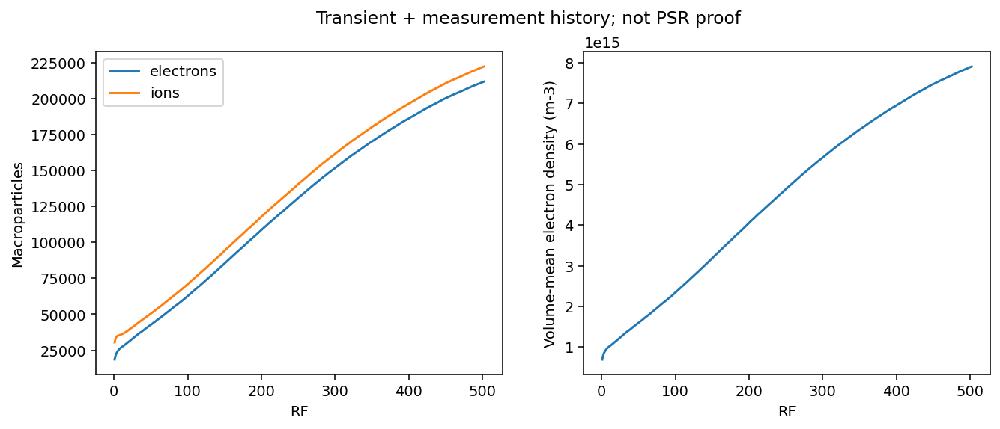

실제 저장 RF의 입자 수·체적 평균 밀도. 과도구간을 포함합니다.

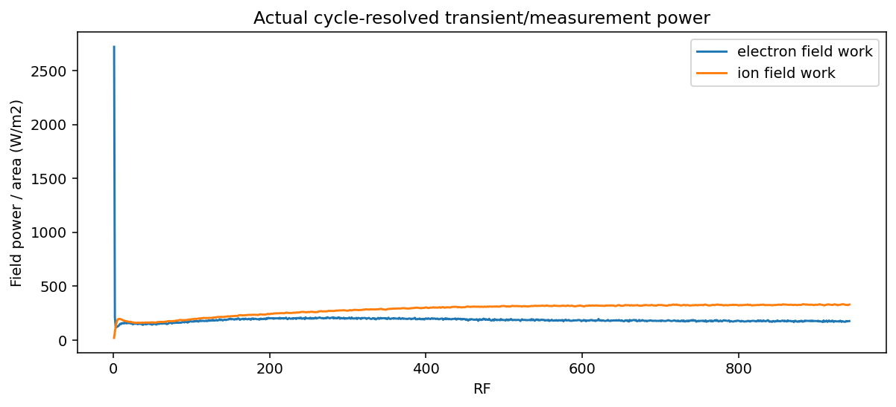

주기별 전자·이온 field-kick 전력. 배경 안정화 입자 수와 함께 확인하며 과도구간은 정상 통계에서 제외합니다.

## 밀도 공간분포

과도구간 2RF 진단(정상 통계 제외):

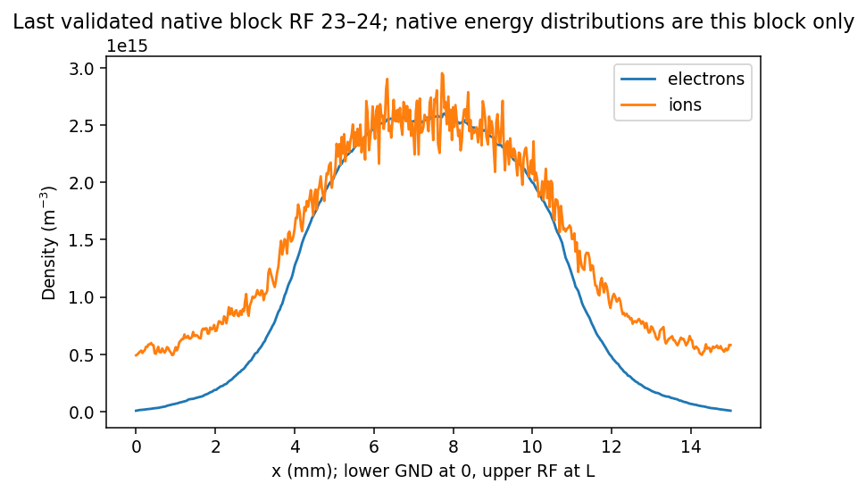

과도구간 2RF 진단(정상 통계 제외): Last validated native block RF 23–24; native energy distributions are this block only

## RF heating

과도구간 2RF 진단(정상 통계 제외): 마지막 검증 블록: 순간 jeE를 먼저 계산한 뒤 위상 평균. 음의 기여를 보존하고 쉬스 경계를 표시합니다.

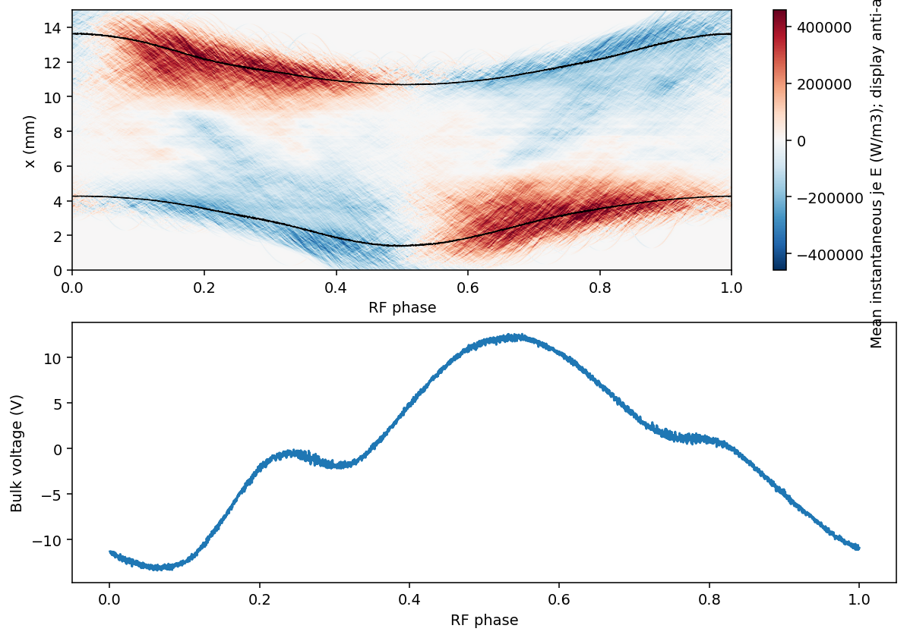

과도구간 2RF 진단(정상 통계 제외): 마지막 검증 블록: 순간 jeE를 먼저 계산한 뒤 위상 평균. 음의 기여를 보존하고 쉬스 경계를 표시합니다.

## 전위·전기장

과도구간 2RF 진단(정상 통계 제외):

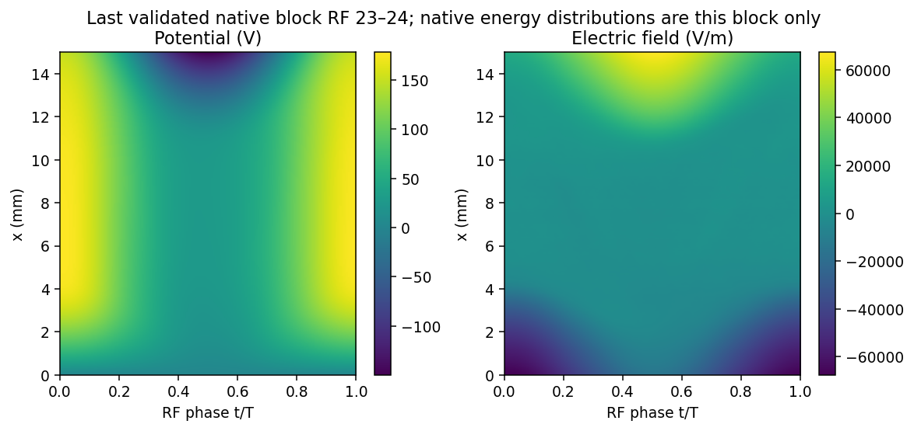

과도구간 2RF 진단(정상 통계 제외): Last validated native block RF 23–24; native energy distributions are this block only

## 평균 에너지·이온화

과도구간 2RF 진단(정상 통계 제외):

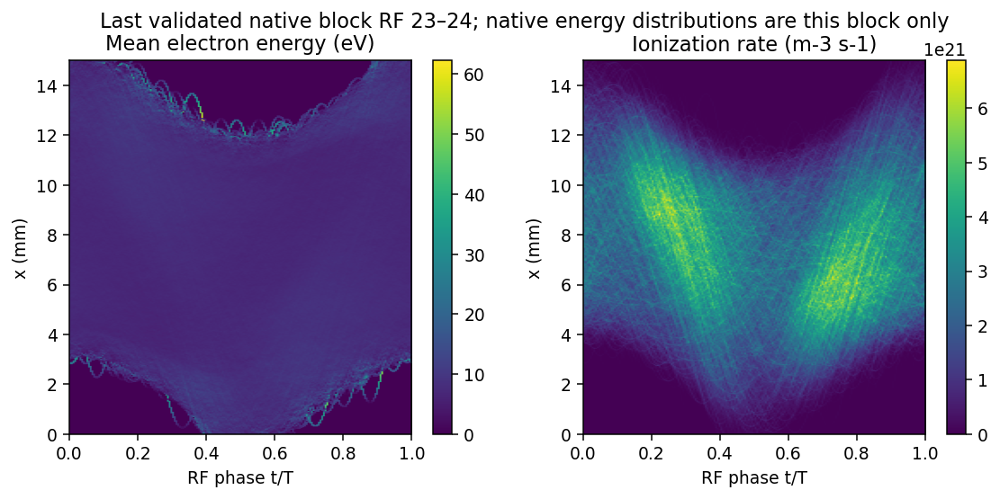

과도구간 2RF 진단(정상 통계 제외): Last validated native block RF 23–24; native energy distributions are this block only

## 에너지 분포

과도구간 2RF 진단(정상 통계 제외):

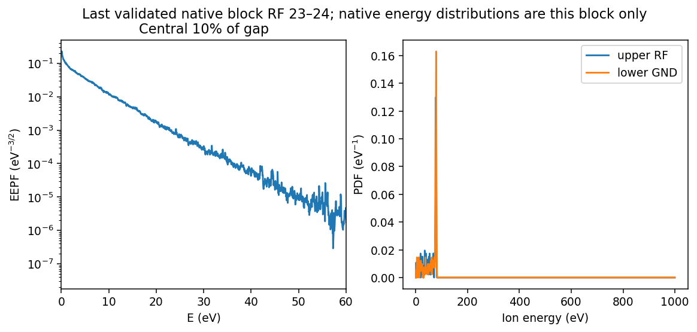

과도구간 2RF 진단(정상 통계 제외): Last validated native block RF 23–24; native energy distributions are this block only; 정규화된 서로 다른 블록 EEPF는 임의로 합치지 않습니다.

## 전극 flux·손실

과도구간 2RF 진단(정상 통계 제외):

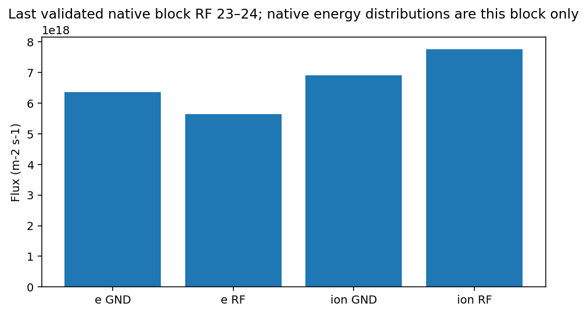

과도구간 2RF 진단(정상 통계 제외): Last validated native block RF 23–24; native energy distributions are this block only

## 전력 전달·손실

과도구간 2RF 진단(정상 통계 제외):

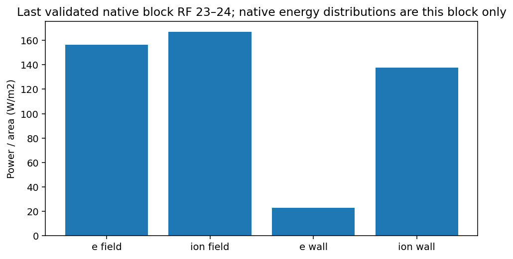

과도구간 2RF 진단(정상 통계 제외): Last validated native block RF 23–24; native energy distributions are this block only; 이산 field work와 벽 운동에너지 유출. 전체 전력 폐합은 아닙니다.

## VI 고조파

과도구간 2RF 진단(정상 통계 제외): 단자 양의 방향은 상부RF→플라즈마. 마지막 블록과 전체 RF가중 복소 평균을 구분합니다. 진폭·위상·차수별 전력·블록 변동은 CSV 참조. 오차 막대는 2.3SE 변동 지표이며 총 오차나 수렴 보장이 아닙니다. 한 블록에서는 변동 지표가 없습니다. 이상적 정현파에서 V(n>1)=0은 경계조건입니다.

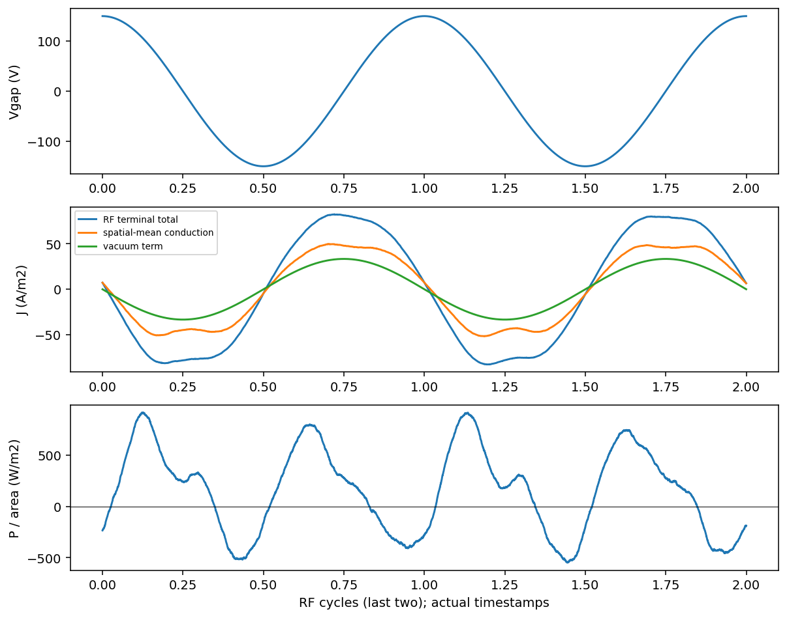

과도구간 2RF 진단(정상 통계 제외): 단자 양의 방향은 상부RF→플라즈마. 마지막 블록과 전체 RF가중 복소 평균을 구분합니다. 진폭·위상·차수별 전력·블록 변동은 CSV 참조. 오차 막대는 2.3SE 변동 지표이며 총 오차나 수렴 보장이 아닙니다. 한 블록에서는 변동 지표가 없습니다. 이상적 정현파에서 V(n>1)=0은 경계조건입니다.

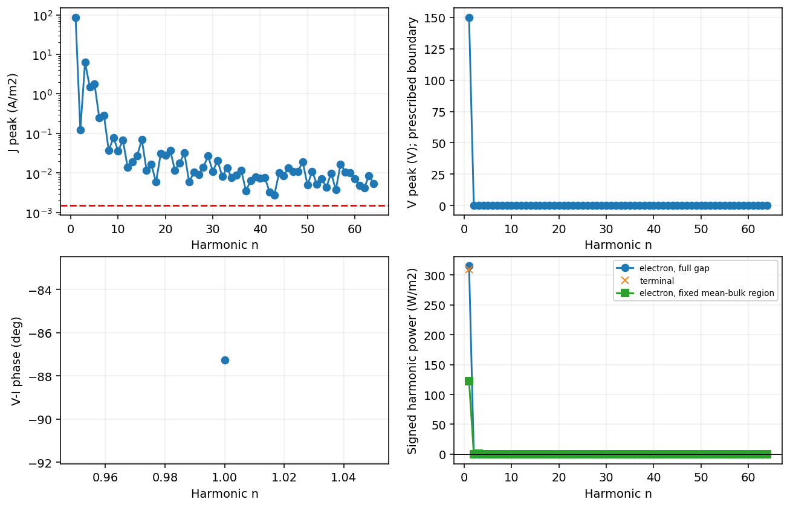

과도구간 2RF 진단(정상 통계 제외): 단자 양의 방향은 상부RF→플라즈마. 마지막 블록과 전체 RF가중 복소 평균을 구분합니다. 진폭·위상·차수별 전력·블록 변동은 CSV 참조. 오차 막대는 2.3SE 변동 지표이며 총 오차나 수렴 보장이 아닙니다. 한 블록에서는 변동 지표가 없습니다. 이상적 정현파에서 V(n>1)=0은 경계조건입니다.

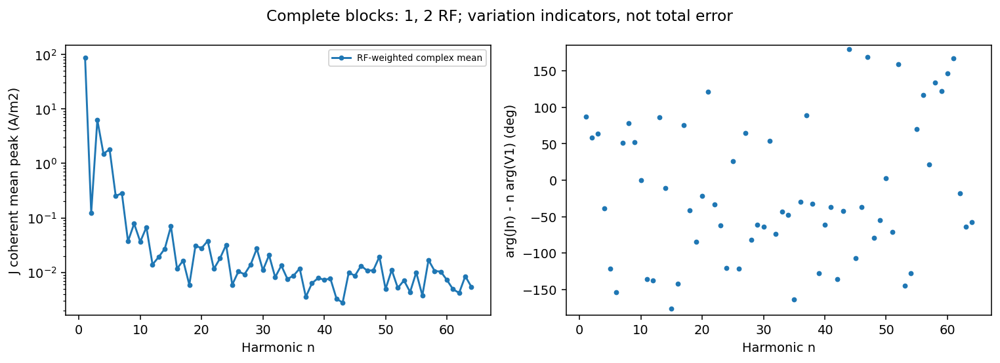

과도구간 2RF 진단(정상 통계 제외): 단자 양의 방향은 상부RF→플라즈마. 마지막 블록과 전체 RF가중 복소 평균을 구분합니다. 진폭·위상·차수별 전력·블록 변동은 CSV 참조. 오차 막대는 2.3SE 변동 지표이며 총 오차나 수렴 보장이 아닙니다. 한 블록에서는 변동 지표가 없습니다. 이상적 정현파에서 V(n>1)=0은 경계조건입니다.

## 쉬스 비선형성

과도구간 2RF 진단(정상 통계 제외): 공간 쉬스 전하/면적과 전압강하의 RF위상 궤적. 전극 표면전하와 구분합니다. 적분 경계가 유효하지 않은 시점은 NaN; 정적 다항식은 근사이며 hysteresis를 포함할 수 있습니다.

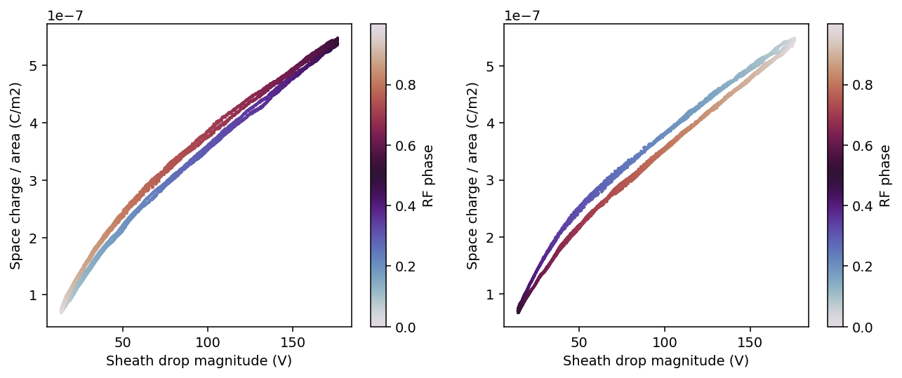

과도구간 2RF 진단(정상 통계 제외): 공간 쉬스 전하/면적과 전압강하의 RF위상 궤적. 전극 표면전하와 구분합니다. 적분 경계가 유효하지 않은 시점은 NaN; 정적 다항식은 근사이며 hysteresis를 포함할 수 있습니다.

## PSR·전자 전력흡수

과도구간 2RF 진단(정상 통계 제외): 원전류와 고주파 재구성, bulk전압, 순간 전자 가열. 고조파 peak·필터 ringing·근사 LC주파수만으로 PSR을 확정하거나 PSR 가열 증가분으로 명명하지 않습니다. 기본 전력그림의 legacy <j><E>와 새 순간 jeE는 구분합니다.

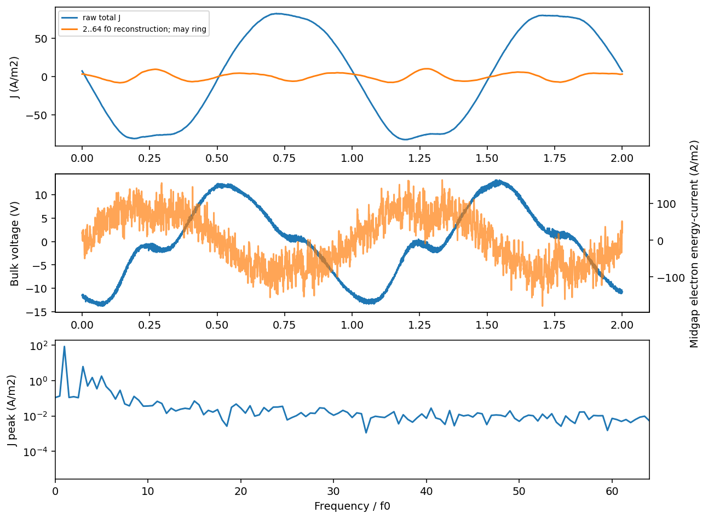

과도구간 2RF 진단(정상 통계 제외): 원전류와 고주파 재구성, bulk전압, 순간 전자 가열. 고조파 peak·필터 ringing·근사 LC주파수만으로 PSR을 확정하거나 PSR 가열 증가분으로 명명하지 않습니다. 기본 전력그림의 legacy <j><E>와 새 순간 jeE는 구분합니다.

과도구간 2RF 진단(정상 통계 제외): 원전류와 고주파 재구성, bulk전압, 순간 전자 가열. 고조파 peak·필터 ringing·근사 LC주파수만으로 PSR을 확정하거나 PSR 가열 증가분으로 명명하지 않습니다. 기본 전력그림의 legacy <j><E>와 새 순간 jeE는 구분합니다.

## 실험 비교

**자료 없음:** 실험 VI 파일·기준면·면적·위상/DC 정보가 제공되지 않았습니다. 빈 비교 CSV와 입력 템플릿을 제공합니다.

## 수치 검증·민감도

다중 고조파 진공 해석해와 동일한 과도 체크포인트의 dt·격자·입자 수·stride 검증. 오른쪽 차이는 기본파 전류로 정규화한 값이며 약한 고차 자체의 상대오차율이 아닙니다. 짧은 과도 시험의 전자 순전력은 149.41–158.19 W/m²로 달랐고 확률 충돌 변동을 포함합니다. 정상 수렴이나 PSR 발생을 증명하는 결과가 아닙니다.

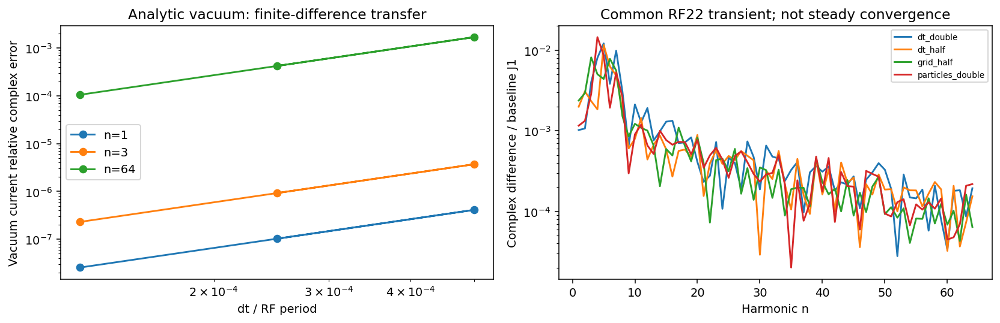

다중 고조파 진공 해석해와 동일한 과도 체크포인트의 dt·격자·입자 수·stride 검증. 오른쪽 차이는 기본파 전류로 정규화한 값이며 약한 고차 자체의 상대오차율이 아닙니다. 짧은 과도 시험의 전자 순전력은 149.41–158.19 W/m²로 달랐고 확률 충돌 변동을 포함합니다. 정상 수렴이나 PSR 발생을 증명하는 결과가 아닙니다.

## 읽는 기준

- 위상 그림의 가로축은 RF 위상 t/T, 세로축은 위치 x입니다. 전극 방향은 위 조건표를 따릅니다. 위상 0은 cos 인가 전압의 양의 최댓값입니다.
- Heating은 위상 평균 j × 위상 평균 E입니다. 양수는 전기장에서 입자로, 음수는 반대 방향의 전달입니다. 순간 jE의 평균·온도 상승률과 구분합니다.
- 통계 중단 기준은 전체 물리·격자 오차나 모든 픽셀의 오차를 보증하지 않습니다. 소멸·미완료·짧은 진단을 정상 방전 측정과 구분합니다.
- 전력 표시는 W/m² 또는 W/m³입니다. 실제 전극 면적·회로 없이 발생기 총 W와 동일시하지 않습니다.

## 파일과 재시작

| 자료 | 다운로드 | 크기 |
|---|---|---:|
| 진단·위상·소스·조건 메타데이터 | [run_metadata.json](run_metadata.json) | 3.7 KiB |
| config.json | [config.json](config.json) | 3.4 KiB |
| status.json | [status.json](status.json) | 827 B |
| criteria.json | [criteria.json](criteria.json) | 131 B |
| implementation_validated.json | [implementation_validated.json](implementation_validated.json) | 1.6 KiB |
| 연속·분할 PIC 자료의 고조파 통합 검증 | [block_statistics_native_verified.json](block_statistics_native_verified.json) | 552 B |
| experiment_template.csv | [experiment_template.csv](experiment_template.csv) | 82 B |
| experiment_metadata.template.json | [experiment_metadata.template.json](experiment_metadata.template.json) | 608 B |
| METHOD.md | [METHOD.md](METHOD.md) | 11.0 KiB |
| 별도 수치 검증(과도구간, 정상 통계 제외) resolution_validation.json | [resolution_validation.json](data/resolution_validation.json) | 12.3 KiB |
| 별도 수치 검증(과도구간, 정상 통계 제외) vacuum_dt_convergence.csv | [vacuum_dt_convergence.csv](data/vacuum_dt_convergence.csv) | 1.2 KiB |
| 별도 수치 검증(과도구간, 정상 통계 제외) plasma_sensitivity.csv | [plasma_sensitivity.csv](data/plasma_sensitivity.csv) | 25.5 KiB |
| 별도 수치 검증(과도구간, 정상 통계 제외) validation_reproduction.zip | [validation_reproduction.zip](https://github.com/YGLSNU/eduPIC_PAL_RF-sheath/raw/refs/heads/results/20mTorr-60MHz-topRF/results/261126_PSR_gap15_f60_V150/data/validation_reproduction.zip) | 23.27 MiB |
| 입자 수 이력 | [history.csv](data/history.csv) | 16.2 KiB |
| RF별 입자·흡수전력 이력 | [RF_particle_power_history.csv](data/RF_particle_power_history.csv) | 215.8 KiB |
| 과도구간 2RF 진단(정상 통계 제외): 마지막 검증 블록 harmonic_spectra.csv | [harmonic_spectra.csv](data/harmonic_spectra.csv) | 16.9 KiB |
| 과도구간 2RF 진단(정상 통계 제외): 마지막 검증 블록 harmonic_power.csv | [harmonic_power.csv](data/harmonic_power.csv) | 8.4 KiB |
| 과도구간 2RF 진단(정상 통계 제외): 마지막 검증 블록 harmonic_power_spatial.csv.gz | [harmonic_power_spatial.csv.gz](data/harmonic_power_spatial.csv.gz) | 694.0 KiB |
| 과도구간 2RF 진단(정상 통계 제외): 마지막 검증 블록 harmonic_fields_spatial.csv.gz | [harmonic_fields_spatial.csv.gz](data/harmonic_fields_spatial.csv.gz) | 1.81 MiB |
| 과도구간 2RF 진단(정상 통계 제외): 마지막 검증 블록 sheath_estimates.csv.gz | [sheath_estimates.csv.gz](data/sheath_estimates.csv.gz) | 683.5 KiB |
| 과도구간 2RF 진단(정상 통계 제외): 마지막 검증 블록 sheath_harmonics.csv | [sheath_harmonics.csv](data/sheath_harmonics.csv) | 27.4 KiB |
| 과도구간 2RF 진단(정상 통계 제외): 마지막 검증 블록 sheath_QV_fits.json | [sheath_QV_fits.json](data/sheath_QV_fits.json) | 2.2 KiB |
| 과도구간 2RF 진단(정상 통계 제외): 마지막 검증 블록 current_spectrum_Hz.csv.gz | [current_spectrum_Hz.csv.gz](data/current_spectrum_Hz.csv.gz) | 47.5 KiB |
| 마지막 검증 블록 analysis.json | [analysis.json](data/analysis.json) | 1.5 KiB |
| 마지막 검증 블록 bulk_harmonics.csv | [bulk_harmonics.csv](data/bulk_harmonics.csv) | 8.2 KiB |
| 마지막 검증 블록 power_regions.json | [power_regions.json](data/power_regions.json) | 286 B |
| 과도구간 2RF 진단(정상 통계 제외): 블록별 평균·변동 block_harmonic_spectra.csv | [block_harmonic_spectra.csv](data/block_harmonic_spectra.csv) | 16.3 KiB |
| 과도구간 2RF 진단(정상 통계 제외): 블록별 평균·변동 block_harmonic_power.csv | [block_harmonic_power.csv](data/block_harmonic_power.csv) | 8.1 KiB |
| 과도구간 2RF 진단(정상 통계 제외): 블록별 평균·변동 harmonic_power_block_statistics.csv | [harmonic_power_block_statistics.csv](data/harmonic_power_block_statistics.csv) | 17.1 KiB |
| 과도구간 2RF 진단(정상 통계 제외): 블록별 평균·변동 harmonic_block_statistics.csv | [harmonic_block_statistics.csv](data/harmonic_block_statistics.csv) | 13.9 KiB |
| 과도구간 2RF 진단(정상 통계 제외): 블록별 평균·변동 harmonic_statistics_method.json | [harmonic_statistics_method.json](data/harmonic_statistics_method.json) | 845 B |
| PSR·순가열 판단 범위 | [PSR_summary.json](data/PSR_summary.json) | 506 B |
| 과도구간 2RF 진단(정상 통계 제외): RF block transient_probe 원자료·phase필드·전력(분할 ZIP 모두 받기) | [261126_PSR_gap15_f60_V150_transient_probe_p01.zip](https://github.com/YGLSNU/eduPIC_PAL_RF-sheath/raw/refs/heads/results/20mTorr-60MHz-topRF/results/261126_PSR_gap15_f60_V150/blocks/transient_probe/261126_PSR_gap15_f60_V150_transient_probe_p01.zip) | 3.44 MiB |
| 과도구간 2RF 진단(정상 통계 제외): RF block transient_probe 원자료·phase필드·전력(분할 ZIP 모두 받기) | [261126_PSR_gap15_f60_V150_transient_probe_p02.zip](https://github.com/YGLSNU/eduPIC_PAL_RF-sheath/raw/refs/heads/results/20mTorr-60MHz-topRF/results/261126_PSR_gap15_f60_V150/blocks/transient_probe/261126_PSR_gap15_f60_V150_transient_probe_p02.zip) | 48.00 MiB |
| 과도구간 2RF 진단(정상 통계 제외): RF block transient_probe 원자료·phase필드·전력(분할 ZIP 모두 받기) | [261126_PSR_gap15_f60_V150_transient_probe_p03.zip](https://github.com/YGLSNU/eduPIC_PAL_RF-sheath/raw/refs/heads/results/20mTorr-60MHz-topRF/results/261126_PSR_gap15_f60_V150/blocks/transient_probe/261126_PSR_gap15_f60_V150_transient_probe_p03.zip) | 48.00 MiB |
| 과도구간 2RF 진단(정상 통계 제외): RF block transient_probe 원자료·phase필드·전력(분할 ZIP 모두 받기) | [261126_PSR_gap15_f60_V150_transient_probe_p04.zip](https://github.com/YGLSNU/eduPIC_PAL_RF-sheath/raw/refs/heads/results/20mTorr-60MHz-topRF/results/261126_PSR_gap15_f60_V150/blocks/transient_probe/261126_PSR_gap15_f60_V150_transient_probe_p04.zip) | 5.53 MiB |
| 실험 비교 CSV(현재 빈 상태) | [comparison.csv](data/comparison.csv) | 126 B |
| 실험 비교 미확인 입력 | [experiment_status.json](data/experiment_status.json) | 321 B |
| 재시작 입자·난수·전류 상태 RF942 | [261126_PSR_gap15_f60_V150_restart.zip](https://github.com/YGLSNU/eduPIC_PAL_RF-sheath/raw/refs/heads/results/20mTorr-60MHz-topRF/results/261126_PSR_gap15_f60_V150/261126_PSR_gap15_f60_V150_restart.zip) | 18.44 MiB |
| 사용 소스·분석·설정·검증·라이선스 | [261126_PSR_gap15_f60_V150_source.zip](https://github.com/YGLSNU/eduPIC_PAL_RF-sheath/raw/refs/heads/results/20mTorr-60MHz-topRF/results/261126_PSR_gap15_f60_V150/261126_PSR_gap15_f60_V150_source.zip) | 126.4 KiB |

[전체 파일 목록·SHA256](files.json)
